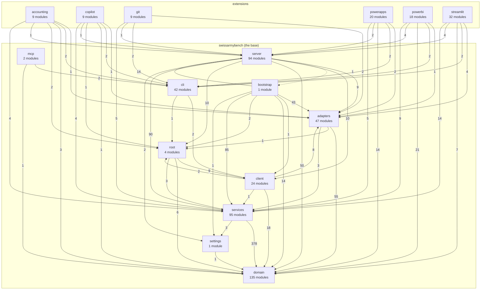

# The architecture map

Made by `python tools/architecture_map.py` from the real imports of `src/swissarmybench` and every
extension (read with `ast`; nothing is run). Do not edit it by hand: run the tool again after a
change to what imports what. `tests/test_architecture_map.py` refuses a stale file and an import
cycle.

## The components and what depends on what

Each box is a component: a folder of the base (its layers after REFACTOR.md; `root` is the package's
own modules, `bootstrap` the composition root, `settings` the limits) or a whole extension. An arrow
goes from the component
that imports to the one it imports, with the number of module-to-module imports that make it. A solid
arrow points inward or sideways, as the dependency rule asks; a dotted one points outward (listed
below the picture).

### Arrows that point outward

From a component further in to one further out (settings, domain 0; services 1; adapters, server,
client, cli, root 2; mcp, bootstrap 3; an extension 4). `tests/test_architecture.py` is what enforces the layers;
this list is everything the picture draws dotted, including what that test allows on purpose (the
plain client borrowing a rule, the server starting the composition root).

- **server → bootstrap** (1):
  - `swissarmybench.server.app` imports `swissarmybench.bootstrap`

## The couplings (Robert Martin's component measures)

- **Ca** (afferent): modules outside the component that depend on it. **Ce** (efferent): modules
  outside that it depends on. Only this repository's code is counted, never a library.
- **I** = Ce / (Ca + Ce): 0 is stable (much depends on it, it depends on little), 1 is free to change.
- **A**: the share of its classes that are a `Protocol`, an abstract base class or have an abstract
  method. **D** = |A + I - 1|: the distance from the line where stable things are abstract and
  changeable things are concrete; 0 is on it.

Read with care: the domain here is functions and frozen records far more than classes, so its A is
low by design and its D says little; the measure bites for the components that hold ports.

| Component | What it is | Modules | Ca | Ce | I | Classes | Abstract | A | D |
|---|---|---:|---:|---:|---:|---:|---:|---:|---:|
| domain | the model and its rules | 135 | 175 | 0 | 0.00 | 359 | 1 | 0.00 | 1.00 |
| settings | every limit, one frozen record | 1 | 6 | 1 | 0.14 | 2 | 0 | 0.00 | 0.86 |
| services | the use cases | 95 | 98 | 120 | 0.55 | 343 | 183 | 0.53 | 0.08 |
| adapters | the driven edge: DuckDB, files, the keyring | 47 | 22 | 40 | 0.65 | 111 | 2 | 0.02 | 0.34 |
| cli | the agent's commands | 42 | 7 | 3 | 0.30 | 5 | 0 | 0.00 | 0.70 |
| client | the plain client and the kernel's helpers | 24 | 7 | 21 | 0.75 | 26 | 0 | 0.00 | 0.25 |
| root | the package's own modules: its public face, stats, sab_excel, extensions | 4 | 16 | 18 | 0.53 | 4 | 0 | 0.00 | 0.47 |
| server | the HTTP door and what starts a process | 94 | 12 | 136 | 0.92 | 43 | 2 | 0.05 | 0.03 |
| bootstrap | the composition root | 1 | 1 | 160 | 0.99 | 2 | 0 | 0.00 | 0.01 |
| mcp | the MCP server | 2 | 0 | 3 | 1.00 | 1 | 0 | 0.00 | 0.00 |
| accounting | an extension | 9 | 0 | 11 | 1.00 | 5 | 1 | 0.20 | 0.20 |
| copilot | an extension | 9 | 0 | 10 | 1.00 | 16 | 5 | 0.31 | 0.31 |
| git | an extension | 9 | 0 | 8 | 1.00 | 17 | 4 | 0.24 | 0.24 |
| powerapps | an extension | 20 | 0 | 22 | 1.00 | 39 | 15 | 0.38 | 0.38 |
| powerbi | an extension | 18 | 0 | 24 | 1.00 | 50 | 9 | 0.18 | 0.18 |
| streamlit | an extension | 32 | 0 | 17 | 1.00 | 58 | 3 | 0.05 | 0.05 |

### The modules most depended on

| Module | Modules that import it |
|---|---:|
| `swissarmybench.services.workspace` | 95 |
| `swissarmybench.server.http` | 77 |
| `swissarmybench.services.ports` | 59 |
| `swissarmybench.domain.datasets` | 53 |
| `swissarmybench.cli.api` | 47 |
| `swissarmybench.domain.blades` | 45 |
| `swissarmybench.cli.command_kit` | 38 |
| `swissarmybench.adapters.atomic_files` | 34 |
| `swissarmybench.domain.steps` | 31 |
| `swissarmybench.domain.grids` | 28 |
| `swissarmybench.domain.connections` | 26 |
| `swissarmybench.domain.table_cells` | 25 |
| `swissarmybench.domain.notebooks` | 24 |
| `swissarmybench.domain.packages` | 18 |
| `swissarmybench.domain.codegen` | 17 |

## Import cycles between modules

### While loading

Modules that import each other at their top, so one meets the other half made. None is allowed.

None.

### Only through an import inside a function

Rings that close through an import made when a function runs (or for type checking only): nothing
breaks while loading, but the modules know each other. Each group is listed whole.

- Group 1 (13 modules):
  - `swissarmybench`
  - `swissarmybench.client.analyze_client`
  - `swissarmybench.client.blades_client`
  - `swissarmybench.client.completion`
  - `swissarmybench.client.kernel_connections`
  - `swissarmybench.client.kernel_variables`
  - `swissarmybench.client.sql_cell`
  - `swissarmybench.client.standalone`
  - `swissarmybench.client.table_cells`
  - `swissarmybench.client.visualizations_client`
  - `swissarmybench.client.watcher`
  - `swissarmybench.client.write_sql`
  - `swissarmybench.client.writes`
- Group 2 (2 modules):
  - `swissarmybench.domain.blade_suggestions`
  - `swissarmybench.domain.blades`
- Group 3 (2 modules):
  - `swissarmybench.server.desktop`
  - `swissarmybench.server.desktop_shell`
