# Swiss Army Bench user guide

Swiss Army Bench is a local data grid that runs on your own machine. You push a pandas DataFrame from Python, and it opens as a tab in a browser page where you can filter, sort, compare and profile the table without changing the source data. Every change you make is a step you can see, turn off or export as Python.

## Getting data in

Install it once with the installer in the repository's `installer/` folder (`install.ps1` on Windows, `install.sh` on macOS and Linux), or with `uv tool install "<wheel>[server]"`. After that, push a DataFrame from any script or notebook:

```python
import swissarmybench as sab

sab.push(orders)
```

The grid is named after the variable, here `orders`. To choose the name yourself, pass `name=`. Names can be 1 to 64 letters, digits, `_` or `-`.

```python
sab.push(orders, name="orders", new_grid=True)
```

`new_grid=True` opens a new grid even when one with the same name is already open. Without it, pushing again refreshes the same grid, and its steps stay in place.

Without Python: the folder button beside + opens a file (CSV, Parquet, JSON, Arrow or an Excel workbook; a workbook with several sheets asks which), and a file dropped anywhere on the page opens the same way. Pasting a copied table (Ctrl+V on the page) makes a table named `pasted_` and the time; its toast holds the name in a box, so type a better one there and press Enter.

**Rename a table** by double-clicking its tab (or F2 on the tab): type the new name and press Enter, or Escape to leave it. The new name holds everywhere: every tab on it, its steps, the relationship model and the SQL that names it from then on. A Python session that kept the old name current stops following it.

## Opening the app, and updates

Swiss Army Bench is a desktop app: open **Swiss Army Bench** from the Start menu (Windows), Applications
(macOS) or your applications menu (Linux), or type `swissarmybench` in a terminal. Each page opens in a
window of its own; the Workbench, a pop-out and a steps or SQL window open as windows too, and each kind of
window opens where you last left it. `swissarmybench open ~/sales` opens a project folder in it.

- **It runs while it is open.** The app starts its local server when it opens and stops it when you close its
  last window. Nothing stays in the background: there is no tray icon and nothing starts when you sign in.
  An open project with unsaved changes is saved first (as Autosave does); with Autosave off the server waits.
  When your agent, VS Code or a Python session is still using it, the server stays up until ten minutes after
  their last request.
- **The browser too:** right-click a page's empty space and choose **Open in browser** (or Ctrl+Shift+B), or
  run `swissarmybench open --browser`: the same app in a browser tab, on the same server.
- **Links** to anything that is not the app open in your browser. **Downloads** ask where to save (the system's
  Save dialog), then the window's bottom line shows the progress and **Show in folder**. **Print to PDF**
  (Analyze's button, or Ctrl+P) asks where to save the PDF.
- **Keys:** F11 full screen, F12 the developer tools, Alt+Left and Alt+Right back and forward, F5 reload
  (in the Workbench F5 runs). In the app the browser's tab keys are the app's: **Ctrl+W** closes the tab in
  front (a table's, or the Workbench's document), and the window once no tab is left (a page with unsaved work
  asks first); **Ctrl+T** opens a new query tab (a new notebook in the Workbench), **Ctrl+N** a new query (a
  new notebook in the Workbench); **Ctrl+Tab** and **Ctrl+Shift+Tab** go round the tabs; **Ctrl+Shift+T**
  reopens the last table you closed, with its steps (a table you closed altogether is read again from its
  file). The command palette (Ctrl+Shift+P) lists them. In a browser these keys stay the browser's.
- **Open with:** the installers offer Swiss Army Bench for .csv, .parquet, .xlsx and .ipynb files (and
  .blade.py; on Windows that is every .py file), without making it their default; on Linux and macOS it is the
  default for a blade (.blade.py). `swissarmybench open orders.csv` does the same from a terminal. The file
  goes to the app that is open (never a second one): a table opens as a grid (read by its path, so a project
  reads it again), a notebook in the Workbench, a blade of your library on its page, a folder as a project.
- **Drop a file on a window** from your file explorer: it opens the same way, by its real path. (In a browser a
  dropped file is uploaded, as before.)
- **Changed on disk:** a table read from a file is watched. When the file changes, its tab shows a dot and the
  table says **Changed on disk** with **Reload** (read again, its steps kept) and **Not now** (said again when
  the file changes again). It never reloads by itself.
- **Stop it from a terminal:** `swissarmybench stop` closes the app's windows (without asking about unsaved
  work: it is your word), keeps where each window was, and stops the server.
- **Install:** the installer adds the app to the Start menu (`-DesktopShortcut` adds one on the desktop too),
  Applications or the applications menu, and opens it once. `install.sh --uninstall` (or `install.ps1
  -Uninstall`) removes it; your projects and settings stay. The app needs about 650 MB more than the browser
  version did (Qt WebEngine, Chromium inside).
- **Upgrading from a version with the tray:** its icon and its start-at-sign-in entry are removed the first time
  the new version starts, and the page says so once.
- **An update:** when a newer version is out, the status bars of the grid page and the Workbench show **Update available**, with **Update to 0.0.2** and **What's new**.
- **Update to X** asks first only if a notebook has unsaved changes or a kernel is running (nothing is saved for you). The app closes, installs the new version and opens again (its windows close and the new version's home window opens). If that fails, the old version opens again and the status bar says **Update failed**, with the reason.
- **Settings, Updates, Check for updates** turns the check off. The check asks PyPI (then GitHub) which version is the latest; it is the only thing that leaves your computer, and it sends nothing about you or your data.

## Extensions

**Extensions** (the puzzle piece at the bottom of the rail, above Settings) lists what plugs into Swiss Army Bench, one card each: its name, what it is for, what it adds, its status and version.

- **Preinstalled:** Streamlit comes with every install, as an extension of its own (the Canvas and the Widgets window, 56 prebuilt widgets, the Streamlit, Components, Controllers and Text and layout starters). Its card says **Preinstalled**, with **Remove**: without it the app is the base alone (no Canvas, no Widgets, a canvas's file says which extension opens it), and **Install** brings it back. It never comes back by itself once you removed it.
- **Available:** Accounting (an Excel workbook built by a repeatable Python automation; cession statements and invoices), Power Apps (code apps) and GitHub Copilot (Copilot's code completion in the Workbench).
- **Available:** **Install**, one click. The app closes, installs the extension for this same version and opens again in a window of its own; the card shows each stage while it works. If it fails, the app opens as it was and the status bar says why.
- **Installed:** **Remove** (asked first), the same way.
- Updates keep your installed extensions. A copy run from a source checkout (not the installer's) says what to run instead and changes nothing.
- The version mark at the bottom left of each status bar names the app, **Swiss Army Bench**; its tooltip lists the installed extensions.
- Your agent can list them; its Install and Remove wait for your Allow.

## Launch Claude

**Launch Claude** (the sparkle at the right of the status bar, on the grids' page and in the Workbench; also in the command palette) starts Claude with what it needs to know about Swiss Army Bench.

- **Claude Code** opens in your own terminal (Windows Terminal or a new console, Terminal on a Mac, your Linux terminal), in a folder of its own (`~/.swissarmybench/claude/<your project>`). Its CLAUDE.md says what Swiss Army Bench is and brings in **context.md**, the app's live picture: your connections (and how to name their tables in DuckDB SQL, `[Finance Captive].model_Report`), the open tables with their rows, columns and steps, the ERD's relationships, your variables (names and where each comes from), the project's documents, what each window shows, and the agent's tool guide. Swiss Army Bench keeps context.md current while it runs (a few seconds after any change), and tells Claude at your next prompt which parts changed, so it reads the file again instead of asking the app. No row, cell value, secret or password is written there, and the names in it are marked as data. Your project's working folder is added, so Claude can read its notebooks and scripts.
- **Claude Desktop** takes no folder, so Swiss Army Bench adds itself to Desktop's MCP settings (asked once; everything else in that file stays, and a copy is kept first), then starts it; the same context.md text reaches it through the app's tools. If Desktop was already open, quit it and start it again.
- **Both installed:** a small menu asks which. **Neither:** the install commands to copy and the download page; **Choose its file…** if yours is somewhere the search did not look.
- **Settings, Claude:** which Claude Code and which Claude Desktop (the ones found, or **Other…**), where that Desktop keeps its settings, and **Start Claude Code with bypass permissions** (off unless you turn it on: Claude then runs its tools without asking you each time).
- Your agent can see which Claude is installed, but never launches one or changes these settings.

## The workspace

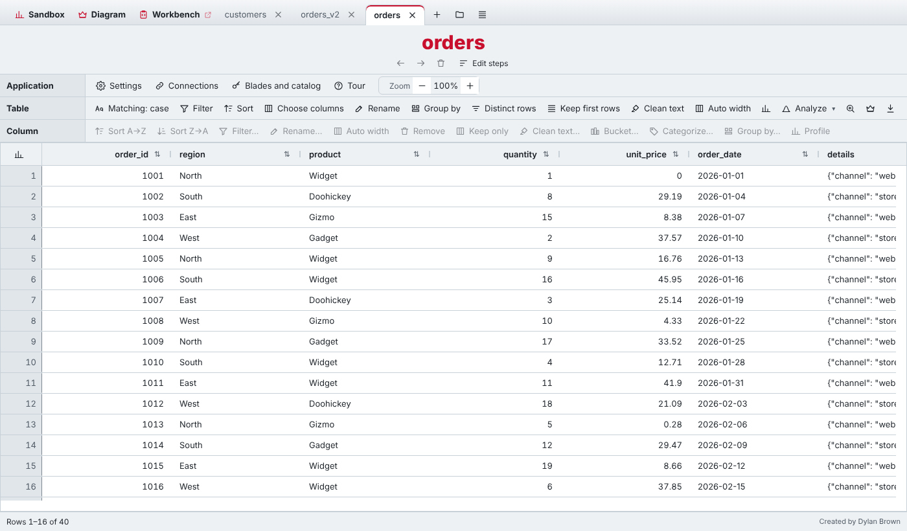

The page has these parts:

- **Tab bar.** Each open grid has its own tab (Analyze, ERD and the Workbench are on the rail). Right-click a table's tab for **Compare with…**, **Rename** and **Close**. After the last tab: + starts a new table from a query (see below), the folder opens a file, and ≡ opens **Tables**, one list of the open tables, the closed ones and the tables in your Python sessions (see Tables, below).
- **Title.** The dataset name, and its version from the second push on (a new push to the same dataset raises it). Beside it, the **steps strip**: how many steps the grid has (a sort made by clicking a header counts), with Undo, Redo, Clear and Edit steps. Hover the count to see the steps in plain words, each with a remove button. The steps as code are the table's own read-only cell in the Workbench (see The Workbench: every table has its own cell).
- **Application row.** Above the ribbon, on every tab: the project's group (its name, Save, Save as…, Close, **Autosave**) and **Zoom**. The **Tour** (a guided walk down the rail: it opens each place in turn and lights up the control it is talking about, with two small made-up tables it opens to show things on and closes again at the end; Escape stops it and brings you back) is on the **Projects** page (**Home** at the top of the rail); on your first visit a **New here?** bubble sits beside it.
- **Ribbon.** Two rows under the Application row, each named for what its buttons act on. **Table** works on the whole view. **Column** works on the selected column or columns. A cell's tools are on its right-click menu. Buttons that have nothing to act on are greyed out, and the caption under each row name says what it is looking at.
- **Grid.** The rows, with the column headers above them.
- **The grid has the whole page.** The steps themselves (Table Transformations) open in a tab of their own from Edit steps, and SQL is written in the notebook.
- **Status bar.** The row count and the selection summary. The memory meter shows only once the data is past 80% of its budget (click it for the Tables list, which always has the numbers), and "not live: push again" only when the page has lost the server.
- **Every action by name.** Ctrl+Shift+P opens the command palette: type a few letters of any button, menu entry or tab, and press Enter. The table's commands come first, and the ones you used lately before all of them. A command that cannot run now is greyed, and says why in its row.
- **Keyboard shortcuts.** Press **?** (or Ctrl+/) anywhere outside a text box: every command that has keys, by group, with a box to find one. In the Workbench too (outside an editor, where Ctrl+/ comments a line).
- **Filter by ticking values.** Filter (on the Table row, a header's menu or the Column row) starts on the selected column and lists its values, most common first, each with how many rows hold it. Type to search them, tick the ones to keep, and Add step. "is one of" is the starting condition for text and numbers; the others are a click away.
- **A column at a glance.** Rest the pointer on a header: a card shows its type, blanks, distinct values, range, mean and a small histogram (or its most common values).
- **The status bar's numbers** follow the column's scale (a whole-number Sum has no decimals; an Average two). An id column (order_id, CustomerKey) is counted, never summed or averaged.
- **Undo after a removal.** Closing a tab, removing a column, removing a step or clearing the steps says so at the bottom with **Undo**.
- **Copy with headers, Copy as Markdown.** A cell's right-click menu copies the selection (or the one cell) with its column names first, or as a Markdown table for a chat, a pull request or a note.

### Getting around

- **The rail** down the left of every page and window has an icon for each area, in the order you work: first **Home** (a house: the Projects page), then where the data comes from (**Connections**, **APIs**, **Environment**: everything the project holds, **Catalog**: the one place to browse tables), getting and shaping it (**Grids**, **ERD**), tools and building (**Blades**, **Scripts**, **Notebooks**, **Apps**: the Streamlit canvas), presenting (**Analyze**), then the log (**Session**), and **Settings** at the bottom. **Notebooks** and **Scripts** are two pages, each a window of its own: a notebook opens only on the Notebooks page, a .py only on the Scripts page. The Scripts page is a Python IDE: the project's code by module on the left (with each module's outline, the library's connections and APIs, and what the app generates), the Blades below it, the files as tabs; F12 goes to a definition (into an installed library: its file opens in a tab of its own marked **read-only**), Shift+F12 lists the references, F2 renames across the project, Ctrl+Shift+F searches every script, F11 is full screen (in the desktop app the window goes full screen too) and Ctrl+B folds the explorer. **Debug a script:** click the gutter beside a line (or F9) for a breakpoint; right-click there for a conditional breakpoint (it stops only when a condition holds) or a log point (it prints a message with `{values}` instead of stopping). The bug button (Ctrl+Shift+D) starts debugging: the script runs in its kernel and pauses at a breakpoint, its line highlighted, with the panel below: Call stack, Variables (unfold a value), Watch (expressions shown at each stop), Output, and the Debug console (type an expression to evaluate it where it stopped). F5 continues, F10 steps over, F11 into, Shift+F11 out, Shift+F5 stops. Right-click a module in the explorer (or F2, Delete on it) to **Rename…** it (every import of it in the project follows, shown first), **Duplicate** it or **Delete** it (to the trash); an `__init__.py` also renames, deletes or adds to its package, and **New package** is at the explorer's head. Point at an icon (or Tab to it) to see its name; the area you are in has a bar beside it. The arrow keys move along the rail and Enter goes.
  - **Every icon lands on a page**, in the tab you are in: Grids, Analyze and the ERD on the grids' page; **Notebooks** and **Scripts** on their own pages, **Canvas** on its page and **Widgets** in a window of its own (your documents of that kind as cards, the open ones first; on Scripts and Notebooks, above them, each open table's **Transformations**: its name, its steps in plain words, and a click opens its read-only cell; **New** and **Open…** are in the Workbench's top bar); **Blades** on the Scripts page's Blades pane; **Connections** and **Settings** on pages of their own over whatever you were doing (your grids and kernels stay as they were). A card opens its document, and Back comes back to the cards.
  - **Right-click** any icon (or Ctrl+click, or middle-click) for **Open in a new window**: for Notebooks, Scripts or Apps a Workbench window of its own, for another screen.
  - The rail is always there. The tabs along the top are only your grids, and the Application row keeps the Tour and Zoom: Analyze, ERD, the Workbench, Settings, Connections and Blades are the rail's.
- **The mark** (the red square at the top of the rail, on every page and window) takes you home: the **Projects** page, every project as a card (see Projects: a folder, below), with New project, Open project… and the Tour. It is a page of its own: the grids' page is only your grids, and with no table open it is the **New query** page (the same page the tab row's **+** opens, Ctrl+T): **Open tables (DuckDB)** while a grid is open, then each connection that runs SQL, with its kind and colour; click one (or arrow to it and press Enter) and a new query opens with **Query from** already set to it, the editor ready. Open a file is the folder button beside the **+**, and Ctrl+V pastes a table. From the Workbench, the blades page or the Key Finder window the mark brings the grids' window to the front showing Projects (and opens it if you closed it). **Alt+Home** does the same. The app opens on Projects when no table and no project is open.
- **The browser's Back and Forward** (Alt+Left, Alt+Right, or your mouse's back button) move between what you looked at: the tabs, the Settings and Connections pages, a connection's detail and its forms, a kind's page of documents, a blade's screen. Back closes the dialog on top first, and walks out of Connections one form at a time, so it never leaves the app by surprise. An agent's question (Allow or Deny) stays until you answer it.
- **Reload** (F5 on the grid page) keeps what you were looking at, Analyze, a table or a Connections form, because each is in the address. Bookmark one to come straight back to it.
- **Back buttons** say where they go ("← Connections", "← Add connection", "← sales"), and a place two levels deep shows its trail, each step a link: **Connections › Add connection › PostgreSQL**.
- **The browser tab** names the place: the table's name, "Analyze", "Workbench · sales.ipynb", "Blades · Warehouse › sales › orders".

### Choosing a file or folder

Every Open, Save as, Locate and "Change…" opens **your computer's own file dialog** (Windows' Explorer dialog, the Mac's Finder panel, your Linux desktop's dialog), so the paths, favourites and shortcuts you know are there. Cancel it and nothing happens. If it opened behind the browser, look for it on the taskbar; a second click while it is open says "A file dialog is already open".

When the app cannot open one (a server with no desktop, or `SWISSARMYBENCH_SYSTEM_DIALOGS=off`), it shows its own picker instead:

- **Places** down the side: Home, Desktop, Documents, Downloads, your projects folder, your library, the folders you picked from recently for this kind of file, and the drives.
- **The path** as a breadcrumb (click any part) and as a box you can type or paste into (Enter goes); **Up** goes to the folder above.
- **Filter** narrows the folder as you type; **Hidden files** shows the hidden ones; **New folder** (when choosing a folder or saving) makes one and opens it.
- A click selects, a **double-click** (or Enter) opens a folder or picks a file. The arrow keys, Home and End move, Backspace goes up, Escape closes.

An agent never opens a file dialog on your screen: it passes paths to its commands directly.

### Projects: a folder

A project is a **folder**: its notebooks, scripts, apps and structures are ordinary files you can open in
any editor, and the whole folder can be a Git repository (share it, review it, branch it). The app keeps
its own state beside them in a hidden **.sab** folder (plain text that reads well in a diff): the open
tables with where each came from and its steps, Analyze and its saved dashboards, the
relationships, and where your windows were. Run `swissarmybench open <folder>` to open one from a
terminal (it starts the app when it is not running).

- **The Projects page is the Project Explorer** (the mark, or Alt+Home, brings it): every project in one
  place, as cards: the ones in your **projects folder** (Settings: **Projects folder**; by default
  *Swiss Army Bench Projects* in your home folder) and every project you opened from elsewhere. Each card
  shows its name, its type (Analysis, Streamlit app, or an extension's: *Needs the Accounting extension*
  with **Install** when it is not installed), when you last opened and changed it, its folder (hover
  for the whole path), what it holds, and its Git branch when it is a repository. A click opens it; its
  **⋯** menu has Open, **Show in folder**, **Copy project to…**, **Rename**, **Move left/right**,
  **Remove from list** (no file is touched) and **Delete…** (its folder goes to the trash once you type
  its name). A project that moved says so, with **Locate…**.
- **Sort** by Last opened, Name, Type, Last changed or Created (the arrow flips the order), or **Custom**:
  drag the cards into your own order. **All types** and **Search projects** (a name, a folder, a
  notebook's name) narrow the cards. The page remembers your sort.
- **What kind of project?** New here? A card for each type says in plain words what you make, who it is
  for, what files you get and an example, with **Create**. **Put away** hides it (remembered); the **?**
  in New project brings it back. With no project yet, the type cards are the page: **Create your first
  project**.
- **New project** asks its name and type and makes its folder in the projects folder (**Choose another
  folder…** for elsewhere): data.ipynb (with the tables open now), data.py, a canvas for a Streamlit app,
  a `.gitignore` and a README. It opens at once, on the **New query** page: your connections,
  one click each to start a query on it (no connection yet: **Add connection**).
- **Open project…** picks a folder. A folder that is not a project yet asks **Make this folder a
  project?**: yes adds data.ipynb and the app's .sab folder around what is there, never writing over a
  file.
- **Save** (Ctrl+S) writes the project's .sab folder (your notebooks and scripts are saved by their own
  Save); a ● after the project's name means unsaved changes. **Autosave** is on for a new project: the
  .sab folder keeps itself current a moment after each change; its switch is in the project's group of
  the Application row. A save that changes nothing changes no file. **Copy to…** (Ctrl+Shift+S) copies
  the whole folder somewhere new.
- **Export outline** (the project's group, and the Workbench's project menu) writes **ARCHITECTURE.md**
  at the project's top for someone joining it, then offers **Download**: the same eight sections in every
  project (overview and folder layout, data sources with how each signs in, the tables with their columns'
  names and types and an ER diagram, each table's steps as one DuckDB query, the lineage as a flowchart,
  the notebooks, scripts, apps and dashboards, what to install and how scripts run, open issues). It holds
  names and types only, never a row or a value from your data; an export that changes nothing changes no
  file. The purpose comes from README.md's first paragraph.
- **Rows only on a tick, and never into Git by default.** A pasted or pushed table has no source to read
  again: the first Save asks **Keep its rows** for each one (off unless you tick it). Kept rows go into
  `.sab/data/`, which the project's `.gitignore` leaves out: data is sensitive. Remove that line to
  commit them on purpose. No password, token or secret is ever written.
- **The project's own:** its documents, tables and grids, Structures, Analyze and its saved
  dashboards. Your connections, APIs, key vaults, blades and variables are your **library** (below), and
  every project has them. In the Workbench, **In this project…** lists its documents, and **Import…**
  copies notebooks, scripts or apps in from another project (its folder) or a single file.
- **Passwords stay on each computer.** A connection names where its password comes from (your keyring,
  an environment variable, a key vault). Opened where that is not set, it says **Needs a password** with
  **Set the password**, and its tables wait with the same fix, then **Try again**.
- **The tables come back from where they came from:** a connection (by its name), a file (found inside
  the project first), the notebook that makes it, or a "+" tab's query, with their steps. Nothing runs
  code on open: a table a notebook makes comes back when you run that notebook. **A table that cannot
  come back** shows in a strip under the tabs with one click that fixes it: **Add connection
  Warehouse**, **Find orders.csv**, **Open data.ipynb**, then **Try again**; or **Remove**.
- **An old .sab file** (a single-file project from 0.0.17) is not opened any more: a project is a folder.
  `swissarmybench open sales.sab` says so in one line; the installer takes away an earlier .sab
  registration.
- A project saved by a newer version opens read-only and says so.
- **Local and shared projects.** New projects go in your local projects folder (Settings, Team: "New projects
  go in …", Change…); a team's projects are its shared ones (below). Each card says **Local** or **Shared**, and the
  Project Explorer filters All / Local / Shared. **Share** (a local card's menu) copies the project into the
  shared folder without its kept rows and opens it there; **Make a local copy** (a shared card's menu) copies it
  into your local folder, says "Copied from <project>" on its card, and opens it. New project asks Local or
  Shared. A shared project whose connections only work on your machine says so once when it opens.
- **A team** (Settings, **Team**). A team is one GitHub repository: the **Team library** (connections, key
  vaults, variables, blades, APIs, relationship sets, colours and the shared catalog) at its top, the team's
  shared projects in its `projects/` folder.
  - **Join a team…** walks you through what is still needed, in one window: installing GitHub sync (the app
    starts again and the window comes back where it was), **Sign in with GitHub** (or Use a token), then the
    team's repository (search, newest first). The app makes its own copy on this computer (no folder to pick),
    uses it as your library and its `projects/` as your shared projects, and shows **Set up this computer**:
    each key vault's sign-in, each value to type once, each connection's status; **Move to a vault** for a
    password kept in your keyring, so the next person needs nothing.
  - **Start a team…** signs in the same way, then asks a name (and an organisation of yours, if any): a private
    repository is made with a README, a .gitignore and `projects/`, your library goes in (passwords never do),
    and you are in it.
  - **In a team**, one row: "Team: owner/repo", what needs doing (2 changes to push, 1 behind: Pull, Conflicts:
    1; nothing when it is up to date), **Pull**, **Push**, and "…": Open on GitHub, Set up this computer, Show its
    folder, **Leave the team** (it asks whether to keep a copy of the team's items in your own library; your own
    library and folders come back; the team's copy stays on disk, and the message says where).
  - **Advanced** (folded): the Team library folder and the Shared projects folder as their own paths, for a team
    that keeps them in two repositories or a folder synced another way; Set up this computer.
  - The shared catalog (`catalog/`: each connection's tables, columns, keys, relationships and the projects
    using them; never a value) brings a teammate's tables to the Data page after a Pull ("From the shared
    catalog: not connected here").
  - The agent: `team_status`, `team_join`, `team_start`, `team_leave` (each waits for your Allow); signing in is
    yours only.
- **The agent** does the same: `projects_list`, `projects_sort`, `project_types`, `project_new`,
  `project_open`, `project_save` (it waits for your Allow only when it would keep a table's rows),
  `project_copy`, `project_rename`, `project_remove_from_list`, `projects_folders` (your Allow),
  `project_share` (your Allow), `project_copy_local`,
  `project_close`, `project_table_fix`, `project_autosave`, `project_documents`,
  `project_import`. Show in folder and Delete are yours only.

### Tables: open, closed and in Python

The ≡ button beside + opens **Tables**. **Open tables** are the ones with a tab. **Closed tables** are still in memory after their tabs were closed: **Open** puts the table itself back as a tab (the same table, not a copy). **Python sessions** lists the tables in your running notebooks and scripts, with Open and Reload. The line under the title says how much of the data budget is in use; the bin removes a table from memory.

### Settings

Open **Settings** with the cog at the bottom of the rail (or the Workbench's **…** menu): a page of its own, over the page you were on. Everything applies as you change it, so there is no Save and no Close: the rail or Back takes you on. It holds the theme (for this browser) and the setup prompt for connecting an agent.


Each kind of Workbench document has its colour: app pages violet, notebooks blue, scripts green (each theme has its own readable shade).


Two settings sit beside what they change. **Column profiles in the headers** (each column's distinct count, blanks and a small histogram) is the small button in the grid's top-left corner, above the row numbers. **Zoom** is in the Application row and covers the whole page, Analyze included.

The "Connect an agent" box holds a prompt you can copy into Claude Code or another agent that has a shell. It tells that agent how to add the Swiss Army Bench MCP server.

## Working with a table

### Selecting cells, rows and columns

Selection works the way it does in a spreadsheet.

1. Drag across cells to select a block. The status bar shows the count, and the sum and average when the values are numbers.
2. Click a row number to select the row. Drag down the row numbers to select several rows. Hold Ctrl and click another row number to add it.
3. Click a column header to select the whole column. The Column row then names it in its caption.

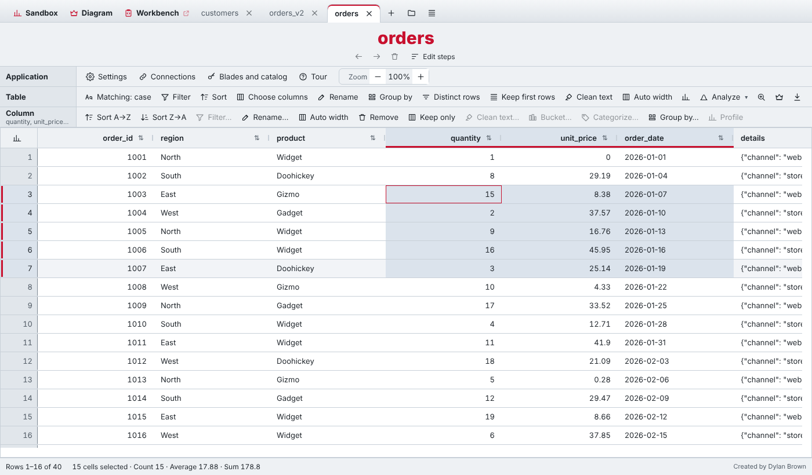

Ctrl+A selects everything, and Ctrl+C copies the selection. Click anywhere outside the grid, or press Escape, to clear the selection. The ribbon's buttons, menus and dialogs don't clear it, because they act on it.

Scrolling sideways is free: the view stops wherever you leave it, even in the middle of a column that is wider than the screen.

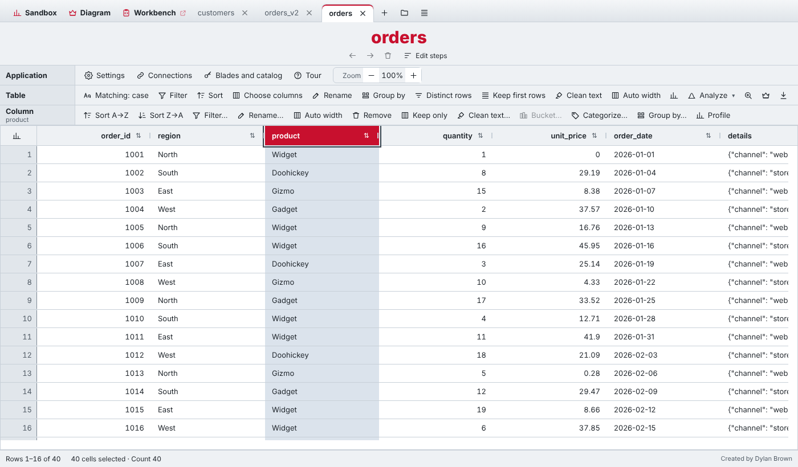

### Ribbon tools

The Table row holds the tools for the whole view: matching, Filter, Sort, Choose columns, Rename, Group by, Distinct rows, Keep first rows, Clean text, Auto width, Profile, Key Finder, Relationships and Export.

The Column row acts on the selected column. It has Sort A to Z and Z to A, Filter, Rename, Auto width, Remove, Keep only, Clean text, Bucket, Categorize, Group by and Profile. Right-click a cell to keep or exclude rows with the selected cell's value, see the full value or copy.

### Filter steps

1. Click Filter in the Table row.
2. Choose a column, a condition and a value, then press Add step.
3. The steps strip counts it. **Edit steps** opens Table Transformations in a tab of its own, with every step in order and the row count before and after each.


Each step there has a checkbox to switch it off, a pencil to edit it and a trash icon to delete it; the grid follows at once. Turning a step off shows the grid without it, which is the quickest way to check what a step changed. **Undo** on the strip, or Ctrl+Z, takes back the last change to the steps, whatever it was: a step added, removed or edited, the steps cleared, a header sort. **Redo**, Ctrl+Y or Ctrl+Shift+Z makes it again. The keys work while a grid is in front and the cursor is not in a text box.

### SQL: in the notebook

SQL is written where your Python is: the Workbench, Jupyter, or Python in the terminal. A grid's steps are there too: every table has a read-only cell in its Workbench notebook or script that holds the steps as one DuckDB query over your table by its own name (`orders = duckdb.sql("""SELECT ... FROM orders WHERE ...""").df()`). The cell follows the grid by itself; see The Workbench.

A DuckDB SQL cell (no connection) also sees every table open in Grids by its name: `SELECT region, count(*) FROM orders GROUP BY ALL` reads the grid as it shows it, its steps applied, each time the cell runs, with a line saying so. A table of the same name in your Python wins. When code names a table open in Grids that it cannot see (`duckdb.sql(...)` in a Python cell), the error offers **orders is open in Grids: add its table cell**.

In Python, `sab.table("orders")` reads a table open in Grids the same way, as an Arrow table (`.to_pandas()` for a DataFrame); add `columns=`, `filters=[("amount", ">", 100)]`, `sort=[("amount", "desc")]` or `limit=` and the app does that work before it sends the rows. It reads again each time; the table itself stays in the app.

For any other Python, the steps window (**Edit steps**) still has a Code tab: **Copy as SQL** and **Copy as Python** there give the same one query, run on a copy of your table and matched with the grid before they're copied.

A SQL step is still one step among the others: in Edit steps, **Add a SQL step** takes one SELECT over the table entering it, read as `grid` or by the table's name. Anything else is refused, and the strip names the broken step.

### A new table from a query

The + after the last tab opens a new tab with a query tray over a blank grid. Use it to build a table of your own from the tables you have open, such as a join of two of them.

1. Click + after the last tab. The new tab is named query_1, or the next free number. Type another name in the tray if you want one.
2. Write one SELECT. A table name reads that table as its tab shows it, after its steps, so a filter you added there applies here too. If a table is open in two tabs, its name reads the first one.
3. Press the green Run button, or Ctrl+Enter. The result becomes the table in this tab, with the ribbon, the steps strip and everything else a pushed table has.

The tray stays at the top of the tab. Change the query and press Run again to rebuild the table in place; the steps you added to it then apply to the new rows. The arrow at the left of the tray folds it down to one row. The table doesn't update by itself when the tables it reads change: press Run again for that.

### Profiles

Click a column header, then Profile in the Column row, to open a popup for that column. It shows the row count, blanks, distinct values, the shortest and longest values, and the most common values. Click a value to add a filter step for it.

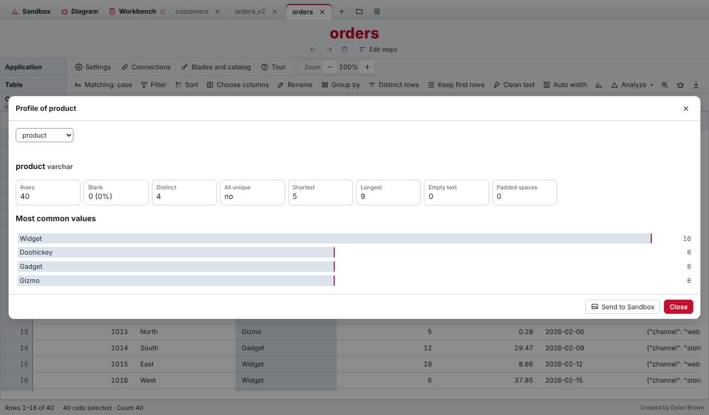

Profile in the Table row profiles every column at once, with the type, blank counts, distinct counts and the minimum value of each. Export profile (CSV) saves that table.


### The analyses are on the Analyze page

The grid page has no analysis on it any more (the fit test, outliers, odds, find predictors, regression, time series, forecast and tie-out moved): see **Analyze** below. A column's quick **Profile** stays here, and so do **Profile to Analyze** and **Distinct values to Analyze** on a column header's right-click menu.

### Auto width

Auto width in the Table row fits every column to its header and the rows on screen. The same button in the Column row fits only the selected columns.

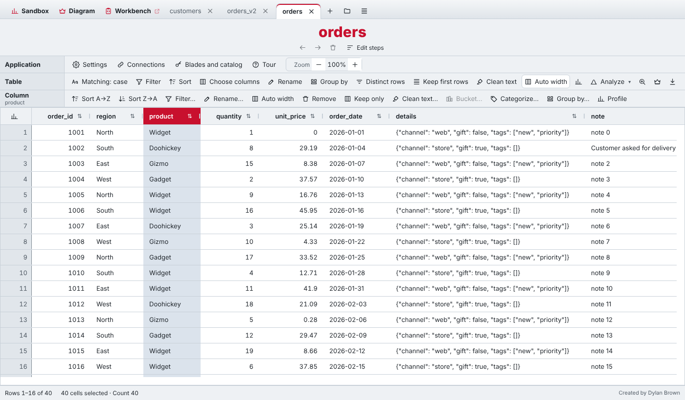

### Value viewer

Double-click a cell that holds a long text or a JSON value, or press Enter or F2 on it, to open it in the value viewer. A JSON object shows as a table of keys and values, and the JSON tab shows the raw text. Long text shows its length and wraps.


### Export and zoom

Export in the Table row writes the grid as CSV, text, Excel or Parquet. The file is built from the grid's steps, so it matches what you see. Choose a download or the export folder.

The zoom control in the Application row changes the text and row size of the whole page: the grid, the ribbon and Analyze. Ctrl+= and Ctrl+- step the zoom, and Ctrl+0 resets it to 100%.

## Comparing two tables

Two grids can sit side by side, and they can be lined up row for row on a key.

1. Right-click a table's tab and choose **Compare with…** (with more than two tables open, pick the other one), or drag one tab onto the middle of another. The two grids show side by side, and the key picker opens.
2. The picker lists the column pairs that share values, best first. Tick the pair that identifies the same row in both tables. To use a key made of two columns, tick both pairs.
3. If no pair fits, choose the columns in the "Or pick a pair yourself" row and press Add.
4. Press Compare.

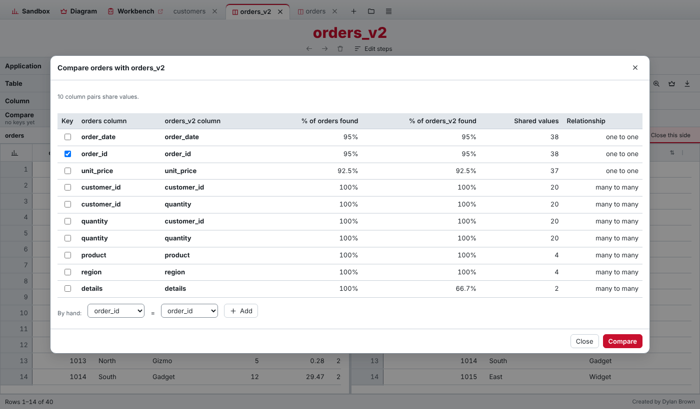

The Key Finder runs when the picker opens. It ranks the pairs by the share of values that match on each side. The pair that starts ticked is the best one that is unique on both sides (one row lines up with one row), so a column whose few values all match, such as a quantity, does not win over the identifier. Read the list all the same, and tick the key you mean. When the two tables have a known relationship (see Relationships below), its columns come first with a crown, already ticked.

The Key Finder also runs on its own from the Table row. It opens in a window of its own, titled "Possible Join Keys for" your table, so you can keep it beside the grids. Choose the table to compare with and press Find keys. Each row shows your column, the other table and its column, the relationship it looks like, the share of each table's values found in the other (headed by the table names) and the shared values as fractions. Click a row to see sample values that match and values that do not. Known relationships carry a crown. Each row has two buttons: **Compare on these** puts the two tables side by side in the grid window, lined up on that pair, and **Add as relationship** makes the pair a known relationship.

Above the pairs, every run also shows the most distinct column combination in your table: the fewest columns that together tell every row apart, which is usually the table's primary key. It reads the first 400,000 rows of the grid as it stands after its steps. The search starts with the column that has the most distinct values, then adds whichever column tells the most remaining rows apart, one at a time. Each of those rows shows the share of rows the combination tells apart. The last row, marked with an accent edge, is the answer. Any other combination just as small that is also unique per row is listed under it. If no combination tells every row apart, the table repeats whole rows, and the answer says how many. The search adds one column at a time, so it finds a small key quickly, but a different key of the same size can exist. Check one you mean with a count in the notebook.

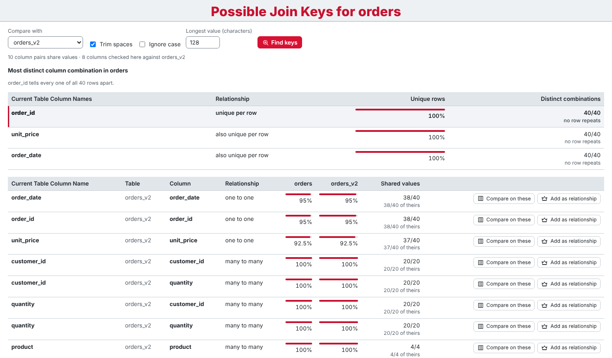

### Reading the aligned view

Once compared, the two grids always line up. Row N on the left and row N on the right share a key. When a side has no row for a key, a striped blank row sits opposite the row that has it. The two grids scroll together through one scrollbar in the centre.


Cells that differ between the two sides are marked with a coloured bar. Click any row to highlight every row with the same key on both sides, so you can see the same order on the left and the right at once.

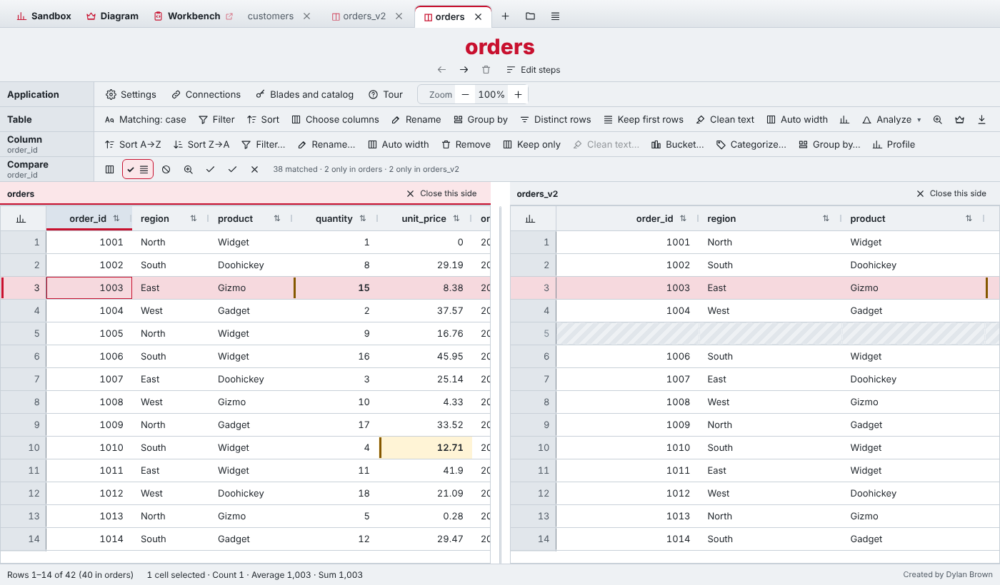

### Compare modes

The Compare row in the ribbon switches the mode.

- **Outer join** shows every key from both tables, as above.
- **Anti join** shows only the keys with no match on the other side. Choose both sides, only the left table or only the right table.
- **Cross compare** keeps each grid on its own rows. Click a row on one side to filter the other side to that key.
- **Diff** lines the two grids up as Outer join does and keeps only the rows that differ: a changed cell in a column both tables have (names matched ignoring letter case, the keys left out), or a key on one side only. Changed cells are marked on both sides. The Compare row says how many matched rows differ and has a button per changed column with its count ("price 280"): click one to see only the rows where that column changed, and again to go back. **How values compare…** sets a tolerance for numbers (an amount, or a percentage of the left value), whether text ignores spaces at either end (on) and letter case (off), and which columns are compared; a blank equals a blank, and an empty text is a blank. **Every row** goes back to Outer join.
- **Tie-out** (do these two tables add up the same?) is an analysis now: **Do two tables add up the same?** on the Analyze page.
- The ribbon's counts (matched, only on one side) follow each grid's steps.
- In **Diff**, each side shows only its key and the columns that differ, so the changes are in front of you; **Only differing columns** in the Compare row (on to start) switches every column back on. Both halves scroll sideways together and start at the first column that differs; a column's own button takes both halves to it.
- A compare survives a reload of the page: the two grids come back side by side, in the same mode.
- **Stop compare** returns to two independent grids. The side-by-side view stays, with no keys.

## Analyze

Analyze (on the rail; it was called Visualizations, and the Sandbox before that) is where every analysis is run and where every result lands: a toolbar of the analyses across the top, and under it one board for every table, where charts, notes, result tables, Mermaid diagrams, Plotly and Vega-Lite figures and images live. Each card names the table it is drawn on; a card that belongs to no table (an analysis's result, a note added here, or anything from Python) says where it came from, and stays when grids close.

**Resize a card** by dragging the grip in its bottom right corner: it snaps to the dashboard's twelve columns and rows, and the chart inside redraws to fill it. With the grip focused, the arrow keys do the same (left and right for width, up and down for height); a double-click returns the card's usual size. Sizes are kept in this browser.

To add a chart, press Add chart. Choose the table, the chart type, the column for the X axis, the aggregate (such as sum) and the column for the Y axis. To add a note, press Add note, give it a title and write its text in Markdown.


Clicking a bar in a chart filters the grid to that value. Each card has a pin, a zoom button for a larger view, and a remove button.

### Running an analysis

The toolbar has a button for every analysis, by group, each with its everyday question and its technical name under it:

| Group | Button | What you get |
|---|---|---|
| Describe | **What can I do with a column?** | The table's columns; pick one and only the analyses that fit it show, as big buttons that run in one click. |
| Describe | **What is in this table?** (profile) | Every column's type, blanks, different values and range, in one table. |
| Describe | **Check this table** (data shape check) | The three analyses that suit the table best, each one click, and every other one with why it fits or not. |
| Test | **Do the first digits look natural?** (Benford's law) | In natural amounts about 30% start with 1 and under 5% with 9; numbers someone made up rarely do. With Nigrini's conformity rating. |
| Test | **Is each value as common as expected?** (fit test) | Whether some values turn up more or less often than they should: every value equally common, or as common as in another open table. |
| Test | **Are these two related?** (chi-square test) | Whether two columns go together, and the combinations furthest from chance. |
| Test | **Find unusual values** (outliers) | Values far from the rest (robust by default; within each vendor, store or month if you say), or values seen far too often or too rarely. **Show these rows** and **Exclude these** on the result add the step. |
| Test | **How likely is each value?** (odds) | Each value's share and odds; with a yes/no outcome, each value's rate of it against the rest and its odds ratio with a 95% range. |
| Test | **What explains this?** (find predictors) | Every other column ranked by how much it tells about this one (Cramér's V), identifiers and dates skipped, columns that say the same thing marked. |
| Model | **Predict a number** (regression) | How much each column moves the target, the others held steady, with ranges; a yes/no target gets a logistic one (odds ratios). |
| Model | **What if…?** (what-if) | The prediction for one row you describe, with its range. |
| Time | **Spot the trend and the seasons** (time series) | The trend, the season, the periods that stand out and where the level stepped. |
| Time | **What comes next?** (forecast) | The periods ahead with 80% and 95% ranges, checked on the last periods held back. |
| Compare | **Do two tables add up the same?** (tie-out) | Per group, whether both tables' rows and totals match, and which groups are off. |
| Compare | **Which columns join two tables?** (Key Finder) | The column pairs that share values, how much of each side, and the table's likely key. |
| Yours | each of your analysis blades | Your own analysis, run on the table (see Analysis blades). |

A button opens its form in a panel **beside** the board, so the board stays in view. The form asks as little as it can:

- **The table is already picked**: the grid you came from, else the one Analyze last used, on one line with its steps and rows ("orders, with 2 steps · 12,400 rows"). **Change** picks another open table, or **Find data…** for a connection's.
- **The columns are picked for you** and shown as chips, each saying why ("the only date column", "the likeliest, by its name"). Open a chip to pick another: it lists only the columns that fit, each with its type and a few of its values, and under **Does not fit** every other column with the reason ("region: is a text column: amounts needs a number column"). An identifier (a name ending in id or key, or a different value on every row) is never offered as a measure.
- **One sentence says what will run**: "Test whether amount follows Benford's first-digit law, on 12,400 rows of orders."
- **Run.** The form is covered while it runs, with **Cancel**; an error stays in the form, in the same shape as everywhere else.
- **More options** holds everything else, each with its default and one line of what it means.
- The columns and options you last ran come back the next time you open that analysis on that table.

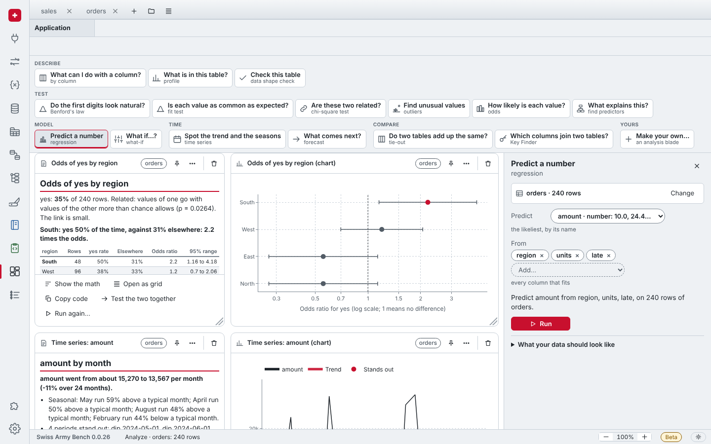

**Every result lands on the board by itself**: its note (the verdict in words, the key rows as a table, the cautions) and its chart appear at the top, come into view and are briefly outlined. There is no Send step. Under the result's note:

- **Show the math**: every number worked out step by step, as a note beside it.
- **Open as grid**: the result's table in a tab of its own.
- **Copy code**: the analysis as Python for a notebook (the grid's steps as DuckDB SQL, then one `swissarmybench.stats` call), on the clipboard.
- **The next tool**: "Predict it from these", "Test the two together", "What comes next?", "Show these rows".
- **Run again…**: the form reopens filled with what it ran with; change something and run.

### What your data should look like

Each analysis has a **data contract**: which kinds of column it takes (a number, a whole number, a date, a text category, a yes/no), how many, what each must be (not an identifier, at least two values, values spanning 10s to 1,000s for Benford's law) and how the table is shaped ("one row per order, not totals"). **What your data should look like**, folded at the foot of the form, shows it: the shape in a sentence, each slot in plain words, and a small made-up table with the slots' columns marked. **Try it on this sample** opens that sample as a table and runs the analysis on it, so you can see what comes out before you bring your own data.

### Make it fit

When the table does not fit, the form says what is missing in one sentence and how to make it fit:

- **Read amount as numbers**: a text column whose values are numbers ("1,240 of 1,250 values are numbers (10 become blank)").
- **Read when as dates**: a text column of dates, read in one style for the whole column (year-month-day, month/day/year or day/month/year); when both of the last two read every value, both are offered and you choose.
- **Group ordered by month**: a date column as a category of months.
- **Keep the 10 most common**, the rest called Other: a text column with too many different values.
- **Leave out rows with no value**, **Keep amounts above zero**.
- **Make a yes/no column**: from Y/N, yes/no, true/false and 1/0 in any spelling, or from one value of a text column ("late, or not").
- **Total amount by month** or **per customer** (for Find unusual values: unusual months or customers instead of unusual rows).

Each says how many rows it touches and has **Apply**. Nothing is applied by itself. A fix is added to the table as its own **steps**, which you see in the steps strip and can undo there; your original rows never change. **Check this table** ranks every analysis for the table: fits now, fits after its fixes (the button says so: "Read when as dates and run" applies the fix and runs in that one click), or does not fit, with the reason.

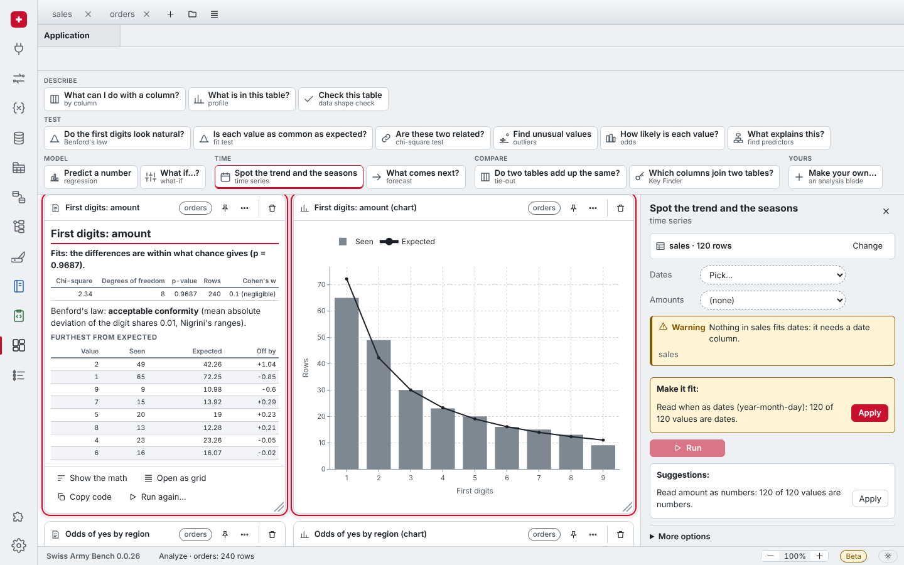

### Analyze as a report

- **Move a card** by dragging its title bar onto another card (the left half puts it before, the right half after), or with Move earlier and Move later in its **⋯** menu.
- **Notes** are markdown: headings, **tables** (`| Region | Late |` rows under a `|---|---:|` rule; numbers line up right), lists, `code`, and `>` cautions. Double-click a note (or Edit note in its menu) to change it, an analysis's note too: add your own reading of the result.
- **Page view** shows Analyze as **letter** or **letter landscape** pages, edges drawn, cards in their order; a card never splits across pages, and **Start a new page here** (in a card's menu) begins a page with it. Notes grow on paper so no text is cut.
- **Print to PDF** prints exactly those pages: choose Save as PDF in the print dialog. A dark theme prints on light paper.
- **Export markdown** saves all of Analyze as one `.md` file: every note as its markdown, tables as markdown tables, every chart and diagram as a picture inside the file. Ready to keep, or to hand to an AI model to help read it.

### Analyze's theme

Analyze can wear a theme of its own, apart from the grid's: pick one from the theme menu in its toolbar. Its cards, charts, Page view, the PDF and the markdown export's pictures all take it; the grid keeps the app's theme. There are twenty: **high contrast light and dark** and **colourblind-safe light and dark** (Okabe and Ito's eight colours) first, then Steel light and dark (the app's own), Paper (made to print), Ink, Arctic, Sand, Meadow, Rose, Mint, Sunrise, Graphite, Midnight, Forest, Slate, Plum and Carbon. **Theme: follow the app** goes back to the app's theme (and prints on light paper as before).

Every theme is readable: text stands at least 7:1 against its background, quieter text 4.5:1, and chart colours and lines 3:1. **Import theme** takes a theme file of your own (`{"name": "Harbour", "dark": false, "tokens": {"bg": "#f4f8fb", "fg": "#14202b", "accent": "#0b6e99", "cat": ["#0b6e99", "#c2410c"]}}`): colours left out come from the light or dark base, and any colour too faint for its place is darkened (or lightened) just enough. Imported themes are kept until you remove one (**Remove this theme**, beside the picker while an imported theme is chosen; the 20 built-in themes stay); **Export theme** saves the one in use as a file to share or start from. An agent can propose a theme too: it shows marked as proposed, and **Keep this theme** keeps it. A saved dashboard remembers its theme.

### Saved dashboards

**Dashboards…** on the Analyze board' toolbar saves Analyze under a name: every card as it is drawn now, its size and place, a chart's points and a query table's rows included, so the dashboard opens even when its tables are gone. Saving again under the same name adds a version (the last 60 are kept); **History** lists them, newest first, with their cards, and **Open this version** brings one back. Opening replaces the cards on Analyze (it asks first). A chart or query whose table is open draws live on it; one whose table isn't shows what it showed when saved ("As saved") and turns live by itself once that table is pushed again. Nothing is saved unless you press Save; dashboards live in your Swiss Army Bench folder (`~/.swissarmybench/dashboards`). An agent can list a dashboard's versions, never save, open or delete one.

### Sending things to the Analyze board

Anything that shows details can go to the Analyze board, as a readable note and, where there is one, a chart beside it:

- **Every analysis** lands by itself: there is nothing to send.
- **Right-click a cell**: Send value to the Analyze board, Send the row to the Analyze board (each column and its value), Keep these, Exclude these, View value, Copy.
- **Right-click a column header**: Profile to the Analyze board (its numbers, most common values and a histogram), Distinct values to the Analyze board (the Analyze page's own count of them), Profile.
- **Send to Analyze** also sits on the column profile, the whole-table profile, the value viewer and the Key Finder.

### From Python: sab.analyze

`sab.analyze(thing, "Title")` puts anything visual from your own Python on the Analyze board:

```python
sab.analyze(fig)  # matplotlib or seaborn: a picture
sab.analyze(plotly_fig, "Sales by month")  # Plotly: drawn live, in the theme
sab.analyze(chart)  # Altair: drawn as Vega-Lite
sab.analyze(frame, "Top stores")  # a DataFrame or Arrow table: its first 100 rows
sab.analyze("## Findings\n- North leads")  # Markdown: a note
sab.analyze("chart.png")  # a file: a picture, .md, .mmd
sab.analyze(text, kind="mermaid")  # Mermaid or Plotly text
sab.analyze(fig, key="monthly", size=(8, 10))
```

`key=` names the card, so running the cell again replaces it where it is, at the size you gave it, instead of adding another. `size=(w, h)` is 2 to 12 columns by 3 to 30 rows. Nothing is drawn automatically: the script decides what is worth showing.

`sab.analyze` also runs every analysis, by the same contracts and the same checker as the page:

```python
sab.analyze.benford(invoices)  # the columns picked as the page picks them
sab.analyze.odds(orders, column="region", outcome="late")
sab.analyze.forecast(sales, horizon=3)  # options by their names
sab.analyze.tie_out("orders", other="ledger")  # an open table by its name runs in the app
sab.analyze.check(orders)  # which analyses suit this table, and its fixes
sab.analyze.contract("benford")  # the analysis's data contract
sab.analyze.sample("benford")  # its made-up sample, as a DataFrame
```

On a DataFrame the analysis runs in your own Python (the function `swissarmybench.stats` has, so the numbers are the page's) and returns a plain dictionary; when the app is running its cards land on the board too (`board=False` keeps them off). A table that does not fit raises `ValueError` with what is missing and how to make it fit.

### How an agent sees the grids

An agent works on your tables through the Swiss Army Bench MCP server, which has one tool for each thing the grid can do (anything you can do with a button, the agent can do with a command, named for the part of the app it belongs to (`table_`, `column_`, `cell_`, `steps_`, `compare_`...), except the controls that are yours alone, such as approving an export). The plugin provides it, the setup prompt in Settings installs it in other agents, and the agent workspace has it already. The agent sees which table you have in front of you without asking: the page tells the grid server which tab is active, and each prompt carries a short summary of that table (its name, row count, columns and steps, never its values). An agent can also ask for it with the `agent_context` tool. Before anything else the agent reads the server's short index (`swissarmybench://index`): what the app is, its tools by area and the rules.

## Relationships

Relationships, on the Table row, holds each table's primary key and the joins between tables. Once they are set:

- Primary-key columns carry a key mark in their header.
- Splitting two tables that have a known join pre-ticks its columns in the key picker, with a crown.
- The Key Finder marks known pairs with a crown.

**Find relationships** works out how the open tables join from their data. For each join it shows the tables and columns, its kind, a confidence bar and the evidence: the share of values that match, the orphans (values with no row on the other side), and why it thinks so. It handles names that don't match (`orders.customer_id` to `customers.cust_key`), a text column holding numbers, keys made of two columns, and two joins between the same tables (only one can be active; the second is marked inactive). Small number columns that happen to overlap, such as status codes and months, are not suggested. The confident joins are ticked: press **Accept the ticked joins**, or reject one so it isn't suggested again.

### In use now: managing the joins

**In use now** lists every join you use, and is made for many: forty foreign keys imported from a database are as easy as four. Each row has its From and To tables, the columns it joins **On**, its **Kind** (many-to-one, one-to-one, one-to-many, many-to-many) and **Run** (on: the join is used; off: kept, but not used). Long names are cut in the middle so the end that tells them apart shows; hover a cell for all of it. The table scrolls inside the window and never sideways, down to a 700-pixel window (narrow, the Note column steps aside and the buttons show their icons).

- **Pick rows:** a checkbox per row, **Select all** (only the rows the filter shows), and shift-click to pick a range. The bar says how many are selected.
- **Delete selected**, **Run on**, **Run off**: on every selected row at once. Each row's **⋯** menu does the same for that row alone.
- **Kind** and **Run** change in place on a row.
- **Filter by table or column**, click a heading to sort (again for the other way, a third time for the order they came in), and **Group by From table**.
- **Undo:** every change says what it did in a toast with **Undo**, which puts back everything that change did (all forty, if you deleted forty).
- **Deleting a connection** takes the relationships its tables held with it (the toast says how many, and the ERD redraws); your saved sets are left as they are.

**Check against the open tables** checks every join in use: each one **holds**, **holds with orphans** (with a few of the orphan values), is **broken** (a column has gone, the key side repeats, or nothing matches) or is **not open**; the Check column shows it.

### Saved sets: sharing relationships

A saved set of relationships is a **relationship set** (it was called a tang until 2026-11-17). **Save as a set…** keeps the joins in use, with a name, description, tags and, if you like, your name, as one `.relationships.json` file:

- **In your saved sets**, in your library's `relationship-sets/` folder, or
- **In a shared folder**: the blade folders (a team share or a repository, set with Blade folders on the blades page). A set saved there is in your coworkers' list the next time they open this window, marked **Shared**, with who saved it and when.

**Saved sets** at the top lists every set found, searchable by name, description, tag or author, with how many of its tables you have open. **Apply** uses one (merged into what you use now; the toast says if it changed a join you had, with **Undo**). **Check** runs a set against your tables before you trust it. Its **⋯** menu **Renames** it (its file too), **Exports** it, or **Deletes** its file (a built-in set cannot be deleted). **Import relationships** opens a set's file: you see what it holds and what it would change before applying it, and can keep it in your saved sets or share it. **Export** downloads the joins in use as a `.relationships.json` file. Older `.tang` files still read for this release. Ordinary JSON files in those folders are left alone; older model files (`~/.swissarmybench/models`, `SWISSARMYBENCH_MODELS`) still work.


Draw diagram adds a copy of the diagram to the Analyze board; the ERD tab always shows the joins in use. Tables are matched by the names you pushed them with, so push with the names the set uses. An agent can do all of this for you too (its delete of a saved set waits for your Allow).

## The ERD tab

With a project open, the ERD draws only the tables the project uses: the open tables, the project's tables, and the tables its notebooks and scripts name (a `%%sql` or `%%dax` cell, `sab.sql`, `sab.read`, `[Connection].table`). A join is drawn when both its tables are used. **Tables in this project** (the default) and **All tables** switch between them, and beside them it says how many are not drawn ("34 more tables from FI-Atlas are not used in this project."). Nothing is removed: importing forty foreign keys keeps all forty, and **All tables** draws them. The Relationships window's **In use now** has the same switch. With no project open, the ERD draws the open tables as before.

The ERD (on the rail, after Analyze; it was called the Diagram) draws the keys and joins between the open tables as an entity relationship diagram: one box per table holding only its key columns (PK for a primary key, FK for a column a join uses), with crow's-foot lines showing one-to-many and one-to-one joins. A line's label is the join's note, such as an outlier or a caveat about how it matches; joins without one carry no text. In a star schema the central table is drawn in the middle, with its spokes above and below it.


With no relationships for the open tables it says so and offers these ways in:

1. **Import relationships**: a saved set's `.relationships.json` file (reviewed first: what it would change) or a model as a JSON file, such as one a colleague exported. The Relationships window has the same button.
2. **Apply a shared model**: when a model in the shared library fits the open tables, it is listed with an Apply button.

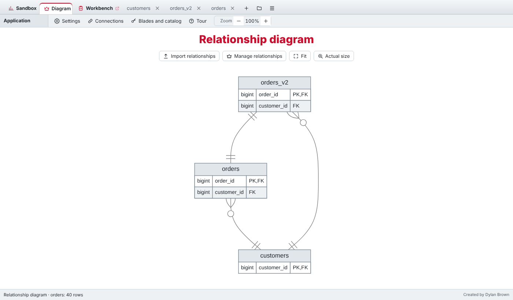

The diagram is fitted to the window as it is drawn, and follows the window's size. **Actual size** shows a large diagram at its own size (it then scrolls); **Fit** puts it back.

**Export to Power BI…** makes the tables the ERD shows into a Power BI Project that Power BI Desktop opens with a double-click: each table with its columns and how it is read (its Power Query: from its database, file, lake, SharePoint list or Dataverse), and the relationships between them. You build the report in Power BI Desktop. The dialog lists the tables with a tick each; a table Power Query cannot read (pasted, or pushed from Python) says so, with **Include its rows** to send its rows with the model. A database table's steps go as the database's own SQL when they can (else the table goes as it is, said); a file is read as it is. Of two joins between the same tables, one stays active, as Power BI wants; a join on two columns, or between columns of different types, is left out and said. With a project open it is written into the project's `powerbi/` folder (shared in Git like the rest; Power BI's own cache is ignored), then **Open in Power BI Desktop** (on Windows) or **Show its folder**; with no project open it downloads as a zip. A `${NAME}` becomes a Power Query parameter; no password is ever written: Power BI Desktop asks for it. (Export to Power BI comes with the **Power BI** extension: install it on the Extensions page.)

**Use an existing report's pages**: drop a `.pbix`, `.pbit` or `.pbip` on the dialog (or **Choose file…**) and its pages, visuals and theme go into the export, pointed at your model. Each field the report uses is listed: the ones found in your model by name are ticked; for the rest, pick one of your columns or **Leave it** (Power BI then shows that field as broken). The report's measures come along with their column names rewritten; one that names a column you did not map is said and left out. The file you dropped is never changed.

## The Workbench

The grid page's **Workbench** tab opens notebooks (`.ipynb`) and Python scripts (`.py`) in a window of
their own, run in an IPython kernel on this computer.

- **One row on top:** the document in front (a dot while it has unsaved changes), **Save**, **Save
  as…**, **New** (the kind you are on: **New notebook**, **New script** or **New Streamlit app**),
  **Open…**, and **…** (New notebook, New script, Open…, Recent, Split right, Split down, Commands).
- **A project has two kinds of notebook, each with its own icon and name:** its **data notebook**,
  data.ipynb (a notebook with a small table), where the tables are loaded and shaped, and its **app
  notebooks**, every other notebook in it (a notebook with a small page), where an app's pieces are
  written, whether a canvas uses them yet or not. A tab's icon says which (hover it for the word), and
  the **Notebooks** page lists them under **Data notebook** and **Notebooks**. Every other notebook is a
  plain one (app notebooks were replaced by widgets on the Canvas, 2026-11-21); a cell that calls Streamlit
  runs in the kernel like any other. The cells fill the width of their pane; a wide table
  in an output scrolls sideways inside its cell.
- **The Data Explorer, on the left** (the status bar's **Data Explorer**, or Ctrl+Shift+E; off until
  you open it, then beside every document, the data notebook and scripts too; drag its right edge to
  size it). One search box finds data by name as you type: your **connections**, their **tables** and
  **columns** (from each connection's catalog; a table shows its name for DuckDB SQL,
  `[Shop].customers`), the **tables open in the grid** and their columns, your **Structures** (each key by
  its path, `$.orders[].customer.id`: **Open at this node**, **Copy path**), your **APIs'** web calls that
  return a table (by their SQL names) and their columns, **variables** (by name and
  source, never a value) and **blades**. Any case, any part: `cust` finds `customer_id` and
  `CustomerKey`. The results come grouped and counted; the chips keep one kind or a few, the picker one
  connection, and your recent searches wait under the box. A connection whose catalog is not loaded yet
  says so, with **Load its catalog**. On a result (its buttons, a right-click, or Enter for the first):
  a table: **Open as grid**, **Preview** (its first rows under it, nothing kept), **Copy SQL name**,
  **Insert** (into the selected cell, as that cell writes it: `SELECT * FROM [Shop].customers` in a
  SQL cell, `sab.sql("SELECT * FROM [Shop].customers")` in a Python cell) and **Query in a notebook**;
  a column: **Copy name**, **Insert** and **Show tables with this column** (every table that has it,
  in every connection: where a join may be); a variable: **Open in Variables**; a blade: **Insert its
  call**. Drag any result into a cell. **+ Table** opens a file, browses a connection's tables,
  searches the catalog or adds a connection; **+ Blade** shows your saved blades and connections.
  **Pop out** opens the **Data** page (below, under "Data: browse and find tables") in a window of its
  own (on another screen, say) with your search, and closes the pane here; its Insert still goes into the
  Workbench's selected cell, and a drag from it drops into a cell there. On the grid page, **Ctrl+K**
  (Find data…) opens the same search in a dialog, with **Open the Data page** to take it there.
- **Tabs, in groups, as many as you like:** drag a tab along its row to reorder it; drag it over a
  group and a five-way guide shows where it goes: the middle moves it into that group, an edge splits
  the group that side. **Split right** (Ctrl+\\) and **Split down** are in the **…** menus too. Drag the
  bar between groups to size them; a group closes with its last tab. A tab's icon and coloured edge say
  its kind, in its kind colour: blue for a notebook (`data.ipynb` with the
  data's own icon), green for a script. The group wears its front document's colour as a thin band, and
  so do the Data Explorer's project files and the Recent and Move menus.
- **Each group's row:** its tabs, then, for the group you are in, the document's controls: a
  notebook's **+ Cell** (Python, SQL, DAX, HTML, Streamlit, Markdown), **Run all** and **…**; a script's
  **+ Cell**, **Run file** and **…** (Run statement, Open…, Recent, Save as…, Interrupt, Restart, the
  Streamlit app, split, Close). **Run tables** appears there while a table's cell waits.
- **The status bar** is for the document in front: its kernel (click for Interrupt and Restart; it
  says its state only while it is not ready), its environment, the cursor, and **Console** and
  **Variables**, which open the console under the groups and Variables on the right. Both start
  closed; running a script opens the console. A picture or chart a run draws has **Send to Analyze**:
  Analyze is where they gather. Splitters can be dragged, or focused and moved with the arrow keys.
- **Running a script:** F5 runs the file as Python would (`__name__ == "__main__"`, `sys.argv`,
  multiprocessing), saving it first. Ctrl+Enter (or Shift+Enter, F9) runs the whole statement at the
  cursor, a `for` block or a function, then moves to the next one. Run to here and Run from here are in
  the palette.
- **The console:** every notebook and script has one, on its Python session (a project's documents share
  the project's one session; a loose file has its own). Enter runs a whole statement
  and adds a line to an unfinished one; Shift+Enter adds a line; Up goes back through what ran.
  `input()` asks in place. Colours, progress bars and long output show as they would in a terminal.
- **Notebooks:** a new notebook has the cursor in its first cell: type at once. A result that is a
  table (a DataFrame as a cell's last line) has **Open as grid** under it: a cell ending in a variable
  (`orders`) opens as that name, anything else (`orders.head()`) as `out_` and its number, so the
  table itself is never replaced. Shift+Enter runs a cell and moves on. Escape leaves the editor for Jupyter's command
  mode: A and B insert, D D deletes, Z brings it back, Y, M, S, X and H make a cell Python, Markdown, SQL,
  DAX or HTML.
  Each cell's More menu runs the cells above or below, duplicates, clears or hides the output.
- **When code fails:** the error panel says what happened in plain words, where in your code (click
  to go there), and offers fixes with one click: use the close name, add the missing import, install
  the missing package into this environment (asked for at once: Install now runs it again), run the
  cell that makes a name. It shows the values of
  the failing expression at that moment and the function's variables; library frames are folded; the
  full traceback is behind a toggle. In the editor the failing expression is underlined, its message
  sits at the line's end, the hover shows the explanation and Ctrl+. offers the same fixes. A SQL
  cell's error is underlined where the database pointed.
- **Completion and checks as you type** (every notebook cell, script and the console): the member list
  comes up as you type (or with Ctrl+Space), each name with its kind and its signature or type, and
  the documentation panel beside it (the docstring, each parameter's words, what it returns, where it
  comes from; Ctrl+Space again hides or shows it). Before the kernel runs, the names come from your
  code (a notebook's cells above), your project's modules and your Python's libraries; once it has run,
  from the live objects too (a DataFrame's columns). Inside strings it offers the app's own names:
  connections in `sab.connection("…")`, `sab.sql("…")` and `sab.read("…")`, variables in
  `os.environ["…"]` and `secret("…")` (with where each comes from, never a value), blades in
  `sab.blade("…")`, structures in `sab.structure("…")`, an open table's columns in `orders["…"]`.
  Picking a function fills in its required arguments (Tab moves through them); a name from your
  project's functions.py, data.py and the other made modules adds its `from … import` line. While you
  type a call, its parameter info shows each signature with the current parameter in bold and its own
  words. Hovering a name shows its signature or type and its docstring. A moment after you stop typing
  the code is checked: syntax errors and names nothing defines underlined in red (names earlier cells
  or the kernel made count as defined), warnings in yellow, unused imports faded; with Ruff in the
  document's Python its rules join in. The status bar counts errors and warnings (click it for the
  list, a click on one goes there), and Ctrl+. offers the fixes: add the import, remove the unused
  import, define a name from the Environment's settings, use the close name. A SQL cell is checked by DuckDB's
  own parser (another database's by its dialect). Your agent sees the same list.
- **Send to the agent:** right-click an error (its panel, or the underlined code), or select code and
  right-click, then **Send to the agent** (or **…with a question** to add your own words). It reaches
  your agent with your next message to it, through the plugin's prompt hook; the agent can also read it
  any time with its `agent_inbox` tool. Nothing is written to disk.
- **Every command by name:** Ctrl+Shift+P opens the palette. F1 on a name shows its help in a card over
  the source (Escape puts it away). Ctrl+1 to Ctrl+3 (and F6) move between the panes. **?** (outside an
  editor) lists every shortcut.
- **How long a run took:** beside a cell's count, "Running… 3 s" while it runs and then the time it took.
  The first run starts Python: the cell says **Starting Python…** until it is up. A cell that has run keeps
  its Name box showing, so naming it is one click.
- **After a reload** the open documents, their unsaved text and the groups come back (kept in the
  window, not on disk).
- **Every cell has a number that never changes:** `#7` in a notebook cell's head (beside the run count
  `[3]`), `# %% [7]` on a script's cell marker. It is given when the cell is made and never given
  again, wherever the cell moves. Write `@cell7` in a comment and it is a link: a click goes to cell 7,
  a hover shows its first line. Outside the Workbench it is a plain comment.
- **The agent** works the Workbench as you do: it opens, runs and saves files and kernels, and its
  `workbench_window` tool runs any palette command in the window you were last in (`documents` says
  what is open and how the groups are arranged, `commands` lists them all: splitting, moving a tab,
  the Data Explorer's too: its search, Insert and Pop out).

## Connections and key vaults

**Connections** on the rail opens the Connections page: a card for each of your databases, files and connections made of your own Python (key vaults are on the **Variables** page), with its type, a status (**Works**, **Ready**: not used yet, **Needs a password**: one is in none of its places, **Failing**: its last call or its catalog failed) and how many times it has been called this session. **Add connection** at the top makes one with a form for its type. APIs are not here: they are on the **APIs** page. A database's password comes from this computer (the system keyring), an environment variable, or a key vault.

**Find connections on this computer…** (beside Add connection and Import…) looks, only when you click it, at
the connections your other tools keep: ODBC data sources, SSMS (registered servers and recent connections),
DBeaver, Azure Data Studio, VS Code (mssql, SQLTools), JetBrains IDEs (DataGrip, IntelliJ, PyCharm), pgAdmin 4,
MySQL Workbench, HeidiSQL, and Office's .odc and .udl files; then, for a few seconds, it searches your app
settings folders for connection strings and database addresses ("found by searching"; Cancel stops it). It
changes nothing in those tools and never reads a password (nor browsers, password managers, key stores, .ssh,
or cloud sync folders). One row per connection, with every tool it was found in; **Already added** for one you
have; a kind Swiss Army Bench has no connection for yet is shown but cannot be ticked. Tick the ones you want
(**Select all**, the search box), **Import**: each becomes a connection of its kind with its password a
variable that is not set yet (**Needs a password** on its card: set it once on the Environment's Settings and secrets tab or Set up
this computer). SQL Server and Azure SQL use mssql-python (no ODBC driver); a Windows sign-in, an ODBC data
source or a file on this disk keep the amber "Only works on your machine". For you: `connections_find`, then
`connections_import_found(ids)`; both wait for the user's Allow.

Click a card for its **detail**:

- **Used in:** every notebook and script cell that uses it (a SQL cell `%%sql Warehouse`, a DAX cell, `sab.sql("Warehouse", …)`, `sab.dax`, `sab.read`, `sab.blade`, `sab.connection`; a table's read-only cell is marked **Table cell**), every Streamlit app block on such a cell, and every open grid read from it. Click one to open that cell in the Workbench (or the grid). A name in a comment, or inside some other text, is not a use. The documents looked in are your recent ones, the ones open in the Workbench and the open project's.
- **Configuration:** its type, how it signs in, its settings (server, database and so on), and where each password comes from (the system keyring, a key vault's entry, an environment variable, or nowhere yet). Never a password itself.
- **Calls this session:** catalog loads, queries, table reads, tests and connects, and when it was last used. Calls made through the app and from Workbench notebooks and scripts count; code you run in your own Jupyter does not.
- **How long its calls take:** a card's calls line adds "usually 140 ms" once the open project has calls on it (rest on it to see every figure: the slow ones, the wait for a slot, the typical rows, the failures), and its Calls section lists them. The figures are kept with the project (`.sab/stats.json`, not shared in Git), so today can be compared with last week: names, times and sizes only, never a value. Your agent reads the same with `stats`, with hints such as "filter at the source" or "keep it as a table".
- **Open as grid** (a file), **Edit**, **Test**, **Refresh catalog**, **Copy for Python** and **Remove**. Edit's Back returns to the detail, and Save shows it again.

- **Every database form reads in the same order:** the server, the port and the catalog or database; then the user and the password, each under its own label; then the certificate file and **Trust server certificate** together.
- **A file connection** takes its name from the file you pick or type, until you name it yourself. **Test connection** shows what is in the file: its columns and its first 20 rows. **Open as grid** reads a CSV, Parquet or JSON file as DuckDB reads it (its types; the delimiter found by itself, a semicolon too): a file with a stray value far down a column, or saved in an older Windows encoding, says so in one line; **Open file** (the grid page's) still reads such a file, a stray value as text.
- **A package that is not installed** is asked for at once, in a window of its own: "Key Vault connections needs azure-identity", **Install now** or **Not now**. Install now puts it into Swiss Army Bench's own Python with uv, shows it working, says done or what went wrong, and then carries on with what you were doing. Not now leaves a small **Install azure-identity** button on the form, with the command for your own Python beside it, and does not ask again until you reopen the app. The same window comes up wherever a package is missing: a connection's form or test, a blade, an analysis blade, a YAML API document, a Streamlit app, Test this page, and a notebook cell that stops on an import.
- **A password from a key vault:** choose the vault, and **Entry in the vault** lists the vault's secrets by name (never a value). Picking one applies it. A secret the vault does not list can be named by hand (**A secret by name…**).

- **Only works on your machine.** What you build here should run unchanged on an Azure Function App or a hosted Streamlit app (Linux, no desktop, no installed drivers, nobody signed in). A connection that leans on this computer says so in amber, wherever you choose it or see it: beside its type or its sign-in in the form, on its card and its page, on a Write starter for it, and before an export is written. Each note says why and what to use instead, for example: an ODBC driver (use a driver pip installs: mssql-python, python-tds), Windows sign-in or Microsoft Entra **as you** (use a managed identity or an app registration whose secret is in a key vault), a certificate or file at a path on this disk (use a variable or a storage account), a password **Saved on this computer** (use a key vault or an environment variable). Each form starts with a way that runs anywhere, and a new password starts from **An environment variable**.
- **SQL Server and Azure SQL** connect through Microsoft's **mssql-python** (a pip package with its own driver: no ODBC driver to install). They ask how to sign in: **User name and password (SQL login)** first for SQL Server, an **app registration** with its secret from a key vault first for Azure SQL; then a **managed identity** (in Azure; a user-assigned one's client id), **the driver's default** (a managed identity in Azure), Microsoft Entra **user name and password**; and, on this computer only, **Windows sign-in**, Microsoft Entra **as you** (the Azure command line's sign-in, Visual Studio Code's, else a browser window) and an app registration with a certificate file. Switching keeps what you typed. **Options** (folded) hold **Encryption** (mandatory, optional or strict), **Trust server certificate** (tick it for a self-signed certificate on your own network), **Host name in certificate**, the **port** or a named **instance**, **Read only intent** (on: reads go to a read replica where there is one; the Write starters always take the primary), **Multi subnet failover** and the login and query timeouts. **Server**, **Database**, **User**, the **client id** and the **tenant** may each come **From an environment variable** (this computer's value is its default), as a certificate file may.
  - A connection saved before (on pyodbc and an ODBC driver) keeps working as it is; its page offers **Update to the new driver**, which writes its code again on mssql-python with the same settings, sign-in and passwords. Code you wrote yourself is never rewritten.
  - When it fails, the card says why in plain words with the fix: a refused login, Azure's firewall (with the address it refused and where to add it), mssql-python missing (`pip install mssql-python`), a certificate this computer does not trust, a server not found, a timeout. A serverless database that was paused is waited for (up to a minute; the card says **Resuming**); Azure's passing errors are tried again by themselves, on connect and on reads.
  - **Test** says which driver and sign-in it used, the server's version and edition (Azure's service objective) and a case-sensitive collation (keys that differ only in case are two keys, in DuckDB too).
  - **Import relationships** (on the connection's page; the agent's `connections_import_relationships`) puts the database's foreign keys into the ERD, a key of several columns as one relationship.
  - Tables read with their exact types (decimals and money exact, datetimeoffset as a time with its zone, geography and hierarchyid as text); their row counts come from the server's own statistics, never a count of every row. A running query stops on the server when you interrupt it.
- **Trino** connects over https with your company's certificate file (**Browse…** for a `.pem`); **Trust server certificate** skips the check, for testing only. **Sign in** offers **Username and password**, **Client certificate (from a key vault)** or **Client certificate (a file on this computer)**:
  - **From a key vault:** type `${` in **Keystore** and pick the vault's variable that holds the certificate (Azure Key Vault keeps a certificate as its base64 PKCS#12, or as PEM text; both work). **Keystore password** stays empty for Key Vault's own certificates, or names the variable of its password (`${NAME}`); a password is never typed there. **Certificate file** may name a vault's variable too. This way runs on a Function App (the vault read by its managed identity), so it has no amber note; the certificate never lands in the library, a project or a log, only in a temporary file only you can read, removed when Python ends.
  - **A file on this computer:**
  - **Keystore:** the keystore file (**Browse…**: `.keystore`, `.jks`, `.p12`, `.pfx`; PKCS#12, JKS or JCEKS, told by its contents, not its name). A JKS or JCEKS keystore needs the `pyjks` package (the form's **Install**). **Keystore alias** names the entry when the file holds more than one key. Its password is **TRINO_KEYSTORE_PASSWORD**: from an environment variable of that name, this computer's keyring, or a key vault; never in the code.
  - **Test connection** signs in with the certificate: "It works: signed in." A wrong password, a file with no private key, an unknown format or a missing file is said in words.
- **A certificate or keystore file from an environment variable:** under any certificate or keystore file (Trino's keystore and certificate file, a PostgreSQL `sslrootcert`, a client certificate or key), choose **From an environment variable** instead of **Path**. The name is suggested (**TRINO_KEYSTORE_PATH** for the keystore, otherwise the connection's name and the setting's: **WAREHOUSE_CERTIFICATE_FILE**) and can be changed; the path you chose stays as the default on this computer. Wherever the variable is set, its value wins.
  - **In an Azure Function app:** put the keystore file in the function app, then in its **Configuration › Application settings** add **TRINO_KEYSTORE_PATH** set to the file's path there, and **TRINO_KEYSTORE_PASSWORD** (a value, or a Key Vault reference: `@Microsoft.KeyVault(SecretUri=...)`). **Export as one script** and a script's **Run settings** list both; the file itself is never copied into the export.
- **A Power BI workspace:** one connection reaches every dataset (semantic model) in the workspace, each read with DAX. Fill in the **Workspace id** (it is in the workspace's address in Power BI: `.../groups/<workspace id>/...`); the form asks for no dataset. Then choose how to sign in:
  - **App registration, from a key vault** (the first choice): the **Tenant id**, the **Client id** and the **Client secret** each start on **A key vault**; pick each one's entry from **Entry in the vault**. The connection then reads them by name, so the same notebook runs in an Azure Function whose Key Vault references put those names in its environment. This way needs no package installed.
  - **App registration, ids typed here:** type the tenant id and the client id; only the client secret comes from a vault, an environment variable or this computer.
  - **Browser sign-in, as yourself:** Microsoft's sign-in window, for trying a workspace by hand. It needs `azure-identity` (the form's **Install** button), and its catalog waits for first use.
  - **Test connection** signs in and lists the workspace's datasets: "It works: signed in and found 3 datasets."
  - Its catalog shows the workspace's datasets, and under each one its tables, with their columns and, marked **measure**, their measures. Datasets are read one after another: the first 25, for at most 200 seconds. A dataset that could not be read has a circled **!** on it (point at it, or click the dataset, for the reason); the others are not affected.
  - **Open as grid** opens a table's first rows (Rows to open) from its own dataset and says how many the table holds; **Copy the EVALUATE** gives the DAX. The grid is named after the table. When two datasets have a table of the same name, the grid is named after the dataset too: `Sales_model_Date`.
  - **Import its relationships** is on a dataset: on its page (click the dataset in the catalog), in its right-click menu, and offered in the message when one of its tables opens. It brings that dataset's own relationships into the ERD and the Key Finder's known joins. An inactive relationship stays inactive (a dashed line).
  - **DAX goes in a DAX cell** (the Workbench, below): `EVALUATE TOPN(10, 'Sales')` on the dataset picked in the cell's head. In Python: `sab.dax("Finance/Sales model", "EVALUATE ...")`. A dataset is named after its connection: the connection, a slash, the dataset.
  - In Python the connection is the workspace: `conn = sab.connection("Finance")`, then `conn.datasets()` (each dataset's name and id) and `conn.dataset("Sales model").cursor()` (one dataset, used as a database's cursor is; a dataset is found by its name or its id).
  - A connection saved before this, for one dataset, still works: it shows as one dataset called **Model**, and a DAX cell names the connection alone.
  - Power BI gives at most 100,000 rows or 1,000,000 values (rows times columns) for one query. An answer that reaches that is refused with a message: ask for fewer rows or columns, or summarize in DAX.
  - What the tenant needs: the admin setting **Dataset Execute Queries REST API** on, service principals allowed to use the Power BI APIs (for an app registration, which must also be a member of the workspace), and Read and Build permission on each dataset.
- **Lakes and SharePoint** (their own group on the Connections page): five kinds whose tables their own
  code lists and reads, each signed in one of the same ways (**As you**, **Managed identity**, **App
  registration, its secret from a key vault**, and **Username, with multi-factor sign-in (a browser
  window, or a code on another device)**; SharePoint first offers **Username and password (ROPC)**,
  with or without the app's client secret). A username and password cannot do multi-factor sign-in (the
  form says so beside it): an account with MFA picks **Username, with multi-factor sign-in**, which opens a
  browser window with the username filled in (or shows a code to type on another device when no browser can
  open) and remembers the sign-in in the system's own encrypted token cache, so MFA is asked again only
  when Microsoft wants it. It works on your computer only (it needs you to approve the sign-in). Dataverse,
  SQL Server and Azure SQL offer the same way. Every setting (tenant, client id, username, site, account,
  container, workspace, root...) may come **From an environment variable** (the form suggests a name,
  `SHAREPOINT_TENANT_ID`; this computer's value is its default), so a function app runs the exported code
  with only its application settings. Passwords and secrets come from the keyring, a key vault or an
  environment variable, never the connection's file.
  - **Microsoft Fabric OneLake:** a workspace and an item. A lakehouse's Delta tables (`Tables/`) and its
    CSV and Parquet files (`Files/`) are its tables (`[Fabric].orders`, `[Fabric].Files.raw.regions`); a
    warehouse's are read with T-SQL on its **SQL endpoint** (Microsoft's mssql-python: no ODBC driver).
  - **Azure Data Lake Storage:** an account, a container and a folder. Its Parquet, CSV and JSON files,
    Delta folders, hive-partitioned folders (`day=2026-11-01/...`) and a job's part files are one table
    each. It also signs in with the **account key** or a **SAS token** from a key vault.
  - **Delta Lake:** a root (a folder here, `abfss://...`, or `s3://...` with an access key or a profile);
    every folder holding a `_delta_log` to a depth is a table, named by its folders (`[Lake].sales.orders`).
    A version or a time: `[Lake].sales."orders@v12"`, `[Lake].sales."orders@2026-11-01"`.
  - **SharePoint lists:** a site's lists (only lists), typed by their columns; a lookup or a person reads
    as its text with `<column>_id` beside it.
  - **SharePoint documents:** each library's file index (`[Team Docs].Documents WHERE extension =
    'xlsx'`), and its CSV, Parquet and JSON-lines files and each workbook's sheets and named tables
    (`[Team Docs].Documents.Finance."Budget 2026.xlsx".Summary`). Read into memory, never to disk; an
    unchanged file is downloaded once. Other documents: the **SharePoint** starters download, upload and
    read them (a Word or PDF document's text).
  - The tree shows a Delta table's version, size and partition columns. A read says how it was made:
    DuckDB's `delta_scan`, the deltalake package, or the table's Delta log read here with `read_parquet`.
- **Dataverse:** one connection reaches a Dataverse environment's tables. Fill in its **Address**
  (`https://<name>.crm.dynamics.com`: Power Apps, Settings, Session details), then choose how to sign in:
  - **As you** (the first choice): the Azure command line's sign-in (`az login`), else Microsoft's
    sign-in window. It needs `azure-identity` (the form's **Install** button), and its catalog waits for
    first use. In Azure (an exported script in a Function App) it signs in as the app's managed identity.
  - **Managed identity:** for a run in Azure (a Function App, App Service or VM); fill in a **Client
    id** for a user-assigned identity. It needs no package. The identity must be an application user of
    the environment.
  - **App registration, its secret from a key vault:** type the **Tenant id** and the **Client id**;
    the **Client secret** comes from **A key vault** (pick its entry) or an environment variable, never
    typed into the app. The app registration must be an application user of the environment, with a
    security role that reads its tables.
  - **Test connection** signs in, counts the tables and shows the first rows of `account`: "It works:
    signed in and found 812 tables."
  - Its tables are listed and read on the environment's read-only **SQL endpoint** (TDS, port 5558):
    its catalog has one schema, **dbo**, and every table by its logical name (`account`); **Open as
    grid**, the first rows and `SELECT * FROM [Sales CRM].account` read through it with T-SQL. It needs
    `python-tds` (pure Python, with `pyOpenSSL` and `certifi` for its encryption: no ODBC driver), and the
    endpoint turned on: when it is off, the environment's administrator turns on **Enable TDS endpoint** in
    the Power Platform admin center.
  - A connection saved before 2026-11-17 reads through the Web API still; its detail has **Web API
    (switch to the SQL endpoint)**, one click. Through the Web API (`sab.read("Sales CRM", "account")`
    too) no admin setting is needed. A choice column reads as its labels (**Won**, not 1), a Yes/No
    column as true or false, a lookup as its id with its name in the column beside it
    (`primarycontactid`, `primarycontactidname`), money and dates as numbers and dates. The grid says
    how many rows the table holds.
  - In Python: `conn = sab.connection("Sales CRM")`, then `conn.read("opportunity",
    columns=["name", "estimatedvalue"], filter="statecode eq 1", order_by="estimatedvalue desc",
    limit=100)` (a DataFrame; `filter` and `order_by` are OData), `conn.fetch("<fetch>...</fetch>")` (a
    FetchXML query), `conn.tables()`, `conn.columns("account")`.
  - **SQL** (`%%sql Sales CRM`, `sab.sql("Sales CRM", "SELECT TOP 10 name FROM account")`) runs on the
    environment's read-only SQL endpoint, in T-SQL (SELECT only). It needs `python-tds` (no ODBC
    driver), and the endpoint turned on: when it is off, the cell says so (an admin
    turns on **Enable TDS endpoint** in the Power Platform admin center, the environment's Settings,
    Product, Features) and the error panel offers **Read the table instead**, a cell with the
    `sab.read` line.
- **Python (your own code)**, under **Your own code**: a connection to anything Python can reach (an internal web service, a vendor's library, your own files). Its form has three code boxes:
  - **Connect** makes `conn`, any object.
  - **List the tables** returns the catalog for `conn`: a list of dicts or a DataFrame with `table` and `column`, and optionally `schema`, `type` and `description` (one row per column). Leave it empty for no catalog.
  - **Read a table** returns a table's rows, given `conn`, `schema`, `table` and `limit` (`None` means all): a DataFrame, an Arrow table or a list of dicts. Return `(rows, total)` and the grid can say "First 10,000 of 250,000 rows" and offer **Load all rows**.
  - **Environment variables** lists every variable the boxes read (`os.environ["ORDERS_API_KEY"]`, `os.environ.get(...)`, `os.getenv(...)`, `secret(...)`), found as you type. Choose where each comes from: **This computer's environment**, **Saved on this computer**, **A key vault** (pick the vault and its entry) or **A plain value (not a secret)**. Your code is not changed: the values are set as environment variables before it runs, so the same code runs where those names are set some other way, such as an Azure Function's settings. A variable the code needs that has no value says **Not set on this computer**.
  - **Test connection** runs Connect, then List the tables, then reads the first table's first 20 rows and shows them. A saved connection's **Test** shows them under its row.
  - Its catalog, **Open as grid**, the first-rows preview and **Rows to open** work as for a database. In a notebook, `conn = sab.connection("Orders API")` gives what Connect made, and `sab.read("Orders API", "orders")` reads a table with your Read a table box.
- **Add API** (the APIs page's heading row): a web API made into blades in this computer's library (see **APIs**, below).
  - First choose how to start: **I have an OpenAPI document** (2.0 or 3.x, JSON; YAML too when your Python has PyYAML: its address and **Read**, **File…**, or **Paste it instead**) or **I'll list the endpoints myself**. Then the form goes in the order you think in: **Name**, **Hosted on** and **Base address**, **Sign in**, **Endpoints**, **Save the file in**.
  - **Endpoints** (when you list them yourself): one card each, with **Method**, **Path** (`/orders/{order_id}`: a word in braces is a path parameter), **Parameters** (`status, limit`), a **Needed** tick per parameter (a path's word is always needed), **Read as a table**, and **Columns to keep** (empty: all). **Try it** reads that endpoint's first few rows before anything is written (a GET read as a table that needs no value); a document's tables each have their own Try button in the list.
  - **Hosted on**: **Azure Function App** (its function key in `x-functions-key`, or Entra ID through an app registration; **Find its OpenAPI** tries where the Azure Functions OpenAPI extension keeps the document), **AWS Lambda** (none, an API key in `x-api-key`, a Cognito JWT, or IAM with Signature Version 4), **Google** (a Firebase ID token, or a Google identity token from a service account key). It fills in the address's pattern and the sign-in; fill in its `<...>` parts.
  - **Sign in**: the document's own scheme first. None, API key (header, query or cookie), bearer, basic, OAuth 2.0 (client credentials; authorization code with PKCE in your browser, its refresh token kept in the keyring; device code; tokens cached until a minute before they run out), JWT (a ready token; a login endpoint, logged in again on a 401; signed here: HS256, or RS256 and ES256 when your Python has `cryptography`), AWS Signature Version 4, Google identity token, Firebase ID token. Under it, a box for each variable the file reads (`ORDERS_API_KEY`): what you type there is used by **Try it**, and on **Add** a key goes to this computer's keyring (empty: this computer's environment).
  - Before you add, the list shows each operation as the method it becomes (`GET /orders` is `list_orders()`), the environment variables it reads, and where the files go: this computer's library, `~/.swissarmybench/library/apis/<name>/`, whatever project is open. When the file is there already, each changed operation is marked (**New**, **Changed**, **Removed**) before anything is written; a file Add API did not make is never written over.
  - **Add** writes `API_<name>.py`, its **API blade** (the client: base address, sign-in, retries, paging) and one **web call blade** per operation (`Orders.list_orders`), with `openapi.json` and `source.json` beside them.
  - `API_<name>.py` is standard library only, so it runs anywhere, an Azure Function included: one documented method per operation, retries on 429 and 5xx, every page read (a next link, a page token, a page number or an offset), and array answers as DataFrames when pandas is there (else lists of dicts). Its secrets are arguments or environment variables, never written in it. In a notebook beside it: `from API_Orders import OrdersApi`, then `OrdersApi().list_orders(status="open")`.
  - An API's tables are exactly its web calls with **Return as table** on (off until you say so): then a SQL cell (`%%sql Orders`, then `SELECT ... FROM list_orders`) and `sab.read("Orders", "list_orders")` read it.
- **A key vault** (Azure Key Vault, AWS, Google, HashiCorp, 1Password, a `.env` file, Windows Credential Manager or the macOS Keychain): fill in its address and save. **Every secret in the vault** is on by default: each secret becomes an environment variable under its own name (`SqlPassword` stays `SqlPassword`; `Sql--Password` becomes `Sql__Password`, Azure's convention; `warehouse-password` becomes `warehouse_password`), and a secret added to the vault later is there at the next kernel. Once its address is filled in, the form lists the vault's secrets by name: leave a box empty and the secret keeps its own name (shown faintly), or type a name to map it to that variable. Untick Every secret to choose them instead.
- **An Azure Key Vault signs in** **As you** (the Azure command line or Azure PowerShell) or as a
  **Managed identity**, for runs in Azure (a Function App, App Service or VM; fill in a client id for a
  user-assigned identity). Nothing is entered on this computer to open a vault: an app registration
  (Power BI's, say) lives in the vault, as entries other connections use. An exported script reads the
  vault the same way, with no package installed (Export as one Python script, below).
- **Every Workbench kernel starts with those variables set.** `os.environ["WAREHOUSE_PASSWORD"]` works in any notebook or script, and so does a connection whose password is `secret("WAREHOUSE_PASSWORD")`. The Variables pane's Environment section shows each one as set or not set, never its value. A vault that cannot be read (signed out of Azure, say) says so when the kernel starts, and the kernel starts without its variables.
- No vault yet? Choose **A key vault** for a password and press **New vault**: the connection's form waits and comes back with the new vault in its list.

### Catalogs load themselves

A connection's catalog (its tables and columns, for the Workbench's catalog tree and the SQL cell's suggestions) loads in the background: when you save the connection, when Swiss Army Bench starts, and the first time you use it in a SQL cell. The Connections window shows **loading catalog…** while it loads and **catalog not loaded** if it failed (hover for why); a catalog that loaded says nothing. A connection that signs in with MFA is never loaded at start-up, so no sign-in window appears out of nowhere: it loads the first time you use it. **Refresh catalog** reads it again after the database changes.

### Connection colours

Every connection has a colour, and everything tied to it wears that colour as a stripe or a dot (never a
background, so text stays readable): its card on the Connections page, the grid tabs of the tables read
from it, the notebook and script cells that use it (`%%sql Warehouse`, `%%dax`, `sab.sql`, `sab.read`,
`sab.dax`, `sab.blade`, `sab.connection`; a cell that uses two connections wears two stripes), a table's
read-only cell, the Streamlit canvas blocks whose cells use it, the Data Explorer's results and the Session
page's entries about it.

- **Choosing one:** the round swatch on its card, or beside **Colour** on its detail. Pick from the eight
  colours, **Other…** for any colour, or **Next free**. A new connection is given the next free colour.
- **The rail's colours stay the rail's:** the kind colours (app violet, notebook blue, script green, as you
  set them in Settings), the red of the rail and amber (out of date) are refused, with the reason.
- **The same in every project:** a colour belongs to the connection on this computer (kept in
  `colours.toml` in the state folder, one line per connection), not to a project.
- **Tabs grouped by connection:** once a table from a connection is open, the home page's tabs gather in a
  group per connection (its dot and name as the head), with files, pasted, Python and query tables in
  groups of their own. Click a head to fold its group (the tab in front stays); drag a head to move the
  whole group; the arrow keys and dragging tabs work as before.

### Swapping a table's connection

A table read from one connection can be read from another with its transformations kept: the Table row's
**Connection: EDP** (it names the table's connection) lists your other connections. Pick one and the table
is read again from it, in the same tab with the same steps:

- **A catalog table** is found in the other connection's catalog by its name in any case; the schema, then
  the database, breaks a tie (an ODBC connection's database can be Trino's catalog). Not found, or found
  twice: the other connection's tables are listed to pick from (a schema opens to its tables), or **Write
  a query…** opens a window with a first query for it.
- **A query** opens in a window of its own, as big as you like, so you can look it over first (ODBC and
  native Trino can name tables differently), then **Run on Trino**.
- **Undo** is in the toast, on the strip under the tabs, and in the Connection dialog: the table comes
  back with its rows as they were. Nothing is deleted.

**A deleted connection.** A project whose tables came from a connection that is gone shows each one on the
strip (No connection EDP). **Use another connection…** moves every table that used it at once; queries
are looked over one by one in the query window, or **Run as they are**.

**The code follows.** After a swap, the cells that named the old connection are listed (a `%%sql EDP`
cell, `sab.sql("EDP", ...)`, `sab.read`, `sab.dax`, `sab.blade`, `sab.connection`), each ticked: **Point
these at Trino** changes the name in the ticked cells only, and nothing else (a string that merely holds
the name stays). An open notebook or script changes in the Workbench, unsaved until you save it; a table's
own read-only cell follows its table by itself.

### How many queries at once

Each connection runs at most 8 queries at once, at most 4 of them the agent's, whoever asks: your grids and new
queries, notebooks and scripts, background catalog loads and the agent. Past that a query waits in line: its
loading cover says "Waiting: 2nd in line for Warehouse (8 queries running)" with Cancel, a notebook cell says
"Waiting for a slot on Warehouse (2nd in line)", and after 2 minutes it gives up with Try again. The card shows
"Running 3 of 8 · 1 waiting" while anything runs or waits; the connection's detail has the three limits (At once,
The agent's, Wait in seconds) and **Queries in progress…**, a window of its own with every running and waiting
query (who, what, its tables, its place, the time ticking), Cancel, and the SQL laid out and coloured when you
open a row (Copy, Copy as written, Open in a new query). The limits are saved in the connection's library file, so
a team shares them.

## APIs

The rail's **APIs** icon (after the ERD) is every API you added, from this computer's library (never a project's: every project sees every API).

- **Cards**: each API's title, base address, how it signs in (never a secret), its operations, its tables, its calls this session, and where it was read from and when. **Refresh** reads its document again and shows what changed (operations added, removed and changed, with their parameters and fields) before **Apply** writes it. **Check for changes** reads it each time the page opens (only an address you gave). **Rename**, **Copy folder**, **Delete** (the code that uses it is listed first).
- **Search every API**: one box across every operation's name, method, path, text, tags, parameters and fields; the words are marked where they matched.
- **The explorer**: an API's operations down the left, grouped by tag, each with its method and path, then its **Schemas**. The right side shows the chosen operation: its description, **Inputs** (each parameter's place, type, whether it is required, its default), its body's schema as a tree beside an example made from it, and **Outputs** (each status: its schema and an example). A table's SQL name has **Copy name for SQL**.
- **Author a call**: a screen of its own. The inputs come filled with defaults and examples; the body is a tree and its JSON side by side, checked against the schema as you edit (double-click a value or a key in the tree to change it). The sign-in is the API blade's, never shown. **Send** runs the call and opens the answer in **Structures**, with its status, time and headers. **Save as web call** keeps the inputs and body in its web call blade; tick **Return as table** (and where its rows are, `$.items`) to make it one of the API's tables. DuckDB turns the answer into the table: a list of records, an envelope (`data`, `value`, `items`...), or header and rows (`columns` and `rows`, Trino's `columns` with types, a header row first); a list inside a record stays a list column. **The DuckDB query** (under the call, and on its page once it is a table) is the conversion itself: change it and **Save the query**, or **Make it again** from the rows path. A list or struct column it leaves opens up with **Unnest this column** on the column's right-click menu in its grid (a SQL step you can read).

- **Older API connections** (added before APIs were blades) keep working and are listed under the cards; **Make into blades** makes one into this computer's library from the document it was made from (if Add API did not keep it, you pick the file). Nothing changes until you click it.

- **Write rows with this call** (on a POST, PUT, PATCH or DELETE): pick an open table; each request field (the body's, nested ones too, and the parameters) takes a column (matched by name to start with) or a value; a required field left out is named and stops the run. **Dry run** shows the first three requests exactly as they will be sent, the rows and the calls, and sends nothing. **Send** writes them one at a time (or **One call for many rows**, where the API takes a list), slowing down when the API says so. The results open as a grid and in Structures: each row's status, the new id, the error; Retry the failed rows sends only those. **Save as web call** keeps the mapping in a blade.

- **What it answers** (each operation, under its inputs): what the app has learned the operation answers, read from its real answers, not only its document: its kind (a list of records, one record, a value, a file), what it maps to (a table or a grid, a detail card or a form, a metric, a download), and each field with its type. Until it has been called it shows what the document declares, marked so. **Discover** (at the foot of an API) learns every read operation at once: it asks you first, then calls each one once at its smallest page, never one that changes anything; what was learned shows on each operation. Only the shape is kept (field names and types, beside the API in your library), never a value. Once it has been called in the open project, its line adds how its calls went ("12 calls · usually 140 ms"; rest on it for the rest).
- **When an API changes**: a field it stopped sending is empty (and marked **missing**), a new one appears (**new**), a number that now comes as text still reads as a number (**retyped**), and the line above says what changed and since when, once. A field that looks renamed (`customerNo` for `customer_id`) is offered: **Use it** or **No**, remembered. Nothing breaks unless code said a field is required.
- **Run** calls it with its saved inputs and says what came back. **Build** puts it where it is used: a **Notebook cell** goes at the end of the open project's `data.ipynb` and the Notebooks page opens on it (`sab.run("Shop", "list_orders", {...})`, its records as a table with `sab.records(answer)`); a **Script function** asks which script (one of the project's, or a new one: `api_functions.py`) and the Scripts page opens on the function; a **Widget on a canvas** puts a table (a list of records), an API metric (one value or record) or an API form (a call that writes) on the project's canvas. With no project open the code is shown to copy. Nothing is built until you pick it.
- **Discover** (at the API's foot) calls each read endpoint once to learn what it answers. It asks first; your **Allow** is remembered for that API (it is kept with the API in the library, so a team's library shares it) and said beside the button: **Discover allowed since <day>**, with **Take it back** (the next Discover asks again). Your agent's discovery uses the same Allow.
- **On the Canvas, every API is one list.** A widget's endpoint, an input's source and an Event's **Call an API endpoint** pick from the same list, grouped by API: your project's local sandbox API first (`GET /orders`), then each API you added (`GET /orders` under **Orders**). Every call goes through the same adapter, so the API widgets (API table, API metric, API form, API button) work on any of them and say a failed call in their own place. A played, launched or exported app carries what it needs to make the calls (`api_adapter.py`, the actions it calls, an added API's own client file); an export's README names the variables to set where it runs.

## Structures

The rail's **Structures** icon (after APIs) is for nested data, as Grids are for tables: JSON, YAML, XML and TOML files, pasted text, an API's answer, or a dict or list from a Workbench kernel (the Variables pane's **Open in Structures**, or `sab.show_structure(x)`).

- Each open structure is a tab. Its **tree** and its **text** sit side by side (or one of them). Click a node to see its path (`$.orders[3].lines`; **Copy path**). **Search** marks the words and unfolds the way to them.
- **Steps**, as a grid's: **Pick** (the tree becomes that branch), **Filter…** a list on a field, **Sort…**, **Flatten** a list of records (dotted keys), **Add key…**, **Rename key…**, **Set value…**, **Remove**; a double click in the tree sets a value or renames a key. Each step is in the strip (× removes it); **Undo** and **Redo**. The original is never changed until **Save**; while there are steps the text shows their result and is read-only.
- **Open as grid**: a list of records at any path becomes a table (SQL and the Analyze page work on it).
- **Save** writes its file; **Save as** picks JSON, YAML, XML or TOML (TOML has no null: it says so) and goes in the project's `structures/` folder, which is the project's own and opens again with it. YAML needs PyYAML (the app offers to install it). XML with a DOCTYPE or an entity is refused.
- An API's answer has **Run again** (the same call, your steps kept), **Return as table…** on a list, and **Lineage**: the call (what was sent, and when), the structure, each step, each grid made from it, and the notebook and script cells that read it.
- In code: `sab.structure("gates")` is a saved structure's value, `sab.structure_table("payload", "$.orders")` its records as a DataFrame.

## Your library

Your connections, APIs, key vaults, blades, relationship sets, variables and connection colours
live outside every project, so you never hunt for an API again in a new project. They are one folder of
text files, your **library**, made to be a Git repository you can share with your team.

- **Where it is:** Settings, **Library**, shows the folder (`~/.swissarmybench/library` to begin with)
  and how many connections, key vaults, APIs, blades and relationship sets are in it. **Change…** points it at
  another folder, such as your clone of a team's library; **Default** goes back. Everything follows at
  once: every page shows the new folder's items.
- **What is in it:** `connections/`, `vaults/` and `blades/` (one `.blade.py` file each), `apis/<name>/`
  (an API's client, its blades and its OpenAPI document), `relationship-sets/`, `variables.toml` (each variable's name
  and where its value comes from), `colours.toml` (each connection's colour), a `README.md` and a
  `.gitignore`. Saving something writes its one file; saving it again unchanged changes nothing, so Git
  shows only what you changed.
- **What never goes in:** passwords and secrets, tokens, rows of data. Secrets stay in this computer's
  keyring. Values you marked **This computer only** go in `local/`, which the `.gitignore` leaves out.
- **Sharing it:** commit and push the folder with your own Git tools (Swiss Army Bench never runs Git). A
  teammate clones it and points Settings' Library at the clone: the same connections, APIs and blades
  appear, and each connection says **Needs a password** until they set theirs; variables kept on your
  computer only are **Not set** there until they set them.
- **Moving in:** the first time this version starts, the connections, blades, variables, colours and saved
  relationship sets you had move into the library once (the old files are kept in a dated backup folder beside them), and
  the page says so. Opening an older project that kept its own connections and blades copies them into
  your library: one that is already there is skipped, and one that differs is kept as
  **&lt;name&gt; from &lt;project&gt;**, and the page says which. The project's next save leaves them out.

## Data: browse and find tables

The rail's **Data** icon (after Variables) is the one place to browse tables: every table your
connections reach, and the ones you have open, on one page.

- **With nothing typed it browses.** Each connection is a group, in its colour, with its status (how many
  tables, **Not loaded**, loading, or why it did not load). Open one: its tables under their database and
  schema (a Power BI workspace's datasets), and open a table for its columns and their types. A
  connection whose tables are not loaded yet has **Load**. Under the connections: the **Open tables**
  (with their columns), **Structures** (each document and its keys by their paths), **APIs** (the web
  calls that return a table) and **Blades** whose result is a table.
- **Type to find.** The search box at the top is the Data Explorer's: any case, any part (`cust` finds
  `customer_id` and `CustomerKey`). The tree narrows to what matches: a table under its connection and
  schema, a matching column under its table. The chips keep one kind or a few, the picker one connection,
  and your recent searches wait under the box.
- **A table's actions** (its buttons, a right-click, or Enter): **Open as grid**, **Preview** (its first
  rows, nothing kept), **Copy SQL name** (`[Shop].customers`, how DuckDB SQL names it anywhere),
  **Insert** (into the Workbench's selected cell, shown while a notebook or script is in front there) and
  **Query in a notebook** (a new `%%sql` cell). A Power BI dataset and a SQL Server schema also have
  **Import its relationships**.
- **The detail side**: click a table to see its columns (type, whether it may be empty), where it comes
  from, its SQL name, and the code that reads it in a SQL cell and in a Python cell, each with Copy.
- **Drag** a table or a column into a Workbench cell: it arrives as that cell's language writes it.
- **Keys**: the arrows move through the tree (Right opens, Left closes), Enter opens a table as a grid,
  and **/** jumps to the search.
- The Workbench's Data Explorer pane is the same search beside your code; its **Pop out** opens this page
  in a window of its own. For an agent: `explorer_browse`, `explorer_search`, `explorer_table`.

## Environment: everything the project holds

The rail's **Environment** page (it took the Structures and Variables places) is one page for everything the open
project holds, with a tab for each kind:

- **Tables**: the data. A grid is only a view of a table, never a copy: the row says "In 2 grids", and closing a
  grid leaves the table. Rows by columns, the first columns, where it came from (a connection, a file, pasted, a
  query, your code). A table your Python holds that is not open yet is marked **In Python**.
- **Variables**: what your code makes (numbers, text, lists, dictionaries), with a short look at the value.
- **Structures**: JSON, YAML, XML and TOML documents (they open in the Structures viewer; **New, open or paste…**).
- **Settings and secrets**: the `${NAME}` settings (this was the Variables page). A secret is always masked;
  **Show** is yours alone, in the viewer. **Add a setting…** adds one. Your **key vaults** are listed above the
  settings they give (a card each: a click opens it, **Read again** reads its names); **Add key vault** adds one.
- **Libraries**: the libraries of the project's Python: version, what each is for, where it is imported. The line
  above them says what the project's Python is.

**One Python for the whole project.** Every notebook and script of a project runs in one Python session, so a
value one makes, the others see, and the Variables tab shows that one session. Code runs one cell at a time: a
long cell in one document makes the others wait. **Interrupt** stops what is running, whichever document
started it; **Restart** clears every variable for all of them, so it asks first. Both are in the status bar of
the Notebooks and Scripts pages, under **Python session**. A file that is not in a project keeps a session of
its own.

**The project's own Python.** The app makes a `.venv` folder in the project (Git never takes it) when you make
or open a project, with the libraries `requirements.txt` names, so a teammate's copy gets the same ones. It is
made in the background: you can work at once in the app's own Python, and one line says when the project's is
ready (**Restart** the session to use it). If it could not be made, the Libraries tab says why, with **Try
again**. A notebook that had an environment of its own says so once when it opens, and offers its libraries to
the project (**Add them**, **Not now**).

**Every table by its name.** Any table on the Tables tab can be read in code by its name, whether or not a grid
shows it: `sab.table("orders")`, or a DuckDB SQL cell that names it.

What you can do there:

- **Search** (press `/`): one box over every tab, in any case and by parts (cust finds customer_id and
  CustomerKey). Each tab's count lights up, and a line names the other tabs that match.
- **Unfold a row** (the arrow, or Right): a table's columns with their type, range and blanks; a structure's
  paths; a list's items; a setting's source and what uses it. Left closes.
- **The viewer** beside the list (Ctrl+B folds it): **Used in** lists every place that uses the row, each a link
  that goes there: grids, notebook and script cells by number, canvas widgets, API.py endpoints, analyses, the ERD,
  tables made from it.
- **Open** (Enter or a double click), **Insert into code**, **Copy name**, **Rename…** (F2), **Keep with the
  project** (a table's rows saved in the project's `.sab/data/`, never shared in Git), **Make a sandbox variant…**,
  **Send to the agent**, **Remove…** (Delete). Removing a table closes it and its grids; tick **Also delete it in
  Python** to delete its variable too. **Clear…** takes what you tick; kept tables, settings and libraries stay.
- **Libraries**: **Pin** keeps a library at its version (`name==version` in requirements.txt); **→ x.y** updates
  one to the newer version (looked up when the tab opens, never in the background); **Update all not pinned**
  skips the pinned ones; **Install a library…** installs into the project's Python and adds it to requirements.txt.

The page updates by itself as your code runs: there is no Refresh. Tables are added on the **Connections** page (or
by your code). Interrupt and Restart are on the Notebooks and Scripts pages, where the same list is the right pane
(the status bar's **Environment**).

## Variables

The rail's **Variables** icon (after Connections) is every environment variable this computer gives or
something reads, whether or not a project is open. They are your library's (`variables.toml`), never kept
in a project. **Key vaults** are here too: a card for each, and **Add key vault** (a key vault holds no
tables, so it is not on the Connections page). Click a vault's card for its detail and **Edit**.

- **Grouped by where the value comes from**: Key vault (the vault and the secret's name, never its value),
  Plain value (shown), Keyring (dots and **Show**), Environment (this computer's own; shown, unless it
  reads like a secret: then behind Show), Not set. Click a group's chip to see only it; search finds a
  name, a vault, a connection or a document.
- **What uses it**: each connection (its card opens), each notebook or script cell that reads it with
  `os.environ`, `getenv` or `secret()` (it opens at the cell), each script's Run settings.
- **Add variable**: a name (typed in capitals), a value and where it is kept: **Plain value**, **This
  computer only** (a plain value that is never shared: a folder's path), or **Keyring (secret)**. A name
  that reads like a secret (PASSWORD, TOKEN, API_KEY) goes to the keyring. Connections, scripts and
  Workbench kernels started from now on read it at once; a running kernel after a restart.
- **Edit**, **Rename** (connections' code and Run settings follow; the notebooks and scripts still reading
  the old name are listed for you to change) and **Remove** (what uses it is shown first). Removing a key
  vault's entry leaves the secret in the vault.
- The agent can list them (never a keyring's, a secret's or a vault's value), add and change them, and
  keep a secret in the keyring; it never reads one back. Show is yours only.

### A variable in any box: `${NAME}`

Type `${NAME}` into any box where you type a value: a connection's server, user or password, an API's
address, a file's path, a script's Run settings, a SQL query. It reads that setting (the Environment's Settings and secrets tab)
at the moment it is used, on this computer, so the value stays out of the files you share and each computer
fills in its own.

- Mix it with text: `https://${TENANT}.sharepoint.com/sites/${SITE}`. Give a default after `:-`:
  `${PORT:-5432}` reads 5432 when PORT is not set.
- **To type the text itself**, double the dollar: `$${NAME}` is the text `${NAME}`. Any other `$` stays as
  you typed it: `pa$$word`, `Sheet1$`, `[Orders$]`, `${not a name}`.
- A value that came from a variable is used exactly as it is: a password holding `${X}` stays that text.
- **In SQL** the value is sent beside the query, never pasted into it, so a value with a quote in it cannot
  change what the query does. Inside a quoted string or a comment, `${NAME}` is just text. It cannot stand
  for a table's or a column's name: the app says so.
- **Not set on this computer**: one message, "NAME is not set on this computer", with **Set it**.
- What the code your connection makes (and an export) holds is `os.environ["NAME"]`, so on a Function App
  the app's settings give the value.
- Passwords you had saved for a connection became variables once, in this computer's keyring
  (Sales DB's password as `SALES_DB_PASSWORD`), its connection's file backed up first.
- **Picking one:** type `${` in a box and the variables are listed under it, each with where its value comes
  from (Plain value, This computer's keyring, Key vault · Team vault), never a secret's value; the arrows and
  Enter pick one, Escape closes. The small `{x}` button on a box opens the same list. **New variable…** at the
  list's foot adds one with the name you typed, without leaving the form.
- **Under the box**, what it reads on this computer: the value (a secret as dots), or the message with Set it.
- **A password box** holds a variable on its own (`${WAREHOUSE_PASSWORD}`) or a password typed there; a typed
  one is kept, on Save, as a keyring variable named after the connection (`WAREHOUSE_PASSWORD`), said in amber
  while it is typed because it works only on this computer. A key vault's secret is a variable too: type its
  variable's name. There are no "comes from" lists beside the boxes: where a value comes from is set once, on
  the Environment's Settings and secrets tab, for every place that uses it.
- The Settings and secrets tab lists each setting's uses by box: `Warehouse · Server`.
- **Anywhere:** typing `${` in any box of the app lists the variables the same way, and right-clicking a box
  offers **Insert variable…** (beside Cut, Copy and Paste; Shift+F10 from the keyboard). A SQL cell or query
  box completes them after `${` too. Search boxes, and Python cells (use `os.environ["NAME"]` there), do not.

### Your connections in DuckDB SQL

A connection is something that exposes tables, and any DuckDB SQL can name them by the connection: the
**+** tab's query, a notebook's `%%sql` cell with **DuckDB** as its connection, `sab.sql(query)` in Python.

```sql
SELECT g.Segment, sum(s.Amount) AS amount
FROM [Finance Captive].Sales AS s
JOIN [Shop].segments AS g USING (CustomerKey)
GROUP BY ALL
```

- **The name.** `[Connection].table`, or `"Connection".table`. A database also takes `.schema.table` and
  `.database.schema.table`, in any case. A Power BI workspace takes `.table` when only one of its datasets
  has that table, else `[Finance Captive]."Sales model".Date` (the error names the datasets that have
  it). A workbook names a sheet, a folder a file (`[Exports].orders` is orders.csv). A name that is not
  there says what the connection has. A key vault has no tables: it is not a connection.
- **Every row the query needs.** A query never runs on a table's first rows only. The columns the query
  uses and its plain filters (`region = 'North'`, `amount > 100`, `IN`, `BETWEEN`, `IS NULL`) are sent to
  a database, and a `LIMIT` too when nothing else in the query needs more rows; the source counts the
  rows first. More than 5,000,000 rows from one table is refused with how to narrow it (a `WHERE`), or
  raise the limit: the `SWISSARMYBENCH_MAX_QUERY_ROWS` environment variable.
- **Read once a session.** Each table read is kept until you Refresh: the **+** tab's line and a cell's
  output say how many rows were read, when, and the filters sent; the **+** tab's toast has **Refresh**.
- **Getting the tables.** A connection's detail on the Connections page lists its datasets (or schemas)
  and tables with a search: each table has **Open**, **Preview** and **Copy name**
  (`[Finance Captive].Sales`, ready for SQL); a dataset has **Open all** (each its own grid), **Import its
  relationships** (Power BI) and **Query in a notebook** (a new `%%sql` cell). The Grids page's
  connections open the same list.
- **In a notebook.** A `%%sql` cell whose connection is **DuckDB** shows the connections its query names
  in its head; typing `[` offers your connections, `[Finance Captive].` its datasets and tables. The
  kernel's own DataFrames join in by their names.

## Session: what the agent made

The rail's **Session** icon (after Connections) is this session's log of what the agent made or changed: a grid opened, a step added or removed, a card on Analyze, a relationship on the ERD, a connection or blade saved, a notebook's cell, an export (and your Allow), a project saved. Each line says when, what in plain words, and where (the area); click it to go to that thing (the grid, the card, the relationship, the connection, the notebook at its cell). It fills in live as the agent works, newest first.

- **The agent / Me / Both**: whose actions are listed (the agent's by default). Your choice is remembered in this browser.
- **Changes**: only the lines that changed something, each with what changed under it in words ("orders: columns added segment; steps added 2 sort"): a table's steps, columns or source, a connection's settings, an API's answer, a widget, a canvas page, a notebook's cells, a variable. The same changes are kept with the project (`.sab/changes.jsonl`, not shared in Git, everything kept) for your agent to ask what changed last on anything (`changes`). Names and types only, never a value.
- **Follow the agent** (a switch here and in Settings, on unless you turn it off; kept across restarts): each thing the agent does comes to the front in the grids' window: a relationship it adds opens the ERD with the new line highlighted, a card opens Analyze scrolled to the card, a step brings its grid back with the steps count pulsing. A cell it adds in the Workbench is scrolled to and highlighted there. The highlight is a soft pulse in the theme's accent (a still outline if your system asks for reduced motion).
- **Never while you type**: if you are typing in a box, have a dialog open, or are reading Session, Settings or Connections, nothing moves; the move waits until you leave the box, and the Session icon shows a count of what arrived.
- **Follow off**: nothing moves at all; the entries arrive on the Session page and the icon counts them until you open it.
- Only names and counts are in the log (tables, columns, files, connections): never a cell value, a query's text or a password. It is kept in memory for this session; the audit log on disk is the full record. The agent can read the log (`app_session`) but cannot turn Follow on or off.

## What the agent may see

A connected agent sees everything the page shows: every table, its rows and columns (up to 1,048,576 rows per read, one Excel sheet), its steps and their values. An export by the agent always waits for your click: a window asks you to Allow or Deny it, and closing the window denies it.

Everything the agent does is written to the audit log (`~/.swissarmybench`); it never includes cell values.

## Beta notes and the log

While **beta mode** is on (a **Beta** mark sits in the status bar), Swiss Army Bench keeps a beta log on
your computer: errors and their stacks, slow requests, the kernels' and Streamlit's starts and crashes,
page errors, and your notes. No cell values, SQL, code, passwords or full paths go in it; tables and
columns appear as `table#1`, `col#3`.

- **Leave a note:** right-click anything (a button, a cell, a tab, a block, a code editor) and choose
  **Leave a note…**. Say what is wrong and Save. The note keeps what you clicked and what you did just
  before. **Attach a picture of this window** is off: tick it only if the picture may show your data.
- **Send it:** Settings, Beta, **Export beta log…** (or the Workbench's "…", or the Beta mark's menu)
  saves one zip: **send this zip to Claude.**
- **Beta mode** in Settings turns the log and the notes off or on, at once; it stays as you set it.
  **Clear the log** removes the log, notes and pictures. Text boxes keep their own right-click menu.

## Blades

**Blades** on the rail opens the Scripts page's **Blades** pane, below its files; a blade opens there as a tab. The old blades page's address (`/catalog`, `/catalog?blade=<name>`) goes there too. The pane's **…** holds **Import blades…** (you review each first), **Import from a project…**, **Export every blade** and **Blade folders…**. A connection's tables are on the **Connections** page (its tree) and in the **Data Explorer**; the blades page has no catalog panel.

- **A blade** is any Python that reaches outside Python to load something: a table, an API, a vault, an analysis. Each blade is a `.blade.py` file in your library (or a blade folder), and its screen is an IDE where you write it. Press **New blade** and pick what it starts as (**A table (a DataFrame)**, **Any code**, **Secret blade**, **Snippet**, or an analysis): the file is made in the library's `blades/` folder and opens in the IDE. If you edit the file in your own editor instead, the IDE takes the change at once; with unsaved changes of yours it asks **Reload** or **Keep mine**. Connections are added on the Connections page. Then in any Python: `conn = sab.blade("Warehouse")`.
- **The blade's IDE:** one slim bar at the top: **Back**, the name (a dot while something is unsaved), **Save** (Ctrl+S), **Save as…** (a new name, checked as you type), **Cancel** (back to the file; it asks first if you changed anything), **▶ Run** (F5 or Ctrl+Enter; **Stop** while it runs), **Properties**, and **…** (**Show its file**, **Export**, **Remove**). The editor completes names, shows signatures and help on hover, and underlines problems as you type (the Workbench's own, with Copilot's suggestions when that extension is on). **Run** runs the blade as Test does (its own Python, its passwords and vaults) with what is in the editor, saved or not: the panel at the bottom opens on **Output** (what it prints), then **Result** (a table with its row count and **Open as grid**, or a value's text; a failure shows the error panel and marks the line). **Problems** lists what the checker found; click one to go to its line. **Properties** (closed until you open it) holds the **Name**, **Description**, **Tags** and **Its table is called**, written into the file's header. Save writes the file only when it changed. A starter is read-only: Save says so, with **Copy as your own**.
- **Its table is called:** a blade whose result is a table (a function or code that makes a DataFrame) has a table name of its own, kept in its file (`table = "monthly_sales"`), so it travels with the library's Git repository. As you type, the line under it says **available**, or why not: **orders is already a table**, **Warehouse is a connection**, **monthly_sales is Monthly sales's table**, or **not a valid name** (1 to 64 letters, digits, `_` or `-`; not a word DuckDB's SQL keeps for itself). Save refuses a taken name with the same words. Left empty, the table is called what its code makes. In a notebook, `sab.blade(...)` makes its result (a function's, each time it is called) the variable of that name, so `%%sql SELECT * FROM monthly_sales` works, and the Variables panel and the Open list show it by that name; the Data Explorer lists it under that name too.
- **Passwords** go in the code as `secret("password")`. Type the value on the blade's screen: it is kept in Windows Credential Manager (or macOS Keychain), never in the blade.
- **Analysis blades** are your own analyses: the code is a function of the grid's rows, `def analyze(df, columns): ...`, where `df` is the rows as the grid shows them (a pandas DataFrame, its steps applied) and `columns` the columns you selected. Return markdown text, a table (a DataFrame), a figure (matplotlib, Plotly, Altair), or a list of them. It appears under **Your analyses** in the Analyze menu; it runs in the grid server's own Python, in a process of its own, and its result shows in a window with **Send to Analyze**.
- **Vault blades** read secrets from Azure Key Vault, AWS, Google, HashiCorp Vault, 1Password, a `.env` file or the operating system's vault, and set each one as an environment variable (key vaults are added on the Environment's Settings and secrets tab). **Secret blades** keep only variable names: you type the values once per session.
- **Packages:** the blade's screen lists the packages the code needs that are missing. A missing one is asked for as the blade opens (**Install now**, **Not now**), and **Install <package>** asks again; they go into the grid server's Python.
- **A connection's tables are always listed.** On a connection's screen, **How its tables are listed** in Properties is the query that lists them; a connection saved before without one uses its starter's. Drag a blade into a script or a cell for its `sab.blade` line (on a line of its own, after the line you drop it on).
- **Find a blade:** the search box above the blades matches names, descriptions and tags, and the tag chips under it narrow the list. The star pins a favourite to the top.
- **Share a blade:** **Export** on its screen downloads it as one `.blade.py` file (its code under a short header; passwords never go in it). The download arrow above the blades exports them all as a zip. To bring blades in, press the up arrow or drop the files on the blades: you see each blade's code first, and choose what happens when a name is taken. Importing runs nothing. **Fill in your values** on an import offers the values your other blades use for its server, database, user and path.
- **Blade folders:** the folder button lists folders to search for `.blade.py` files (a team's Git repository, say). Only files that start with the blade header count. A blade from a folder shows **file**; its screen writes only the file's header, and its **Remove** is yours to do in the folder.
- **New blade** (the Blades pane's **+**, or **New blade** in the palette) asks only a name and a kind: **Table**, **Code**, **Analysis**, **Connection**, **Snippet** or **Secret**. It makes a blank blade that already works: comments say what to write, and the body uses a few made-up rows, so **Run** works at once. It opens as a tab with the cursor in its body and **Properties** open.
- **Properties** holds every field of the file's header that the blade's kind has: name, description, tags, family; what it hands back; a table blade's table name; a connection's SQL dialect, rows to open, queries at once, the agent's share and the wait, and how its tables are listed (and a Python connection's Read a table); a snippet's language and cell name; a vault's variables; a secret blade's variable names. Each is checked as you type. The editor shows the code after the header; Save writes both. Save refuses code that does not compile or lacks its kind's part (a table blade's function must return its table), marking the line.
- Your agent does the same: `blades_new(name, kind)`, `blades_header_set` (any header field), `blades_update` (the code), `blades_table_name_check`. It never gets a password's value.

### Starter blades

Every install has a pack of ready-made blades and snippets, **Starters** at the bottom of the blade
list (the blades page, and **+ Blade** in the Workbench), one line a family: click a family to open it.
They are read-only and come with the app, so a new version brings new ones. **Copy as your own** (the
copy button on its row, or on its page) makes it one of your blades, to change as you like; a new
version never touches your copy.

- **Python starters** make one function: `refresh = sab.blade("Power BI refresh dataset")`, then
  `refresh("Sales model")`. Each one's first lines say how it is called and what it gives back.
- **Snippets** are text for a cell, with blanks to fill in. Drag one onto a cell of its language (or
  More: **Insert a snippet…** on the cell): a small form asks for the blanks, already filled from the
  cell's dataset (a DAX cell's tables, columns and measures) or the open tables, and the text goes in
  where you dropped it, ready to edit. A snippet dropped on a cell of another language is refused.
- **Power BI** (through your Power BI workspace connection's own sign-in; name a dataset as
  `Sales model`, or as `Finance/Sales model` with its connection): refresh dataset, refresh and wait
  (until done, with a timeout), refresh status (the latest one), refresh history (a table), refresh
  dataflow, dataflow history, list datasets, list reports, list dataflows, read parameters, update
  parameters, take over dataset (make your sign-in its owner), refresh schedule.
- **Dataverse** (through your Dataverse connection's own sign-in): FetchXML query (a query's rows, as
  a table) and choice options (a choice column's numbers and labels:
  `choice_options("opportunity", "salesstage")`).
- **Excel** (three, each a few lines over the one Excel module): **read a workbook** (a sheet or a named
  table as a table, a range of cells or another header row on request: the same reader as a workbook
  opened as a grid), **make a workbook** (tables as a workbook: a sheet each as they are, or laid out by a
  design: a title, a table with number formats, widths, a total row and colour rules, a pivot, Excel's own
  charts, freeze panes and print setup) and **fill a template** (a copy of an existing workbook with its
  places filled; its table grows with its rows). Text from your data is always text in the workbook, never
  a formula. The twelve cell-level starters (add sheet, borders, number formats...) went: what each did is
  an option of a design, and each old name answers with one line saying which.
- **Files:** combine CSVs (a folder of them as one table), split CSV (one file per value of a
  column), change delimiter or encoding.
- **DAX** (each a query a DAX cell runs, its measures defined at the top to copy into your model): year
  to date (TOTALYTD), same period last year (SAMEPERIODLASTYEAR, with the change), running total, top N
  by a measure (TOPN), percent of total, measure by month (SUMMARIZECOLUMNS over the date table), date
  table checks (missing and repeated days), and the model's tables, columns, measures and relationships
  (the INFO functions, to document a model).
- **HTML** (inline styles only, readable in a light and a dark Workbench; a value can be one of the
  kernel's variables in double braces, `{{ total }}`): styled table (a DataFrame by its name), KPI
  tile, KPI row, progress bar, badge, bar chart (drawn in CSS from a table's rows), list, header block,
  card grid, invoice layout.
- **Markdown** (for a Markdown cell; each says in its description which `{{ names }}` it reads):
  title with subtitle, section heading with a value (`## Sales in {{ region }}`), KPI sentence
  (`Total for {{ region }}: **{{ total_sales }}**`), callout, key figures table, what this page shows,
  executive summary, data dictionary entry, change log entry, footer with source and refresh time. What
  you type in a blank is written as text: a `*` or a `[` you type shows as itself.
- **Streamlit pieces** (below: Learning Streamlit with the starter pieces): snippets for a widget's
  code (or a Python cell): each says what it makes and reads.
- **Components** (below: Your own HTML and JavaScript in Streamlit): Streamlit pieces too, for a Python
  cell, each a piece of HTML, CSS and JavaScript of its own on the page: callout banner, animated KPI
  counter, sortable table, gauge, timeline, and four that send a value back to Python (clickable cards,
  segmented slicer, copy table button, keyboard shortcuts). Nothing is fetched from the internet.
- **Write** (below: Writing data): a Python cell that writes rows to a connection, a dry run first.
- For the agent: `blades_starters` lists the pack, `blades_copy` copies one as yours, `blades_snippet`
  gives a snippet's blanks (or its filled text), and `workbench_snippet_insert` puts one in a cell.

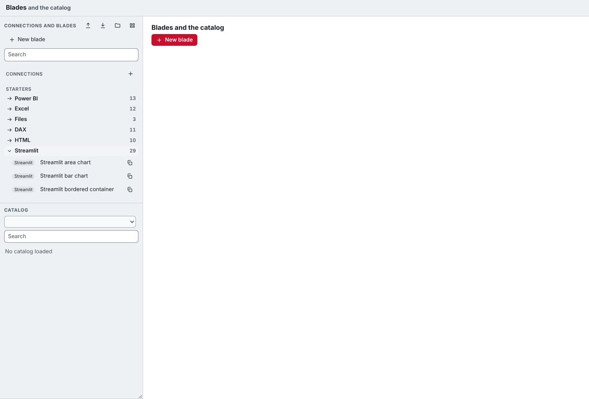

### Writing data: sab.write and the Write starters

One line writes rows to any connection that takes writes, from a Python cell:
`sab.write("Shop", "orders", orders, "merge", key="order_id")`. The rows are a DataFrame, an Arrow table, a
list of dicts, or an open table's name (its grid's rows); the mode is **insert**, **update**, **merge**
(update where the key is there, insert the rest), **delete** (by the key) or **truncate** (the table
emptied, then the rows: with none, only emptied). `dry_run=True` only says what it would do. It is the same
write an exported API's `connection(name).write(...)` makes, so it works the same once deployed.

Writes are also cells in a notebook: the **Write** starters (the Starters' Write family) are Python snippets
for the connections that take writes, with each target's own words. Each connection says which: its card on the Connections page reads
**Writes** or **Read-only** (hover for the starters, or the reason), and its page says it in full. A
Power BI model is read-only (write its source, then refresh it: Power BI refresh dataset); so are a
DuckDB file the app opens read-only and the warehouses that load through their own tools (Snowflake,
BigQuery, Redshift, Databricks), and a key vault.

- **Databases** (SQL Server and Azure SQL, PostgreSQL, MySQL and MariaDB, SQLite, Oracle, Trino, ODBC):
  append, create table (the rows' types made the database's), replace (every row, in one transaction),
  upsert (insert, or update where a key matches) and delete (the rows whose keys are the rows' keys).
  Every one writes as sab.write does, through the adapter. PostgreSQL, MySQL and MariaDB, SQLite, Oracle and
  ODBC: their own INSERT, UPDATE and DELETE in one transaction (an upsert updates the rows whose keys are
  there and inserts the others). SQL Server stages the rows in a temporary table of the target's own types
  and MERGEs them; Azure's passing errors run the whole write again; a replace whose TRUNCATE a foreign key
  refuses clears with DELETE instead, in the same transaction. Trino writes where the catalog's connector
  does (Iceberg, Delta Lake, Hive), row batches without a transaction: its dry run says so, a failure part-way
  says how many rows were already written, and replace is refused (clear the table first, then append).
- **Dataverse** through its Web API (its SQL endpoint is read-only): create, update, upsert (by an
  alternate key, such as an account number) and delete, a batch at a time; a choice column takes its
  labels (Won, not 1).
- **Files**: CSV, Parquet, partitioned Parquet (a folder per value), JSON, an Excel sheet (the
  workbook's other sheets kept). Excel make a workbook is listed here too.
- **APIs**: the APIs page's Write rows with this call.

There is one starter a target (**SQLite write**, **SQL Server write**, **Delta write**...). Drop one onto a
Python cell (or **Insert a snippet…**): the form asks for the connection (those of its kind first), the
rows (an open table, or any DataFrame or DuckDB relation by its name), the target table, the **mode**
(append, create, replace, upsert, delete: the starter's comment lists its own) and the key columns (for
the modes that find rows). The cell gets the call only, `write_sqlite("Shop", "orders", orders,
mode="upsert", keys=["order_id"], dry_run=True)`, with the line that fetches the function above it
(the function itself is the Write family's **Write to SQLite**: Copy as your own to change it). Every
call ends `dry_run=True`: run it and it says what it would do (the
target, the rows and their types, the statements, how many rows it would insert, update or delete, the
first 5 rows) and changes nothing. Set `dry_run=False` and run it again to write: one transaction
where the database has them (a failure writes nothing and says which batch), the counts and the time at
the end, and a note if the table changed since the dry run. No password goes in the cell: it signs in
through the connection's own sign-in. An agent sets `dry_run=False` only after you told it to write,
in your own words.

### Every table has its own cell

A table open in the grid has a read-only cell in the notebook or script it belongs to: the one whose
kernel sent it to the grid. A table no Python made (a file, a paste, a connection, a "+" tab's query)
goes to the document in front, and its cell starts with its load (the file read again, the
connection's query, a small paste written out; a paste over 200 rows or a file dropped on the page
gets a note instead). A table sent from a Python outside the Workbench (Jupyter, VS Code) has no cell
here: its code lives there.

- **Only the transformations are in it,** as one DuckDB query whose result is the table's own name:
  `orders = duckdb.sql("""SELECT ... FROM orders ...""").df()`, in the form the table had (a pandas
  DataFrame, a Polars one, an Arrow table). Your own cell that made the table stays yours.
- **You change it in the grid, never by typing.** A step added, changed or removed in the grid
  rewrites the cell at once. A sort made by clicking a header is a way of looking and stays out.
- **It shows its table.** A table's cell opens unfolded, and one the app wrote whole (its load and
  its transformations: no cell of yours makes the table, as in a project's data.ipynb) runs by itself
  when the notebook opens, starting the kernel, and shows the table as its output. That output is not
  saved in the file: it is drawn again each time. A table your own cell makes waits for your Run.
- **Nothing else runs by itself.** A rewritten cell turns yellow: **Out of date · last run 10:42**, with
  **Run**. Run it and the variable holds the table as the grid shows it. Undo the change in the grid
  and the yellow clears by itself. Before its first run it says **Not run yet**; after a reload,
  **Not run since opening**. A cell that is current says nothing: only a state that needs you to act
  is shown. The group row's **Run tables** appears when a cell needs a run, and runs each one.
- **Running it twice is safe.** The cell always starts from the table as your own cell made it, so a
  second run never transforms a table that is already transformed. Both are in memory while you work.
  Run all and Run file run it the same way. The saved file still runs from top to bottom as plain
  Python with no app: your cell makes the table, its cell transforms it once.
- **All tables sit at the top, in a Tables group.** Each table is a group of its own: your cell that
  makes it, then its read-only cell, after the imports they need and after the tables it is made
  from. A table folds to one line: its name, its steps when it has some, and its state only when it
  needs you (**orders · 3 steps**, **orders · 3 steps · out of date**, **customers**). The whole group
  folds to one (**Tables · 4 tables**; **Tables · 4 tables · 1 out of date**, yellow, when one is). A file opens with the
  group and its tables unfolded. In a notebook file the group is Markdown headings, which JupyterLab folds too; in a
  script it is `# region Tables` to `# endregion` around `# %% [7] [table] orders` and
  `# %% [8] [transformations] orders`, and Ctrl+Enter in a table's cell runs it.
- **A maker that cannot move stays where it is.** When your cell needs something your code defines
  further down (a function, a variable), or sits in a script's main code (before its first `# %%`),
  the table's cells stay there, and the Tables group lists it with a link:
  *orders is made at @cell7 (it needs make_dates)*.
- **The uses line.** One of your own cells that names a table starts with one line the app keeps:
  `# uses orders @cell3, customers @cell5` (`-- uses ...` in a SQL cell). Each link goes to that
  table's read-only cell. The line follows your typing after a short pause and goes when the cell
  names no table any more; nothing else in your cell is ever touched. It is saved as an ordinary
  comment.
- **The agent** reads every table's cell (`workbench_table_cells`), a document's tables and their
  state (`workbench_tables`), runs a table's cell (`workbench_table_run`) and goes to a cell by its
  number (`workbench_cell_goto`).

### DAX cells: a query on a Power BI dataset

A DAX cell holds one DAX query and runs it on one dataset of a Power BI workspace connection. Add one
with **+ Cell** › **DAX**, the kind picker in a cell's head, the palette (**Add a DAX cell**), or
**X** in command mode.

- **The dataset** is picked in the cell's head, beside its kind. The list holds only Power BI
  workspaces' datasets, each named `Finance/Sales model` (the connection, a slash, the dataset). A SQL
  cell's list holds every other connection, never a Power BI one. The list comes from each
  workspace's catalog; a workspace whose catalog has not loaded shows by its own name, and loads when
  you open the list.
- **Write DAX:** `EVALUATE TOPN(10, 'Sales')`. The cell is coloured as DAX. As you type it offers
  DAX's functions and keywords, and that dataset's tables (`'Sales'`), columns (`'Sales'[Amount]`;
  after `'Sales'[`, that table's columns) and measures (`[Total Sales]`). It never offers SQL's words
  or another dataset's names.
- **The result is a DataFrame,** as a SQL cell's: shown under the cell with **Open as grid**, kept
  under a name with `-> name` on the cell's first line in Jupyter.
- **In the file** it is a code cell that starts `%%dax Finance/Sales model`, so Jupyter and VS Code
  run it too, with the Swiss Army Bench client installed.
- **In a script** a DAX cell is plain Python under a marker, so the file runs anywhere:

  ```python
  # %% [dax]
  result = sab.dax(
      "Finance/Sales model",
      """
  EVALUATE TOPN(10, 'Sales')
  """,
  )
  ```

- **`Finance` alone** (the workspace, no dataset) works when the workspace has one dataset. With
  several it is refused, and the message names them.
- **Cells saved earlier:** a SQL cell on a Power BI connection, or a `%%sql Finance/Sales model` cell,
  opens as a DAX cell.
- **No uses line:** a DAX cell names its dataset's tables, not the tables open in the grid.
- **The agent** lists a workspace's datasets (`connections_datasets`), adds a DAX cell
  (`workbench_dax_add`) and runs DAX (`workbench_run` with kind `dax` and the dataset as its
  connection).

### HTML cells: a design drawn from its HTML

An HTML cell holds HTML and shows it as a design: a card, a screen mock-up, a page of a story told
with your data. Add one with **+ Cell** › **HTML**, the kind picker in a cell's head, the palette, or
H in a notebook's command mode.

- **Two faces.** While you edit it, the cell shows its HTML, coloured as HTML. When you leave it
  (click elsewhere, or Escape), it shows the design. Plain HTML draws by itself: no Run is needed. To
  edit again, click the cell's head, its **Edit HTML** button, or press Enter on the selected cell. A
  click inside the design goes to the design, so its own buttons work.
- **The pane resizes.** Drag the design's bottom edge, or focus it and use the arrow keys (Shift for
  bigger steps); a double-click or Enter fits the pane to the design again. The height is saved with
  the cell.
- **Scripts run inside the design, walled off.** The design is drawn in a frame of its own that is
  not part of the app: it cannot reach the app, its token, the page's storage or your data. Nothing
  loads from the internet: only what is inside the cell works (its own scripts and styles, and
  pictures and fonts written into it as data addresses). A remote picture, stylesheet or script does
  not load, and a script's `fetch()` fails. Links and forms go nowhere.
- **Python data by name.** `{{ total }}` in the HTML is filled with the variable `total` from the
  cell's kernel when the cell runs (Ctrl+Enter, its **Run**, Run all, Run file). Only a variable's
  name: nothing else between the braces runs.
  - A single value shows as its text.
  - A table (a pandas or Polars DataFrame, an Arrow table, a DuckDB relation) shows as an HTML table
    of its first 50 rows and 30 columns, and says so: *first 50 of 1,204 rows*.
  - A matplotlib figure or a picture shows as an image.
  - Inside a `<script>` a name becomes a JavaScript value: a number, a quoted text, or a table as a
    list of rows (up to 1,000), ready for a chart: `const rows = {{ orders }};`.
  - Inside a tag (an attribute) or a `<style>` only plain words and numbers go in (a width, a colour,
    a class name); anything else is left out, and the cell says so under the design.
  - A name the kernel does not hold shows as *{{ name }} not found* in the design. The design never
    breaks on its data.

  Data can never become markup or script: it is escaped where it is read.
- **A cell with names needs a run,** and says so the way a table's cell does: **Not run yet**, **Not
  run since opening**, or yellow **Out of date · last run 10:42** with **Run**, when its HTML changed
  since its last run or a variable it names would now draw something else (*Out of date · total
  changed*). Meanwhile the design keeps following your HTML, with the values of the last run. Undo an
  edit and the yellow clears by itself. A cell that is current, and any plain HTML, says nothing.
- **The uses line.** An HTML cell that asks for an open table starts with
  `<!-- uses orders @cell3 -->`, kept by the app like the other cells' lines (in a script it is a
  Python comment above the HTML: `# uses orders @cell3`).
- **In the file.** In a notebook it is a code cell that starts with `%%html`, IPython's own cell
  magic, so plain Jupyter draws it when run (there `{{ name }}` stays as written); its last filled
  design is saved as the cell's output, and its height in the cell's metadata. In a script it is a
  `# %% [7] [html] height=320` cell holding the HTML as one Python string that does nothing, so the
  file still runs as plain Python:

  ```python
  # %% [7] [html] height=320
  r"""
  <h1>{{ total }} orders</h1>
  """
  ```

  With the cursor in the cell its lines show; with the cursor elsewhere they are put away and the
  design shows under the marker (click the marker line to edit). In a script the HTML is coloured as a
  Python string. Run file fills the script's HTML cells once the file has run.
- **Markdown cells take names too.** `{{ total }}` in a Markdown cell is filled the same way when the
  cell runs (Shift+Enter, its **Run**, Run all), and the cell shows the filled text when you are not
  editing it. A value is always text: its `*`, `_`, `[`, backticks and markup show as typed, never as
  formatting, a link or HTML. A table alone on its line shows as a Markdown table (its first 50 rows);
  elsewhere it says its size. Inside code (a `span` or a fenced block) only plain words and numbers go
  in. Out of date and Not run yet work as for an HTML cell. A Markdown cell without names is plain
  Markdown, as before. (Saved notebooks keep no values for a Markdown cell: it shows its names as
  written until it runs again.)
- **Diagrams in Markdown.** A ```mermaid block in a Markdown cell is drawn as a diagram (a flowchart,
  a sequence, an entity diagram...) when you are not editing the cell, by the app's own Mermaid:
  nothing comes from the internet. A diagram that cannot be drawn says why in its place. A `{{ name }}`
  inside it is filled as text: its marks show in their full-width form (`－－＞`), so a value never
  changes the diagram. On a Streamlit page the block shows as its text (Streamlit draws no Mermaid).
- **The agent** adds an HTML cell (`workbench_html_add`), reads them and their state
  (`workbench_html_cells`), runs one (`workbench_html_run`), sizes its pane (`workbench_html_resize`),
  and can fill a design without the window (`workbench_run` with kind html, `workbench_html_fill`,
  `workbench_html_marks`).

### Lineage: where a value comes from

Right-click a block on a Streamlit app's canvas, a notebook cell (its head or its output, or a line of
its code) or a line of a script, and choose **Lineage**. An overlay shows how that cell's values are
made, all the way back to the data:

- **On the right, the flow** as a chart, top to bottom: the file or connection a table came from, each
  of its grid steps, its read-only cell, the cells that read it (a filter is a six-sided shape), and the
  cell you asked about last. A link written as `# @cell7` is a dotted line. In a project, a name your
  notebook imports from `data` goes back into data.ipynb.
- **On the left, one card per step**, beside its place in the flow: a table's rows and columns, its
  first rows, and how many rows it gained or lost from the step before; a value as it is; a chart as a
  small picture; an error in red where the flow broke. A block on the page is marked **page**.
- The values come from the notebook's kernel (run the cells first), from the grid, and, while the app
  plays, from the page itself: choose another region on the page and the cards follow.
- Click a card or a node to mark both; double-click (or Enter) to go to that cell. Escape closes it.

### A notebook run without the app

    python -m swissarmybench.client.standalone sales.ipynb

It runs every cell in the notebook's own folder and ends with exit code 1 and a report naming the cell
that failed.

### Widgets and the Canvas (a Streamlit app)

App notebooks and their canvases (`.stapp.json`) were replaced by **widgets** (the owner, 2026-11-21: "Creating
a widget is what will replace the concept of app cells and app notebooks"). Opening an old one says so in one
line; the data notebook (data.ipynb, data.py) stays.

**A widget** is a small Streamlit program kept in your library (`widgets/<name>.widget.py`, shared with your
team like blades). Its top-level plain values are its **properties**: `title = "Sales"` is a text box,
`show = True` a switch, `count = 5  # 1..20` a number with a range, `colour = "#1f77b4"` a colour picker,
`start = "2026-01-01"` a date, `kind: Literal["line", "bar"] = "line"` a dropdown, `x = "month"  # column of
orders` a column picker, `key = os.environ["ORDERS_KEY"]` a variable. The comment lines above one are its help.

**A widget's inputs and outputs** (its contract, 2026-11-21) are declared at its top with three markers from
`sab_canvas`, and the app reads them from the code (it never runs it to find them):

```python
from sab_canvas import Event, In, Out, Table

orders: In[Table] = None  # data coming in: wired on the Canvas (None here: its own made-up rows)
region: In[str] = "All"  # the value it takes when nothing is wired
picked: Out[int] = None  # data going out: the code assigns it (picked = 42)
saved: Event[dict] = None  # an action it fires: saved({"id": 7}); the Canvas says what it does
```

The types: `Table`, `str`, `int`, `float`, `bool`, `date`, `datetime`, `File` (a file a viewer gave: its
name, size, type and bytes; the file, camera and audio inputs give `file: Out[File]`, and Excel's upload takes
`file: In[File]`), `list[...]`, `dict`. An Event can say what it sends: `saved: Event[Order]`, where `Order` is
a TypedDict or a dataclass in the widget, and the Canvas then offers its fields when you map the body; a table
going out can say its columns the same way, `rows: Out[Table[Row]]`. Plain values stay
its properties (what you set while designing); Inputs, Outputs and Events are what passes at run time. The
Widgets window's Properties shows them under **Inputs**, **Outputs** and **Events**; a declaration that does
not read says why under it. A widget of yours that passes values through `st.session_state["key"]` shows
**Upgrade to In/Out…**: a preview of the rewrite (each key an In or an Out, what is kept and why), then Apply.
113 prebuilt widgets
come with the app (buttons, inputs, tables, metrics, KPI rows, charts, text, callouts, filters, forms): they
are read-only; **Copy as your own** to change one.

**Starter packs** group prebuilt widgets by the page they make, each listed first under its name and a line
saying what it is for: **Sales dashboard** (KPI row, revenue trend, top products, region map, the filter bar
that drives them), **Operations** (inventory status, low stock, shipments timeline, late shipments),
**Customer service** (ticket queue, ticket detail, status pie, SLA met, reply form), **Data entry** (a form from
a table, an edit grid, approve or reject, validation messages), **Admin** (users, audit log, settings),
**User inputs** (every Streamlit input, each with a label, help, default, required with a red star and the
same red line under it when missing, disabled; its value an Out, its starting value an In from another widget;
the selects, radios, pills and segmented controls take their choices from a table's column too: its distinct
values, sorted, the first 1,000 with a note), **Excel** (upload a workbook and pick
its sheet, header row and range; match its columns to your fields; check its rows; download tables or a
template as formatted Excel; the round trip) and **Form builder** (design a form, pick one, fill it in, see
the submissions). Each draws made-up rows until you wire a table. A pack's widgets pass their values by Ins and
Outs of the same name, which wire by themselves on a page (the filter bar's `sales_filter`, a queue's
`ticket_id`, an upload's `uploaded` into Map columns' `mapped` into Validate rows' `valid`, a form's
`form_definition` and `form_submissions`); Save, Submit, Send, Approve and Reject are Events. The Excel widgets
need openpyxl (xlrd for old .xls): a project's Python gets both when it is made; an older one says so in place.

**A project's own widgets** live in its `widgets/` folder (at the project's top, so they go into Git with
it), beside your library's. The lists show **This project** first, then **Library**, then the prebuilt ones;
a project widget with a library widget's name is the one used (the list says "Instead of the library's").
**Copy to project** and **Copy to library** in the Widgets window's bar copy one across under the same name.
An export carries the project's widgets it uses inlined in its `widgets.py` (the fewest files).

**The Widgets window** (Widgets on the rail; a window of its own, no rail): the list on the left (This project,
Library, then the starter packs, then the prebuilt ones by group, search, **New widget**), the code in the middle with the Workbench's completion,
signatures, help and lint over a kernel of its own, and **Properties** on the right: **Name** (checked as you
type: available, taken, not a valid name; a rename follows every canvas that uses it), **Description**, then
each property with its mask. A value is checked before it is kept and written into its own characters in
the code. One switch in the slim bar, **Code | Preview**: **Preview** (F5) runs the widget and shows it in the
code's place; **Code** (Esc) turns it back. A preview that fails shows the error there with **Go to line N in
the code**. Each widget opens the way you left it this session. Ctrl+B folds the list, Ctrl+Alt+B the
Properties.

**The Canvas** (Canvas on the rail): a project's `<app>.canvas.json`. The top row holds the page tabs and, at
its right end, always there: **Play** (F5; its ▾ has **Launch**, Ctrl+F5, **Launch with the Performance
Analyzer**, Ctrl+Shift+F5, and **Builds…**; while the app runs it is **Stop**) and **Export** (Ctrl+Shift+E).
The same group is at the bottom of every right-click menu on the canvas (the empty grid, a container, a
widget; Stop playing while it plays). The bottom bar **Desktop | Phone** (the two layouts), the sizing (Columns, Row height, Gap), **Snap** and its step (1, 2, 4, 8 px or a
grid cell), Undo and Redo, the **Widgets** and **Properties** panes' toggles, and the zoom (Ctrl+wheel, Ctrl+plus, Ctrl+minus, Ctrl+0; Fit).
- Drag on the empty grid to draw a **container**; drag one to move it (into another container too), its
  corner to size it. Snap puts edges on the step and on other items' edges and centres (guides show); hold
  Alt to place freely. Arrows nudge by the step (Shift: ten steps, Alt: one pixel). Places are kept in
  pixels, so a fine placement stays.
- **Desktop and Phone:** the same containers and widgets in both, each layout with its own places. Something
  you add on Desktop is stacked at full width on Phone (and something added on Phone gets a free place on
  Desktop). Drag the page's right edge to see it at another width (it shows the width in px): the page fits any
  screen; under 768 px it shows the Phone layout. **Show on** in Properties (Phone and Desktop, Desktop only,
  Phone only) hides an item in one layout; it is faded there on the canvas. **Hidden in the app** (a widget's
  Layout) keeps it running, its Outputs still flowing, but the played, launched and exported page give it no
  space: a widget that only moves data. It is faded on the canvas with an eye-off mark; a container with no
  title that holds only hidden widgets takes no space either.
- **Widgets** pane: a card per widget with its rendered preview; hover for a larger one. Drag a card into a
  container, or double-click (or Insert) to put it in the selected container. Right-click a container:
  **Insert widget ▸**, Insert container, Scrollable, Resizable by viewers, Delete.
- **Properties** pane: a widget's properties (its values here override the widget's defaults; ↺ goes back to
  the default), **Edit widget** (the Widgets window), its size. Then its **Inputs** (each one's source: a table,
  the project's **Sandbox** tables among them (its made-up copies, never live data), another widget's Out of a
  fitting type under Page values, or on another page under that page's name (the app keeps an Out's last
  value as you move between pages; until that page has run, the Input takes its starting value), **The
  viewer** (who is viewing: their sign-in where the host gives one, your user name in Play and Launch, else
  "unknown"; a shared app's viewers are "unknown", since Dev Tunnels does not pass their names), a GET
  endpoint of the local sandbox API, a variable, a value you type; a column property wired from another
  widget's table offers that table's columns once they are known (declared, or seen when you last played),
  and still takes one typed; a list of tables in order for one that takes several; **Automatic** when the
  page has one Out of its name), its **Outputs** (who reads each) and its **Events** (actions in order: **Call
  an API endpoint** with the payload, a part of it or a field each as its body; **Set a page value**; **Rerun
  the page**). A source of the wrong type is refused right there, with why. Selecting a widget lights its
  sources and readers on the board; **Wiring** in the bottom bar draws each wire from the exact Out to the In
  it feeds, with a small dot per Input on a widget's left edge and per Output or Event on its right (automatic
  ones dashed; a wire from another page a short stub with that page's name); a wire
  broken by a delete or a type change is marked at both ends and listed when you Play. An export runs the same
  wiring with no Swiss Army Bench; its README.md lists the API's variables to set (SAB_API_URL, SAB_API_KEY,
  SAB_API_BASE) when its events call one; a container's title, border, scrollable,
  resizable, height, padding, columns inside, background and size.
- Every change is saved at once and can be undone. Another window's change is shown with a notice, never
  written over. A widget deleted from the library stays as a placeholder with **Replace** and **Remove**.
- **Play** shows the pages live in place; a widget that fails shows its own error there while the rest runs.
  **Launch** makes a build in the project's `builds/` and opens it in its own window. **Export** writes a
  folder that runs on a hosted Streamlit app (the page reproduces the canvas's pixels).
- **Launch with the Performance Analyzer** opens the analyzer's window beside the app, recording from the
  first load: each rerun (what triggered it: a widget, a page switch, the first load) with each widget's
  time, the calls (outside requests, file reads), the caches, what travels over the web socket (kinds and
  sizes, never content) and hints in plain words. **Save** keeps the session in its build.
- **Builds…**: every launch, newest first, with what changed in words ("metric (w2): label changed").
  Tick two and **Compare** (side by side, file by file), or **Compare with now**; **Open** one read-only;
  **Relaunch**; **Restore** puts that build's canvas back as one change (Undo takes it back; your library's
  widgets stay as they are).
- **A table property** offers, in one list: made-up sample data, the open tables, data.ipynb's tables, and
  each connection's tables as SQL names them (`[Shop].invoices`; a connection whose tables are not listed
  yet: type its table). A connection's table is read when the page plays, through that connection's
  query limit.
- **Share…** (Play's ▾ and the right-click menus' last group, while the launched app runs) lets people in
  your organization open the launched app in their own browser after signing in with their Microsoft work
  account. It runs on this computer while it is shared: its queries run here, with your connections. There
  are no public links. The first time it asks to install Microsoft's **devtunnel** (Install now: downloaded
  from Microsoft, checked, kept in Swiss Army Bench's own folder); then **Sign in with your work account**
  (or **Use a code instead**), and **Share**: the link with **Copy** and **Open**, and a **Shared** mark
  beside Play. It ends on **Stop sharing**, when you stop or launch the app again, or when Swiss Army Bench
  closes. If your organization does not allow Microsoft Dev Tunnels, it says what to ask IT for.
- **The agent:** `widgets_*` and `canvas_*` (the guide's Streamlit topic); its export waits for your Allow.

### Learning Streamlit with the starter pieces

Streamlit draws a web page from a Python script: each `st.` call puts something on the page (a
dropdown, a number, a chart), in order. Two things make it different from a notebook:

- **The whole script runs again, from the top, every time someone clicks, picks or types.** So a value
  is always worked out from what is picked now. A plain variable starts over on each run; one kept in
  `st.session_state` survives (the session state counter shows it).
- **Every widget needs a name of its own on the page** (its `key=`): two dropdowns with the same label
  would otherwise be taken for one ("duplicate widget").

Every starter piece opens with what it does, the names it **makes** and **reads**, and each Streamlit
function it uses in one line; the lines that trip people up are explained where they stand. **Filters
make names, displays read them:** a filter makes the rows its pick leaves (`by_region`), and anything
that reads `by_region` follows the filter, wherever the two sit on the page. A name that starts with
`_` is the piece's own.

**One page in five steps.** Open a table as `orders` (any table with a text column, a date and an
amount), start a notebook, save it, and drag each piece onto an empty Python cell (or below the last):

1. **Streamlit selectbox filter**, Table `orders`, Column `region`: a dropdown of the regions with All
   first. Streamlit's `st.selectbox` draws it and gives back the pick; the piece makes `by_region`, the
   rows of that region. The cell is named **Region filter**.
2. **Streamlit date range filter**, Table `by_region` (the first filter's rows), Date column
   `order_date`, Name `in_dates`: a calendar where you pick the first and last day (`st.date_input`).
   It reads `by_region` and makes `in_dates`, so the two filters chain.
3. **Streamlit metric row**, Table `in_dates`, Value column `amount`: three big numbers side by side,
   the orders, the total and the average (`st.columns` makes the columns, `st.metric` each number).
4. **Streamlit bar chart**, Table `in_dates`, X column `product`, Y column `amount`: one bar per product
   (`st.bar_chart`; the totals are worked out first, since Streamlit draws what it is given).
5. **Streamlit formatted table**, Table `in_dates`: the rows, the amount with two decimals and the date
   as a date (`st.dataframe` with `st.column_config`).

Then make each a widget (the Widgets window: **New widget**, the piece's code), place the widgets on a
canvas, and **Play**. A filter widget that keeps its pick in `st.session_state` under a key of its own lets
the others read it.

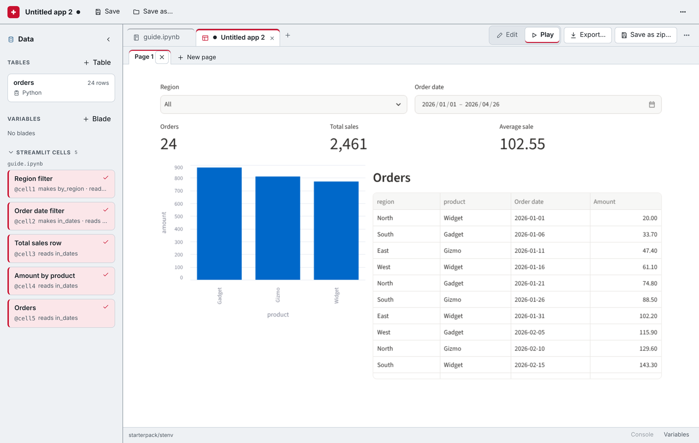

**Every piece, by what you would use it for:**

- **Let the reader choose rows** (each makes the rows its pick leaves): selectbox filter (one value),
  multiselect filter (any number), date range filter, number range filter (a slider with two
  handles), text search, toggle filter (only the rows where a yes/no column is yes), sidebar filters
  (three in the sidebar, making the rows and each pick).
- **Show a number:** metric with change (this month's total and its change from last month), metric
  row (count, total, average), progress bar (a total towards a goal), status message (what was
  checked, folded to one line when done).
- **Show the rows:** formatted table (numbers and dates formatted), editable table (the reader types
  in it; makes the rows as changed).
- **Chart:** bar chart, line chart (a total per day), area chart (a total per day for each value of a
  column), map (a dot for each row's latitude and longitude).
- **Arrange:** tabs (a chart and the rows), expander (the rows, folded), columns (a number beside a
  chart), bordered container (a box around a title, a number and a note).
- **Act:** CSV download and Excel download (the rows as a file), form with submit (fields that take
  effect together), file upload (a CSV or workbook the reader gives, as a table), session state
  counter (a value kept between reruns), cached slow query (`st.cache_data`: worked out once, kept).
- **Tell the reader:** check messages (an error, a warning or a success by what the rows hold), toast
  (a short message in the corner after a click).

**The Controllers starters** drive a page: a filter with defaults (its Makes line a contract, below), a
form with validation (a range refused with what to fix, the last good one kept), an action button whose
callback puts the page's filters back (clicking twice does what clicking once does), a cross-page
filter (the pick follows the reader from page to page, kept in `st.session_state`), and a query
parameter filter (`?region=South` in the address opens the page filtered, and a pick writes it back).

**The Text and layout starters** dress it: a title with a subtitle, a section heading, a divider, a
caption, a callout, a logo and a picture (each read from beside the app), a spacer, and a footer with
where the figures come from, how many rows and when they were read, pinned to the bottom of the window
unless you set Pin to the bottom to no.


### Your own HTML and JavaScript in Streamlit (the Components starters)

When Streamlit has no widget that looks or acts the way you want, you can put HTML, CSS and JavaScript
of your own on the page. Streamlit offers three ways, and the **Components** starters use each:

| The way | What it is | Talks back to Python? | Pick it for |
|---|---|---|---|
| `st.html(body, unsafe_allow_javascript=True)` | HTML on the page itself; the flag lets its `<script>` run | No: one way | Something that only shows and should match the page's own font and colours |
| `st.iframe(html, height=...)` | A frame: a little page of its own | No: one way | A bigger piece with its own styles and scripts that must not clash with the page's |
| `st.components.v2.component(name, html=, css=, js=)` | A component on the page, no build step | **Yes: two way** | Anything whose click, pick or key press Python must hear |

(`st.iframe` is Streamlit 1.67's name for `st.components.v1.html`, which now warns that it is going.
These pieces need a recent Streamlit; they were checked with 1.67.)

**How a two-way component sends a value back.** Its JavaScript is a function Streamlit calls with what
it needs: `export default function (component) { const { data, setStateValue, setTriggerValue,
parentElement } = component; ... }`. `data` is what Python gave the mount call (`data={...}`).
`setStateValue("picked", "South")` sends a value and reruns the page; the mount call then gives it
back: `_result = cards(key=..., data=..., default={"picked": None}, on_picked_change=lambda: None)`,
then `_result.picked`. A **state** stays until the next click (a pick); a **trigger**
(`setTriggerValue`) is there for the one rerun it starts, then `None` again (a key press, a copy).
A two-way piece **makes** the value it sends back (`picked_region`) and, like a filter, the rows it
leaves (`by_region`), so any display that reads `by_region` follows it.

**Data goes in as data, never as code.** The HTML, CSS and JavaScript you give Streamlit run as they
are written, so a value from your data is never pasted into them: on the page it is escaped
(`html.escape`: `<b>` shows as the text `<b>`), into a frame it goes as JSON in a
`<script type="application/json">` (with `<`, `>` and `&` written so that no value can end the
script), and a component gets it in `data=` and puts it on the page with `textContent`. A frame is
not a wall between its page and yours (Streamlit's frames run on the same site), so the same care
applies there too.

**The pieces:**

- **Callout banner** (`st.html`): a coloured box with a title, a message and an x that closes it.
- **Animated KPI counter** (`st.html`): a column's total as one big number that counts up from zero
  (it simply shows the total when the computer asks for less motion).
- **Sortable table** (a frame): a table's first rows; click a heading to sort, type to filter.
- **Gauge** (a frame): a total against a target as a half circle, drawn in SVG.
- **Timeline** (a frame): a table's latest rows, newest first, with their dates.
- **Clickable cards** (two way): a card for each value of a column with its total; a click picks it
  and makes `picked_region` and `by_region`; a second click picks none.
- **Segmented slicer** (two way): joined buttons, All and each value, like a Power BI slicer; makes
  `picked_region` and `by_region`.
- **Copy table button** (two way): copies a table's rows as tab-separated text, to paste into Excel;
  a message says how many rows were copied.
- **Keyboard shortcuts** (two way): listens for a few keys anywhere on the page (not while you type
  in a box) and makes `pressed_key`, the key just pressed.

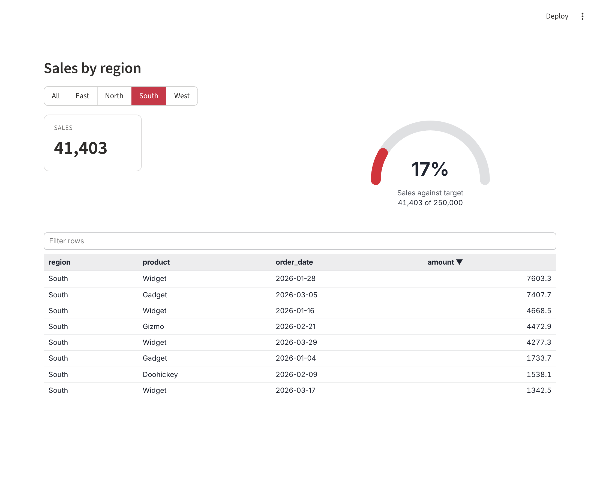

### The Workbench's modes

Each kind of document has its own panels, beside it in its group (two groups side by side keep their
own). The status bar shows the document in front's panels as toggles.

- **Notebook:** a cell you changed since it ran says **edited**; one that reads a name made again since
  it ran says **out of date**. **Outline** lists the headings and named cells, the stale ones marked.
  The selected cell offers **Run up to here**. A DataFrame's output has **Open as grid**. **Present**
  shows the notebook as a document: its text and outputs, no code.
- **Script:** **Run settings** holds the arguments and each environment variable the script needs (the
  ones it reads, by line; each connection's password) with where it comes from: **This computer**, a
  **Plain value**, or a **Key vault**'s secret. Values are never shown but a plain one's. **Run file**
  runs the script with those arguments.
- **Data** (`data.ipynb`): **Cells | Lineage | Dictionary**. The **Dictionary** lists each table's
  columns with their types in plain words and where each comes from (the file, or the grid's step that
  made it). Type a description: it is kept in data.ipynb and written into data.py as comments.
  **Lineage** draws the selected cell's lineage (else the last cell's) in place: the same flow and
  values as the Lineage overlay; a double-click on a step goes back to Cells, at that cell.

### Projects: start with the data

A project is a folder that starts with the data. **data.ipynb** is where you work on it: each table's
read-only cell (its load and its grid steps as DuckDB SQL), and your own code cells that shape
variables. **data.py** is its export, never edited by hand. Your other notebooks, and the app's pages,
start with `from data import orders, ...`.

- **New project…** (a group's **+**, the top bar's **…**) makes the folder: data.ipynb (a cell for each open table), data.py, an
  app's canvas, requirements.txt. **Open project…** opens its files as tabs, data.ipynb first, and the
  Data Explorer lists them at its foot (data.py set in under data.ipynb, as its output).
- **Export data.py** (the same menus) writes data.py again from data.ipynb as it stands. Play and
  Save as do it too.
- A table that was pasted, dropped or sent from Python cannot be read again by data.py: it is a
  marked stub (`FILL IN`) until data.ipynb has a cell that reads it.
- Add as many notebooks and scripts to the folder as you like (analysis, mock-ups of pages).

- **The agent** works projects (`project_new`, `project_files`, `project_export_data`, `workbench_project_open`)
  and the app's canvas (`canvas_*`, `widgets_*`); its `canvas_export` waits for your Allow, as a grid's export
  does.

### Export as one Python script (or one notebook)

**Export as one Python script…** (a notebook's or script's **…** Document menu, and the palette)
turns the document into ONE `.py` that runs on its own, unattended, on any machine with Python 3.10 or
later: a scheduler, a CI job, an Azure Function. **Export as one notebook…** gives the same as one
linear `.ipynb`, for a scheduler that runs notebooks. The name starts as the document's:
`orders_report_automation.py`. The file chooser says where it goes.

- **Everything is written out in it:** each connection the document uses (its own Connect code, a
  file's path, a Power BI workspace's sign-in and DAX, your own Python's Connect and Read a table, a
  blade such as the Excel starters' `make_workbook`), each key vault a password comes from, each table's
  load and its grid steps as one DuckDB query, then your cells in order. `%%sql` and `%%dax` cells,
  and `sab.sql`, `sab.dax`, `sab.read`, `sab.blade` and `sab.connection`, call those. It needs no
  Swiss Army Bench.
- **No password and no row is ever in it.** SETTINGS at the top names every environment variable it
  reads, one per line, with where it came from in the app (the keyring, a key vault's entry, a plain
  value). Set the passwords where it runs. A pasted, dropped or pushed table has no load: it is a stub
  that raises `FILL IN: ...` until you write the code that reads it.
- **Left out, with a line that says so:** what only shows something: HTML cells, Streamlit's cells,
  `display(...)`, a cell's last bare expression, `sab.push`. IPython's own lines become Python where
  Python has the same (`%pip install` goes into REQUIREMENTS, `%env`, `%cd`, `%time`); any other
  (`!ls`, `%run`) is named by its cell, and you are asked whether to export the rest with a stub for
  each.
- **Checked before it is written:** it compiles, Python's own checks (ruff, when the app's Python has
  it) find no name that nothing makes, and it holds no saved password's value and no row.
- **Run it:** `python orders_report_automation.py`. It first checks its packages (REQUIREMENTS, before
  anything else is imported) and, when one is missing, says the exact `pip install` for that Python and
  stops; `--install` installs them first. It logs to the terminal and exits 0 when it worked, 1 when it
  failed, 2 when a setting is missing, 3 when a package is. (`uv run` reads the header too.)
- **The notebook** runs top to bottom in any plain Jupyter kernel: `jupyter nbconvert --to notebook
  --execute orders_report_automation.ipynb`, or papermill. Its first cell checks the packages (set
  `INSTALL = True` there to install them); its settings cell is tagged `parameters`, so `papermill
  ... -p REPORT_FOLDER out` passes one (give passwords as environment variables: papermill writes its
  parameters into the notebook it runs). No magics, no outputs, plain nbformat 4.
- **In an Azure Function** (Python, the v2 model): put the script beside `function_app.py`, put its
  REQUIREMENTS in the function app's requirements.txt (the script's top comment lists them), and call
  `main()` from a timer trigger:

  ```python
  import azure.functions as func

  import orders_report_automation as job

  app = func.FunctionApp()


  @app.timer_trigger(schedule="0 0 6 * * *", arg_name="timer")  # every day at 06:00 UTC
  def orders_report(timer: func.TimerRequest) -> None:
      job.main()
  ```

  `main()` raises when the job fails, so the run shows as failed. Put the settings in the function
  app's **Application settings**, or let the key vault give them: an Azure Key Vault is read by the
  function app's **managed identity** (give it the **Key Vault Secrets User** role on the vault), with
  no secret in the function's settings. The script asks the vault itself, with the standard library:
  the variable when it is set already, then the managed identity, then (for a vault that signs in as
  you, and only when `azure-identity` is installed) `az login`. It needs only "get secret", never list.
  A Power BI workspace's app registration can live in the same vault, as entries.
- **The agent** exports too: `workbench_export_script` (`format` notebook for the notebook), and the
  window's palette commands `file.exportScript` and `file.exportNotebook`.

## Accounting (an extension)

**Accounting** is an optional extension (`swissarmybench-accounting`): a project whose deliverable is an Excel workbook, built by a Python automation you can run anywhere. The workflow is connection, data, then the workbook.

- **New Accounting project…** (the Workbench's project menu) makes `data.ipynb`, `workbook.design.json` (the workbook's design: sheets and blocks, never data) and `workbook.py` (the automation). While it is open, **New Excel workbook** is offered, and the Blades page and Insert a snippet… show the Excel, Write and Files families first (**Show all** for the rest).
- **The Excel canvas** shows a sheet as a grid of cells. **+ Block** adds a title, text, a **table** (an open table, or a DuckDB query; its columns, number formats such as currency, percent or date, widths, a total row, a colour rule), a **pivot** (rows, columns, sums, counts or averages: a summary DuckDB computes, written as a formatted table, never an Excel pivot table) or a **chart** (Excel's own: column, bar, line, pie, or a combo of columns and lines, drawn from a table or a pivot). Drag a block to move it, drag its corner to size it; Properties edits the selected block, or the sheet's freeze panes and print setup when none is selected. Sheets are tabs.
- **Play** builds the workbook from your open tables (each with its grid's steps) and shows each sheet as Excel will; **Download** gives the .xlsx. **Export workbook.py** writes the automation beside the design: `python workbook.py` builds the same workbook from `data.py`, with only openpyxl and duckdb.
- **Templates…** imports a workbook you already have (a cession statement, an invoice): its layout, formats, merged cells and named ranges are kept. Click a cell to bind it: to a column of the data, to text, to the statement's number or date, or to a table of lines that grows (the totals under it follow).
- **Statements and invoices…**: the template, a table with one row per party or period, a table of lines, the columns to group by, the file name (`{cedant} {period}.xlsx`), the numbering (`INV-{n:05d}`) and the date. **Dry run** lists every file with its rows and totals and writes nothing; **Build** writes them, and **Register** opens what was built as a grid. In workbook.py, `build_statements(...)` does the same.

## Power Apps (an extension)

With the Power Apps extension installed, the rail has a **Code App** page: Power Apps code apps (React and TypeScript apps that run in Power Platform), built with Microsoft's own command lines. Without it, nothing of this shows.

- **The tools:** the strip at the top says which are here: Node.js (22 or later), npm, the Power Apps CLI (`pa`) and the Power Platform CLI (`pac`), each with its version, and Deno (for the data notebook's TypeScript cells). A missing one has **Install** (this computer's own command; one that needs your password is shown for you to run in a terminal).
- **Sign in:** **Sign in** opens your browser's sign-in (`pa auth login`); the strip then says who you are.
- **New code app:** a name, an environment (from `pac env list`) and a folder. The app copies Microsoft's template, installs its packages and runs `pa app init`; it is then the open project, and the app works in the code app's mode: **New** in Scripts makes a TypeScript file, the blades list shows the TypeScript, React and Connectors starters first (**Every family** shows the rest), and "+ Cell" offers TypeScript and TSX cells. **Open code app…** opens a folder that has `power.config.json`; **Close** goes back.
- **Project:** the app's data sources (Dataverse tables and connectors; **Remove**), **Add a Dataverse table** (its logical name) and its files: only the ones you edit are listed (`src/App.tsx`, `src/pages.ts`, `src/pages/…`, `src/shared/…`); the template's configs, `power.config.json`, the generated models and services and the rest stay in the folder for Git, VS Code and `pa` (**Show all files** lists them). A click opens one in the Workbench's editor, with TypeScript's own member lists, parameter info, hovers and errors as you type. Ctrl+S saves it.
- **Pages:** each page is a folder of its own, `src/pages/<Page>/`: the page (its state kept there with useReducer), its components, its hooks (its data: loading, error, Refresh), `state.ts`, `types.ts` and `index.ts`. A page never imports from another page: what two pages share goes in `src/shared/` (a data table, a form field, the app's context), and the editor marks an import from another page with that fix. `src/pages.ts` lists the pages; the app shows a button for each. A new code app starts with an Accounts page (made-up rows until it has its data source). **New page** makes another, lists it and opens it; the React starters (a page, a hook over a generated service, a page reducer, a shared component, a form with state) are on the Blades page.
- **Connectors:** the environment's connectors, searchable. Click one to see its operations, each with its inputs and outputs (as on the APIs page) and its method in the app (`ContosotasksService.ListTasks(…)`). **Add to app** asks which of its connections to use (and, for a connector with tables, the dataset and table).
- **Run live:** the app's dev server, shown in the page and reloading as you save. **Local Play** opens it inside Power Apps in your browser, where its connectors answer (they do not answer in the page's pane). **Stop** ends it; it ends with the app too.
- **Push:** what it will run (`npm run build`, then `pa app push`), **Push**, and the app's link. **Versions** lists the environment's code apps and this session's pushes.
- **Custom connector:** pick an API from the APIs page; **Show its files** shows the connector's two files (its sign-in mapped, never a secret: a key, a password or an OAuth client's secret is typed in Power Platform); **Make the connector** writes them in the app's `connectors` folder and runs `pac connector create`.
- **Data notebook:** **Open data notebook** opens the code app's `data.ipynb` in the Workbench (made the first time, with a SQL cell and a TypeScript cell). Its SQL and TypeScript cells run in one Deno kernel and share one DuckDB: a SQL cell's query and ``await sab.sql`SELECT ...` `` in a TypeScript cell see the same tables, and every open table (a tab in the grid, after its steps) is a view by its name. `sab.table("name", rows)` makes a table of an array of objects; a query naming a connection's table (`[Finance].orders`) reads it first. A table result is drawn with its first rows; **Open as grid** opens all of it as a grid. Errors show in the usual error panel. A SQL cell with a connection of its own runs in that database, as anywhere else.
- **TSX cells:** a component (its `export default`) drawn under its code with the code app's own React, in the same walled-off frame as an HTML cell. Its first line can give its props from the notebook: `// props: { rows: byRegion, title: "Sales" }`.
- **Use in app:** writes `src/shared/data.ts`: the notebook's TypeScript cells as a module a page imports (`import { grandTotal } from "../../shared/data"`), each table result's row type (`ByRegionRow`) when the notebook has run, where each result comes from (`SOURCES`: the tables its query read, your Dataverse sources marked), small results (50 rows at most) as constants, and the cells that need the notebook's own kernel (`sab`, DuckDB) left out. DuckDB stays in the notebook: a code app cannot run it (its security policy), so nothing in data.ts imports it. It reads the notebook as saved.
- **Dataverse tables as grids:** a Dataverse source's **Open as grid** reads it through your Dataverse connection for the app's environment (Connections); with none, it says which one to add.
- **Runs:** every `pa`, `pac` and `npm` run this session, with its output as it came. The Session page lists them too.
- **Code apps switched off:** an environment's administrator turns them on (Power Platform admin center: the environment's Settings, Product, Features, Power Apps code apps); the app says so when a command is refused for it.
- **The agent** does all of this with its `powerapps_` tools; its Push, its custom connector and its installs wait for your Allow.

## GitHub Copilot (an extension)

With the GitHub Copilot extension installed, the Workbench's notebook cells (Python and SQL) and scripts show GitHub Copilot's suggestions as grey ghost text as you type. It is off until you install it and sign in; nothing is sent before.

- **Install:** the Extensions page's **Install** on the GitHub Copilot card (the app restarts), then **Install the language server** on the same card: GitHub's Copilot Language Server, pinned, goes into the app's own folder with npm. It needs **Node.js 20.8 or later** (the card says the command to install it when it is missing).
- **Sign in:** **Sign in to GitHub** shows a code. **Copy** it, then **Open github.com/login/device**, enter the code there and allow it. The card then says **Signed in as** your login and Copilot is **On**. You need a **GitHub Copilot plan** (Copilot Free counts); signed in without one, the card says so. The sign-in is the language server's own: the app never sees or keeps the token. **Sign out** on the same card.
- **Using it:** **Tab** takes the suggestion, **Esc** lets it go (a second Esc leaves the cell as before), **Ctrl+Right** takes one word, **Alt+]** and **Alt+[** go through the suggestions when there are several. The Workbench's status bar says **Completions: GitHub Copilot · on**; a click turns it off or on (Settings has the same **On** switch).
- **What is sent to GitHub:** only the document you are editing: a cell with the notebook's other code cells, or a script. Never outputs, tables' rows or variables' values. Telemetry is switched off.
- **Private projects:** the project's **Private** switch (in the Application row, beside Autosave; kept in `.sab/project.json`) stops it for that project: nothing of it is sent, and the status bar says **private**.
- **The agent** reads the status with `copilot_status` and switches it with `copilot_toggle`; its install of the language server waits for your Allow. Signing in and out are yours only.

## Git (an extension)

With the Git extension installed (GitHub sync: Join a team… installs it), the team library and the shared projects folder sync with GitHub, and the rail has a **Source Control** page (VS Code's Source Control view and its graph). No Git is needed on your computer: the app talks to GitHub's web API. Without it, nothing of this shows.

- **Sign in (Settings, Team, Join a team… or Start a team…):** **Use a token**: on GitHub, your picture, Settings, Developer settings, Personal access tokens, Fine-grained tokens, Generate new token; name it, pick an expiry, under Repository access choose Only select repositories (your team's; to start a team, All repositories), under Repository permissions give Contents: Read and write (to start a team, Administration too); Generate token, copy it and paste it here once. It is kept in your computer's keyring only. **Sign in with GitHub** shows a code to type at github.com/login/device.
- **Clone a repository…** (the Source Control page): pick one of your repositories, pick the folder it is for (Team library folder or Shared projects folder), and an empty or new folder; Settings then points at it. A team is simpler: Settings, Team, Join a team…. **Connect this folder** links a folder you already have: nothing is written; the first **Pull** brings GitHub's files, and a file that differs on both sides comes as a conflict.
- **Pull:** GitHub's changes come in. A file changed on both sides is merged line by line; when the same lines changed, your file stays as it is and GitHub's is saved beside it as `<name>.theirs`: keep what you want in your file, delete the `.theirs`, then push.
- **Push / Commit:** your changed files go to GitHub as one commit, never forced: when GitHub has changes you do not, Pull first. A file that looks like it holds a password or a token is refused, by name. Your `.gitignore`'s files, `local/`, `.sab/data/` (a project's rows) and files over 50 MB never go.
- **The words:** each folder says Not connected, Up to date, 3 changes to push, 2 behind: Pull, or Conflicts: 2; a shared project's card says its own ("↑2 to push", "↓1 behind", "Conflicts: 1") and has **Pull** and **Push** in its menu; **Share** asks "Push it to GitHub now?". The footer shows the open project's out-of-sync mark (amber); a click opens Source Control.
- **Source Control:** as in VS Code: the message box (Ctrl+Enter commits), ✓ **Commit** and its menu, **Staged Changes** and **Changes** with M (modified), A (added), D (deleted), U (new), ! (conflict); hover a file for Open File, Discard Changes and Stage Changes (+); right-click for more. With nothing staged, Commit asks to commit every change. The **Graph** shows the branch's history; click a commit to see its files, click a file for its diff. The diff is Monaco's: F7 and Shift+F7 go to the next and previous change, the "..." has Inline View and Previous/Next File. What needs Git on your computer (stash, amending, rebasing, tags) is shown greyed out.
- **The agent** reads the status and the changes and does all of it with its `github_` and `scm_` tools; its Clone, Connect, Pull, Push, Commit, Discard and Checkout wait for your Allow; it can never sign in or out.

## Code to your Python

**Copy code** (on any analysis result) copies the analysis as Python to the clipboard, its imports first. Paste it into Jupyter or any Python; nothing runs until you run it.

- **Drag from the blades page** into a cell or an editor: a blade gives its `sab.blade(...)` line, a table a first SELECT, a column its quoted name.
- **Your tables are grids:** importing `swissarmybench` in Jupyter or IPython lists the tables you make in the grid page's Open list. Open one and it's a grid; run the cell again and the grid refreshes.

### SQL completion

- **Completion:** in Jupyter or the IPython terminal (after `import swissarmybench`), press Tab inside SQL, in a string holding a SELECT, FROM or JOIN, or in a `%%sql` cell, and the loaded catalogs' names come up: `ord` Tab gives tables and columns starting so, `orders.cu` Tab the columns of orders, `sales.ord` Tab the tables of sales. Columns of the tables the query names come first. It asks the running grid server and never starts one. `sab.complete()` turns it on by hand; `SWISSARMYBENCH_COMPLETE=0` keeps it off.

## Limits

- All open tables together can hold 3 GB (never more than half of your computer's memory), and one table up to 1 GB, enough for a full Excel sheet of 1,048,576 rows on most tables.
- A query in the + tab shows up to 1,048,576 rows.
- Up to 50 tables and 50 grid tabs can be open at once.

## Tips

- Press Filter or Keep these first, then compare or chart. The step list keeps each change visible.
- Turn a step off with its checkbox to check what it did, then turn it back on.
- Read the Key Finder list before you pick a key. The top row is the best match, not always the column you mean.
- Use Pin as new grid for a SQL result you want to keep as its own table.
- The status bar shows the sum and average of the selected numbers, so a quick total needs no step.

## Local sandbox APIs

Every project has `API.py` at its top: its own API, run here against the project's **sandbox**, never against live
data.

1. **Fill the sandbox.** On a grid's Table row, **Make a sandbox variant** copies the table as you see it (after
   its steps) into the project's sandbox (`sandbox/` at the project's top, kept out of Git) as a *variant*: its own name ("orders ·
   sandbox", "orders · sandbox 2", or yours), its origin kept and shown (its tab, the bar over its grid, the
   lists), a branch mark. It never writes back to the table it came from. The Structures page makes one from a
   list of records the same way. The APIs page's Sandbox panel adds a file, an empty table by its columns, or an
   open table, and shows each table's rows, where it came from and the client its rows answer as ("Mock of
   Warehouse (sqlserver)" for a table read from that connection). A table from a file or its columns can be
   **Mocked as** one of your connections (the picker on its row): an endpoint's `connection("Warehouse")` then reads
   it as one of Warehouse's tables, its SQL in Warehouse's own dialect. Click a column heading (Table, Rows, From, Created, Last changed) to sort; again, the other way. The
   Catalog's Sandbox section sorts the same way (its Sort button).
   - **Edit in its grid.** Open a sandbox table in Grids: double-click a cell (or Enter, F2), type, Enter. A value
     its column cannot hold is said under the box. **Add row** and **Delete rows** are on the bar over the grid.
     Every edit is counted in the change log, and Reset undoes it.
   - **The Sandbox is a connection.** The Connections page shows the project's Sandbox (local test data, never
     live) in its own indigo, with its tables, the change log and Reset. DuckDB SQL names its tables
     `[Sandbox].orders`. It is never exported as a connection.
2. **Write endpoints.** **New endpoint…** is one wizard: pick a sandbox table, then what the endpoint is for.
   The choices are ranked for your table, each with one sentence why: Table (list, get, create, update and
   delete), Choices (a dropdown's), Search, Summary (totals per group or per month), Bulk upload (checked,
   a dry run, then all or none), Action (approve, close: the rows you send, all or none), Versions,
   Reconcile (two tables: matched, missing, differing) and Export (a CSV file or an Excel workbook). Each
   asks only its own few things, shows the code it will add, and adds it to API.py, where it is yours to
   change. A widget you then drop on the Canvas wires itself to the endpoint made for it. Or
   write your own with `@endpoint("GET", "/orders/{region}")`. `connection("Warehouse")` gives the same calls here
   and in an export: `read("orders", filters=[["region", "=", region]], limit=50)`, `query(sql, params)` in
   Warehouse's own SQL (joins, CTEs), `write("orders", rows, key=["order_id"], mode="merge")`, `tables()`. Here
   they read and write the sandbox's tables from Warehouse, never the real one; the exported API runs the same
   code against Warehouse itself.
3. **Run** it (127.0.0.1, its own key): **Try it** on each endpoint; the request log under it; the change log
   counts every row it inserted, updated or deleted. Try it's form starts from what the endpoint has
   learned it is sent (its fields and their types, with made-up values): nothing you type there is kept.
   (Keep as its example is gone: the app never keeps a request's or an answer's values.)
   - **When an endpoint refuses**, Try it shows the error where you pressed Send: what happened, the line of
     API.py it happened on, **Go to line**, the answer itself behind Details. The request log says the same
     beside the status; **Output** under it is what API.py printed.
   - **Save API.py and try again:** the API starts again by itself, and an open Try it keeps what you typed.
   - On the Scripts page API.py's main button is **Run API** (F5): the same Run. No table's cell is ever
     written into API.py.
4. **Reset** puts every sandbox table back to its baseline (a table's own Reset, that one alone); **Save
   checkpoint…** keeps a state to come back to.
5. **On the canvas**, the API table, API form, API button and API metric widgets call it; their endpoint is picked
   in Properties, with one box under it for each `{name}` in its path: a value, a variable (`${REGION}`) or a page
   value (`{{ region }}`). Export lists SAB_API_URL, SAB_API_KEY and SAB_API_BASE as the variables to set where the
   app runs (in its README too). **Payload shapes** says when a widget expects another shape than its endpoint answers,
   and when an Event wired to call an endpoint sends a field its body does not have, leaves a required one out or
   gives no value for its path.
6. **Will this work for real?** checks each endpoint's tables and columns against its connection's loaded catalog
   (load it on the Connections page first): nothing is sent to the source.
7. **Export…** writes a ready-to-deploy folder (`exports/api/<target>/`) for FastAPI, Azure Functions or AWS Lambda,
   using the real connections' own code; its README lists the variables to set and the deploy steps. An endpoint
   that uses `connection("Sandbox")` answers an error there unless you tick **Include the sandbox's rows**: the
   dialog says so.

