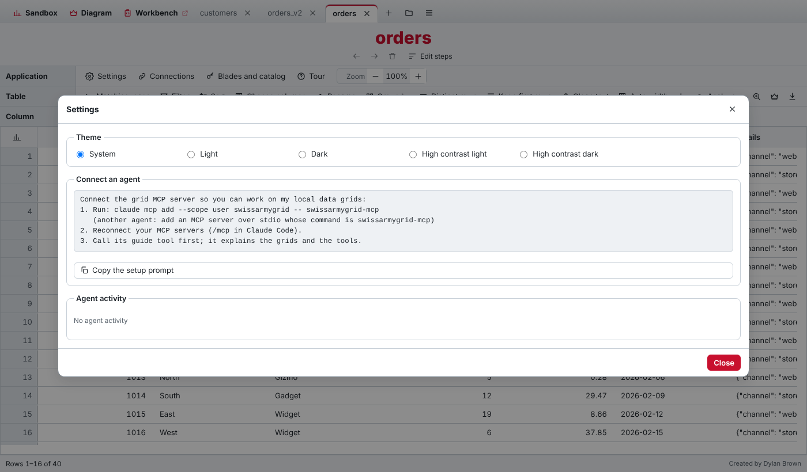
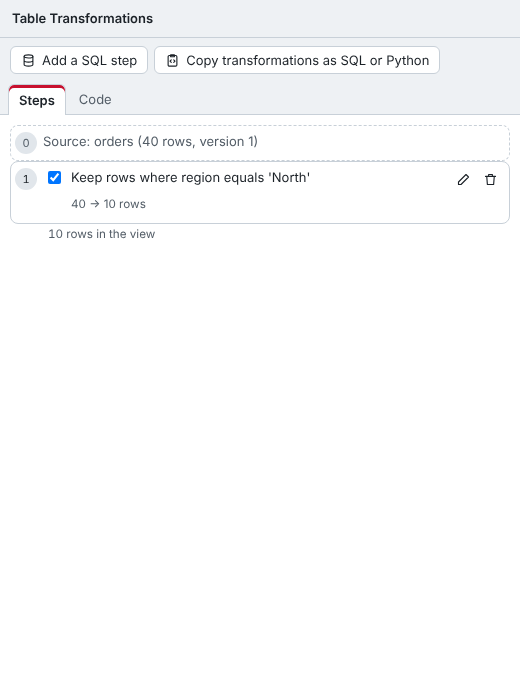
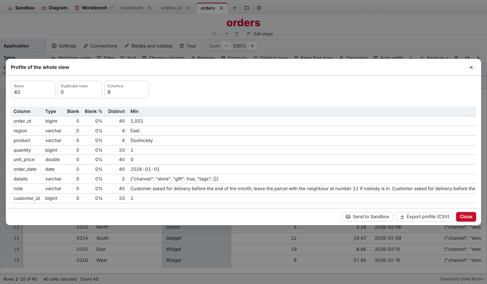
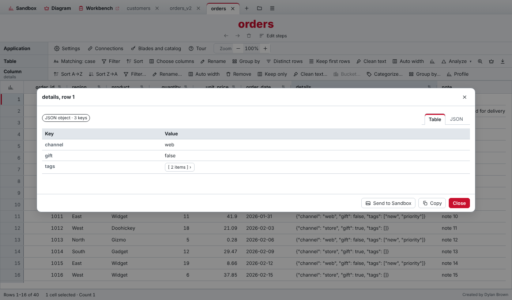
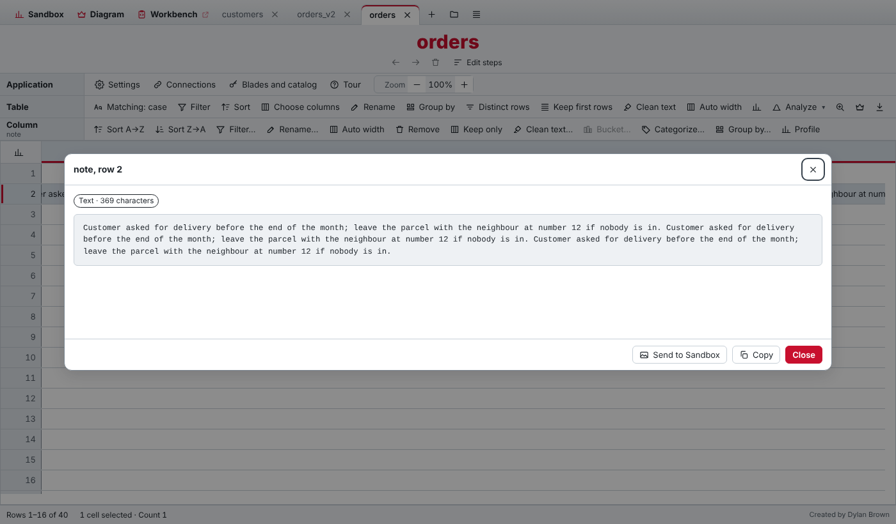
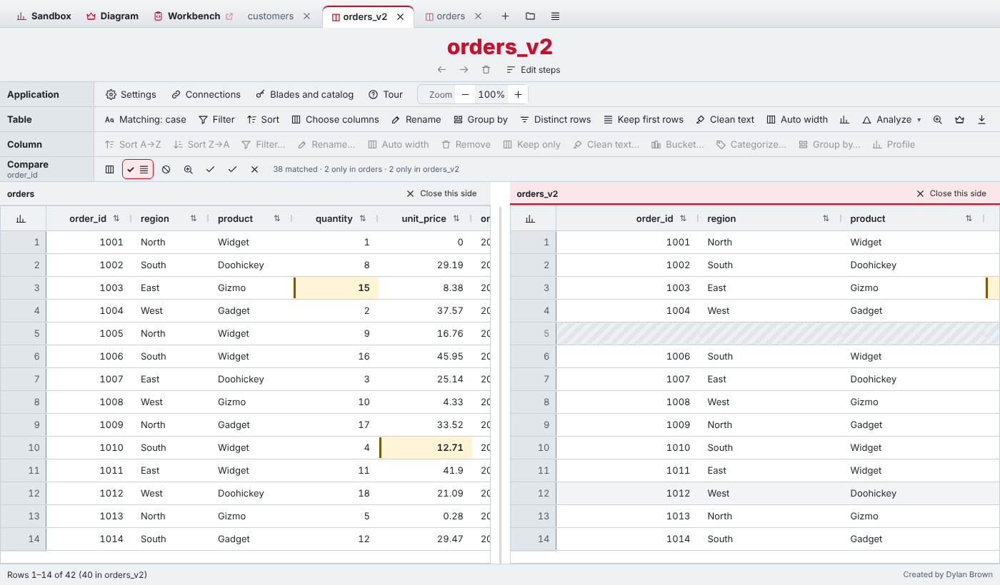
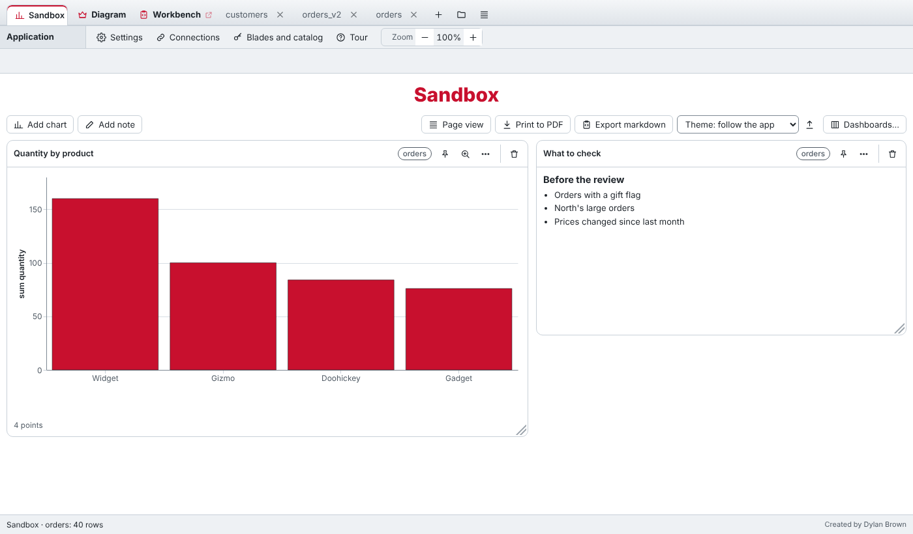
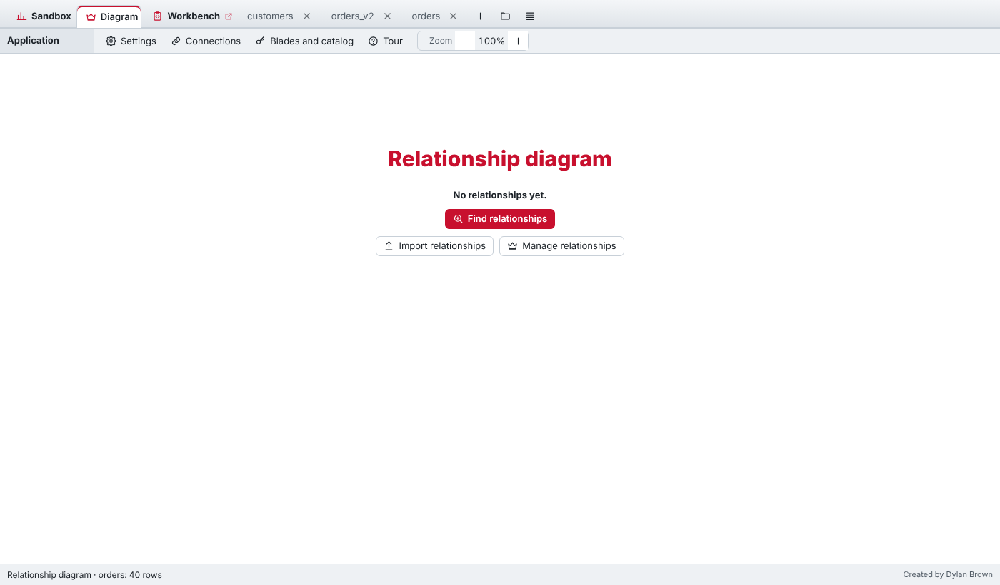
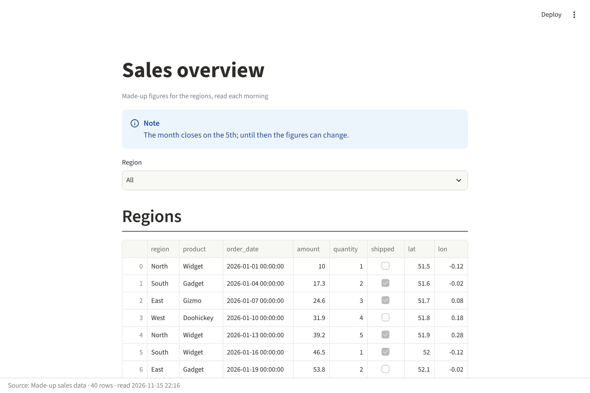

# Swiss Army Bench user guide

Swiss Army Bench is a local data grid that runs on your own machine. You push a pandas DataFrame from Python, and it opens as a tab in a browser page where you can filter, sort, compare and profile the table without changing the source data. Every change you make is a step you can see, turn off or export as Python.

## Getting data in

Install it once with the installer in the repository's `installer/` folder (`install.ps1` on Windows, `install.sh` on macOS and Linux), or with `uv tool install "<wheel>[server]"`. After that, push a DataFrame from any script or notebook:

```python
import swissarmybench as sab

sab.push(orders)
```

The grid is named after the variable, here `orders`. To choose the name yourself, pass `name=`. Names can be 1 to 64 letters, digits, `_` or `-`.

```python
sab.push(orders, name="orders", new_grid=True)
```

`new_grid=True` opens a new grid even when one with the same name is already open. Without it, pushing again refreshes the same grid, and its steps stay in place.

Without Python: the folder button beside + opens a file (CSV, Parquet, JSON, Arrow or an Excel workbook; a workbook with several sheets asks which), and a file dropped anywhere on the page opens the same way. Pasting a copied table (Ctrl+V on the page) makes a table named `pasted_` and the time; its toast holds the name in a box, so type a better one there and press Enter.

**Rename a table** by double-clicking its tab (or F2 on the tab): type the new name and press Enter, or Escape to leave it. The new name holds everywhere: every tab on it, its steps, the relationship model and the SQL that names it from then on. A Python session that kept the old name current stops following it.

## Tray and updates

Swiss Army Bench starts itself when you sign in and stays running: the installer sets that up, starts it and opens its page once. Its icon sits in the system tray (on Linux, when the desktop has a tray). `swissarmybench start` in a terminal starts it by hand and opens the page; `swissarmybench open` opens the page of the one running.

- **Click** the icon to open the page. The address bar then shows just the page (`http://127.0.0.1:<port>/workspace`); a bookmark of it works while the app runs. After a restart, open it from the tray once more.
- **Right-click** it for what is open (your tables and Workbench documents; a • marks unsaved changes; choose one to go to it), **Open the Workbench**, **Open the blades page**, **Restart**, **Start with Windows** (**Open at login** on a Mac or Linux; a tick when on) and **Stop and quit**. When the app is stopped, the menu has **Start**.
- **It stays running:** only **Stop and quit**, `swissarmybench stop` or signing out stop it. If it stops by itself, the tray starts it again; after three times in five minutes the menu says **Swiss Army Bench stopped: Restart**. `swissarmybench autostart off` (or the tray's tick) stops it starting at sign-in.
- **An update:** when a newer version is out, the icon gets a blue dot, its tooltip says "Update available: 0.0.2", and the menu starts with **Update to 0.0.2** and **What's new**. The status bars of the grid page and the Workbench show **Update available**, which offers the same.
- **Update to X** asks first only if a notebook has unsaved changes or a kernel is running (nothing is saved for you). The app closes, installs the new version and opens again. If that fails, the old version opens again and the status bar says **Update failed**, with the reason.
- **Settings, Updates, Check for updates** turns the check off. The check asks PyPI (then GitHub) which version is the latest; it is the only thing that leaves your computer, and it sends nothing about you or your data.

## Extensions

**Extensions** (the puzzle piece at the bottom of the rail, above Settings) lists what plugs into Swiss Army Bench, one card each: its name, what it is for, what it adds, its status and version.

- **Preinstalled:** Streamlit comes with every install, as an extension of its own (the Apps area, the Streamlit canvas, App mode, the Streamlit, Components, Controllers and Text and layout starters). Its card says **Preinstalled**, with **Remove**: without it the app is the base alone (no Apps area, no Streamlit canvas, a Streamlit app's file says which extension opens it), and **Install** brings it back. It never comes back by itself once you removed it.
- **Available:** Accounting (an Excel workbook built by a repeatable Python automation; cession statements and invoices) and Power Apps (code apps).
- **Available:** **Install**, one click. The app closes, installs the extension for this same version and opens again in a window of its own; the card shows each stage while it works. If it fails, the app opens as it was and the status bar says why.
- **Installed:** **Remove** (asked first), the same way.
- Updates keep your installed extensions. A copy run from a source checkout (not the installer's) says what to run instead and changes nothing.
- The version mark at the bottom left of each status bar names the app, **Swiss Army Bench**; its tooltip lists the installed extensions.
- Your agent can list them; its Install and Remove wait for your Allow.

## Launch Claude

**Launch Claude** (the sparkle at the right of the status bar, on the grids' page and in the Workbench; also in the command palette) starts Claude with what it needs to know about Swiss Army Bench.

- **Claude Code** opens in your own terminal (Windows Terminal or a new console, Terminal on a Mac, your Linux terminal), in a folder of its own (`~/.swissarmybench/claude/<your project>`). Its CLAUDE.md says what Swiss Army Bench is and brings in **context.md**, the app's live picture: your connections (and how to name their tables in DuckDB SQL, `[Finance Captive].model_Report`), the open tables with their rows, columns and steps, the ERD's relationships, your variables (names and where each comes from), the project's documents, what each window shows, and the agent's tool guide. Swiss Army Bench keeps context.md current while it runs (a few seconds after any change), and tells Claude at your next prompt which parts changed, so it reads the file again instead of asking the app. No row, cell value, secret or password is written there, and the names in it are marked as data. Your project's working folder is added, so Claude can read its notebooks and scripts.
- **Claude Desktop** takes no folder, so Swiss Army Bench adds itself to Desktop's MCP settings (asked once; everything else in that file stays, and a copy is kept first), then starts it; the same context.md text reaches it through the app's tools. If Desktop was already open, quit it and start it again.
- **Both installed:** a small menu asks which. **Neither:** the install commands to copy and the download page; **Choose its file…** if yours is somewhere the search did not look.
- **Settings, Claude:** which Claude Code and which Claude Desktop (the ones found, or **Other…**), where that Desktop keeps its settings, and **Start Claude Code with bypass permissions** (off unless you turn it on: Claude then runs its tools without asking you each time).
- Your agent can see which Claude is installed, but never launches one or changes these settings.

## The workspace


The page has these parts:

- **Tab bar.** Each open grid has its own tab (Visualizations, ERD and the Workbench are on the rail). Right-click a table's tab for **Compare with…**, **Rename** and **Close**. After the last tab: + starts a new table from a query (see below), the folder opens a file, and ≡ opens **Tables**, one list of the open tables, the closed ones and the tables in your Python sessions (see Tables, below).
- **Title.** The dataset name, and its version from the second push on (a new push to the same dataset raises it). Beside it, the **steps strip**: how many steps the grid has (a sort made by clicking a header counts), with Undo, Redo, Clear and Edit steps. Hover the count to see the steps in plain words, each with a remove button. The steps as code are the table's own read-only cell in the Workbench (see The Workbench: every table has its own cell).
- **Application row.** Above the ribbon, on every tab: the project's group (its name, Save, Save as…, Close, **Autosave**) and **Zoom**. The **Tour** (a one-minute tour of every word Swiss Army Bench uses, each shown on the page, then a quick game) is on the Start page; on your first visit a **New here?** bubble sits beside it.
- **Ribbon.** Two rows under the Application row, each named for what its buttons act on. **Table** works on the whole view. **Column** works on the selected column or columns. A cell's tools are on its right-click menu. Buttons that have nothing to act on are greyed out, and the caption under each row name says what it is looking at.
- **Grid.** The rows, with the column headers above them.
- **The grid has the whole page.** The steps themselves (Table Transformations) open in a tab of their own from Edit steps, and SQL is written in the notebook.
- **Status bar.** The row count and the selection summary. The memory meter shows only once the data is past 80% of its budget (click it for the Tables list, which always has the numbers), and "not live: push again" only when the page has lost the server.
- **Every action by name.** Ctrl+Shift+P opens the command palette: type a few letters of any button, menu entry or tab, and press Enter. A command that cannot run now is greyed, and says why.

### Getting around

- **The rail** down the left of every page and window has an icon for each area, in the order you work: where the data comes from (**Connections**, **Variables**, **Data**: the one place to browse tables), getting and shaping it (**Grids**, **ERD**), web data (**APIs**, **Structures**), tools (**Blades**), building (**Notebooks**, **Scripts**, **Apps**: the Streamlit canvas), presenting (**Visualizations**), then the log (**Session**), and **Settings** at the bottom. Point at an icon (or Tab to it) to see its name; the area you are in has a bar beside it. The arrow keys move along the rail and Enter goes.
  - **Every icon lands on a page**, in the tab you are in: Grids, Visualizations and the ERD on the grids' page; **Notebooks**, **Scripts** and **Apps** on that kind's page in the Workbench (your documents of that kind as cards, the open ones first; on Scripts and Notebooks, above them, each open table's **Transformations**: its name, its steps in plain words, and a click opens its read-only cell; **New** and **Open…** are in the Workbench's top bar); **Blades** on the blades page; **Connections** and **Settings** on pages of their own over whatever you were doing (your grids and kernels stay as they were). A card opens its document, and Back comes back to the cards. An app opened from the Apps page comes with its **Streamlit cells** panel beside the canvas, so the cells you can place are one drag away.
  - **Right-click** any icon (or Ctrl+click, or middle-click) for **Open in a new window**: for Notebooks, Scripts or Apps a Workbench window of its own, for another screen.
  - The rail is always there. The tabs along the top are only your grids, and the Application row keeps the Tour and Zoom: Visualizations, ERD, the Workbench, Settings, Connections and Blades are the rail's.
- **The mark** (the red square at the top left of every page and window) takes you home: the Project Explorer (see Projects: a folder, below). From the Workbench, the blades page or the steps window it brings the grids' window to the front (and opens it if you closed it). **Alt+Home** does the same.
- **The browser's Back and Forward** (Alt+Left, Alt+Right, or your mouse's back button) move between what you looked at: the tabs, the Settings and Connections pages, a connection's detail and its forms, a kind's page of documents, a blade's screen. Back closes the dialog on top first, and walks out of Connections one form at a time, so it never leaves the app by surprise. An agent's question (Allow or Deny) stays until you answer it.
- **Reload** (F5 on the grid page) keeps what you were looking at, Visualizations, a table or a Connections form, because each is in the address. Bookmark one to come straight back to it.
- **Back buttons** say where they go ("← Connections", "← Add connection", "← sales"), and a place two levels deep shows its trail, each step a link: **Connections › Add connection › PostgreSQL**.
- **The browser tab** names the place: the table's name, "Visualizations", "Workbench · sales.ipynb", "Blades · Warehouse › sales › orders".

### Choosing a file or folder

Every Open, Save as, Locate and "Change…" opens **your computer's own file dialog** (Windows' Explorer dialog, the Mac's Finder panel, your Linux desktop's dialog), so the paths, favourites and shortcuts you know are there. Cancel it and nothing happens. If it opened behind the browser, look for it on the taskbar; a second click while it is open says "A file dialog is already open".

When the app cannot open one (a server with no desktop, or `SWISSARMYBENCH_SYSTEM_DIALOGS=off`), it shows its own picker instead:

- **Places** down the side: Home, Desktop, Documents, Downloads, your projects folder, your library, the folders you picked from recently for this kind of file, and the drives.
- **The path** as a breadcrumb (click any part) and as a box you can type or paste into (Enter goes); **Up** goes to the folder above.
- **Filter** narrows the folder as you type; **Hidden files** shows the hidden ones; **New folder** (when choosing a folder or saving) makes one and opens it.
- A click selects, a **double-click** (or Enter) opens a folder or picks a file. The arrow keys, Home and End move, Backspace goes up, Escape closes.

An agent never opens a file dialog on your screen: it passes paths to its commands directly.

### Projects: a folder

A project is a **folder**: its notebooks, scripts, apps and structures are ordinary files you can open in
any editor, and the whole folder can be a Git repository (share it, review it, branch it). The app keeps
its own state beside them in a hidden **.sab** folder (plain text that reads well in a diff): the open
tables with where each came from and its steps, Visualizations and its saved dashboards, the
relationships, and where your windows were. Run `swissarmybench open <folder>` to open one from a
terminal (it starts the app when it is not running).

- **The home page is the Project Explorer** (the mark, or Alt+Home, brings it): every project in one
  place, as cards: the ones in your **projects folder** (Settings: **Projects folder**; by default
  *Swiss Army Bench Projects* in your home folder) and every project you opened from elsewhere. Each card
  shows its name, its type (Analysis, Streamlit app, or an extension's: *Needs the Accounting extension*
  with **Install** when it is not installed), when you last opened and changed it, its folder (hover
  for the whole path), what it holds, and its Git branch when it is a repository. A click opens it; its
  **⋯** menu has Open, **Show in folder**, **Copy project to…**, **Rename**, **Move left/right**,
  **Remove from list** (no file is touched) and **Delete…** (its folder goes to the trash once you type
  its name). A project that moved says so, with **Locate…**.
- **Sort** by Last opened, Name, Type, Last changed or Created (the arrow flips the order), or **Custom**:
  drag the cards into your own order. **All types** and **Search projects** (a name, a folder, a
  notebook's name) narrow the cards. The page remembers your sort.
- **What kind of project?** New here? A card for each type says in plain words what you make, who it is
  for, what files you get and an example, with **Create**. **Put away** hides it (remembered); the **?**
  in New project brings it back. With no project yet, the type cards are the page: **Create your first
  project**.
- **New project** asks its name and type and makes its folder in the projects folder (**Choose another
  folder…** for elsewhere): data.ipynb (with the tables open now), data.py, a canvas for a Streamlit app,
  a `.gitignore` and a README. It opens at once, its **Grids** first: **Open a file…**, **Paste**,
  **Query**, your connections, **Catalog** and **Add connection**.
- **Open project…** picks a folder. A folder that is not a project yet asks **Make this folder a
  project?**: yes adds data.ipynb and the app's .sab folder around what is there, never writing over a
  file.
- **Save** (Ctrl+S) writes the project's .sab folder (your notebooks and scripts are saved by their own
  Save); a ● after the project's name means unsaved changes. **Autosave** is on for a new project: the
  .sab folder keeps itself current a moment after each change; its switch is in the project's group of
  the Application row. A save that changes nothing changes no file. **Copy to…** (Ctrl+Shift+S) copies
  the whole folder somewhere new.
- **Rows only on a tick, and never into Git by default.** A pasted or pushed table has no source to read
  again: the first Save asks **Keep its rows** for each one (off unless you tick it). Kept rows go into
  `.sab/data/`, which the project's `.gitignore` leaves out: data is sensitive. Remove that line to
  commit them on purpose. No password, token or secret is ever written.
- **The project's own:** its documents, tables and grids, Structures, Visualizations and its saved
  dashboards. Your connections, APIs, key vaults, blades and variables are your **library** (below), and
  every project has them. In the Workbench, **In this project…** lists its documents, and **Import…**
  copies notebooks, scripts or apps in from another project (its folder) or a single file.
- **Passwords stay on each computer.** A connection names where its password comes from (your keyring,
  an environment variable, a key vault). Opened where that is not set, it says **Needs a password** with
  **Set the password**, and its tables wait with the same fix, then **Try again**.
- **The tables come back from where they came from:** a connection (by its name), a file (found inside
  the project first), the notebook that makes it, or a "+" tab's query, with their steps. Nothing runs
  code on open: a table a notebook makes comes back when you run that notebook. **A table that cannot
  come back** shows in a strip under the tabs with one click that fixes it: **Add connection
  Warehouse**, **Find orders.csv**, **Open data.ipynb**, then **Try again**; or **Remove**.
- **An old .sab file** (a single-file project from 0.0.17) is not opened any more: a project is a folder.
  `swissarmybench open sales.sab` says so in one line; the installer takes away an earlier .sab
  registration.
- A project saved by a newer version opens read-only and says so.
- **The agent** does the same: `projects_list`, `projects_sort`, `project_types`, `project_new`,
  `project_open`, `project_save` (it waits for your Allow only when it would keep a table's rows),
  `project_copy`, `project_rename`, `project_remove_from_list`, `projects_folder_set` (your Allow),
  `project_close`, `project_table_fix`, `project_autosave`, `project_documents`,
  `project_import`. Show in folder and Delete are yours only.

### Tables: open, closed and in Python

The ≡ button beside + opens **Tables**. **Open tables** are the ones with a tab. **Closed tables** are still in memory after their tabs were closed: **Open** puts the table itself back as a tab (the same table, not a copy). **Python sessions** lists the tables in your running notebooks and scripts, with Open and Reload. The line under the title says how much of the data budget is in use; the bin removes a table from memory.

### Settings

Open **Settings** with the cog at the bottom of the rail (or the Workbench's **…** menu): a page of its own, over the page you were on. Everything applies as you change it, so there is no Save and no Close: the rail or Back takes you on. It holds the theme (for this browser), **Panels**, and the setup prompt for connecting an agent.

**Panels** has a switch for each panel: in the Workbench the Data Explorer, the Streamlit cells, the Console, Variables and the status bar; on the grid page the ribbon, the steps strip and the status bar. A panel switched off is gone from every open window at once, and stays off through a reload; every panel is on again the next time Swiss Army Bench starts. The Workbench's mode panels have switches too: Properties, State, Starters, Outline, Run settings and Run history; and on every page, the navigation rail.

**Kind colours** gives each kind of Workbench document its colour: app pages violet, notebooks blue, scripts green. Pick another with a kind's colour box (it is made readable in every theme); **Default** puts the theme's own back. Your choice is kept when Swiss Army Bench starts again, and every window follows at once.



Two settings sit beside what they change. **Column profiles in the headers** (each column's distinct count, blanks and a small histogram) is the small button in the grid's top-left corner, above the row numbers. **Zoom** is in the Application row and covers the whole page, Visualizations included.

The "Connect an agent" box holds a prompt you can copy into Claude Code or another agent that has a shell. It tells that agent how to add the Swiss Army Bench MCP server.

## Working with a table

### Selecting cells, rows and columns

Selection works the way it does in a spreadsheet.

1. Drag across cells to select a block. The status bar shows the count, and the sum and average when the values are numbers.
2. Click a row number to select the row. Drag down the row numbers to select several rows. Hold Ctrl and click another row number to add it.
3. Click a column header to select the whole column. The Column row then names it in its caption.


Ctrl+A selects everything, and Ctrl+C copies the selection. Click anywhere outside the grid, or press Escape, to clear the selection. The ribbon's buttons, menus and dialogs don't clear it, because they act on it.

Scrolling sideways is free: the view stops wherever you leave it, even in the middle of a column that is wider than the screen.


### Ribbon tools

The Table row holds the tools for the whole view: matching, Filter, Sort, Choose columns, Rename, Group by, Distinct rows, Keep first rows, Clean text, Auto width, Profile, Analyze, Key Finder, Relationships and Export.

The Column row acts on the selected column. It has Sort A to Z and Z to A, Filter, Rename, Auto width, Remove, Keep only, Clean text, Bucket, Categorize, Group by and Profile; Fit test and Outliers for a column are in the Analyze menu and on the column header's right-click menu. Right-click a cell to keep or exclude rows with the selected cell's value, see the full value or copy.

### Filter steps

1. Click Filter in the Table row.
2. Choose a column, a condition and a value, then press Add step.
3. The steps strip counts it. **Edit steps** opens Table Transformations in a tab of its own, with every step in order and the row count before and after each.



Each step there has a checkbox to switch it off, a pencil to edit it and a trash icon to delete it; the grid follows at once. Turning a step off shows the grid without it, which is the quickest way to check what a step changed. **Undo** on the strip, or Ctrl+Z, takes back the last change to the steps, whatever it was: a step added, removed or edited, the steps cleared, a header sort. **Redo**, Ctrl+Y or Ctrl+Shift+Z makes it again. The keys work while a grid is in front and the cursor is not in a text box.

### SQL: in the notebook

SQL is written where your Python is: the Workbench, Jupyter, or Python in the terminal. A grid's steps are there too: every table has a read-only cell in its Workbench notebook or script that holds the steps as one DuckDB query over your table by its own name (`orders = duckdb.sql("""SELECT ... FROM orders WHERE ...""").df()`). The cell follows the grid by itself; see The Workbench.

For any other Python, the steps window (**Edit steps**) still has a Code tab: **Copy as SQL** and **Copy as Python** there give the same one query, run on a copy of your table and matched with the grid before they're copied.

A SQL step is still one step among the others: in Edit steps, **Add a SQL step** takes one SELECT over the table entering it, read as `grid` or by the table's name. Anything else is refused, and the strip names the broken step.

### A new table from a query

The + after the last tab opens a new tab with a query tray over a blank grid. Use it to build a table of your own from the tables you have open, such as a join of two of them.

1. Click + after the last tab. The new tab is named query_1, or the next free number. Type another name in the tray if you want one.
2. Write one SELECT. A table name reads that table as its tab shows it, after its steps, so a filter you added there applies here too. If a table is open in two tabs, its name reads the first one.
3. Press the green Run button, or Ctrl+Enter. The result becomes the table in this tab, with the ribbon, the steps strip and everything else a pushed table has.

The tray stays at the top of the tab. Change the query and press Run again to rebuild the table in place; the steps you added to it then apply to the new rows. The arrow at the left of the tray folds it down to one row. The table doesn't update by itself when the tables it reads change: press Run again for that.

### Profiles

Click a column header, then Profile in the Column row, to open a popup for that column. It shows the row count, blanks, distinct values, the shortest and longest values, and the most common values. Click a value to add a filter step for it.


Profile in the Table row profiles every column at once, with the type, blank counts, distinct counts and the minimum value of each. Export profile (CSV) saves that table.



### Fit test

Select one or more columns, then **Fit test** in the Analyze menu (or on the column header's right-click menu). It asks: could the difference between what a column holds and what you expect be chance? (Pearson's chi-square goodness of fit.) Pick what you expect:

- **Even:** every value as likely (regions, weekdays, shifts).
- **First digit** or **first two digits (Benford's law):** in natural amounts (invoices, expenses, populations) about 30% start with 1 and under 5% with 9. Numbers someone made up rarely do. The result also gives Nigrini's conformity rating, from close conformity to nonconformity.
- **Another grid's spread:** this month's values against last month's, or a sample against the whole.
- **Together** (two columns): are they related? Region and late delivery, say.

Each column gets a verdict in words, the chi-square number, the p-value and an effect size. With many rows even a tiny difference is "certain", so read the effect (negligible, small, medium, large) to see whether it matters. The bars show each value's count, the tick the expected count, and values far off are shaded. A column with more than 200 different values needs bucketing first (or the Benford test, for amounts).

### Outliers

Select one column, then **Outliers** in the Column row:

- **Amount** (number columns): values far from the rest. **Robust** (the default) measures distance from the median, so a few wild values cannot drag the average along and hide themselves. **Quartile fences** is Tukey's box-plot rule; **mean and standard deviation** is the classic z-score. **How far out** sets the line (3.5, 1.5 and 3 by default). **Within each** judges every vendor, store or month on its own, so a normal amount for one is not hidden by another.
- **Frequency** (any column): values seen far more often or far more rarely than values usually are. A rare one is often a misspelling (Nrth among thousands of Norths); a common one, a copy or a default (the same amount forty times). Ordinary chance (990 against 1,000) is not flagged.

**Show these rows** adds a step that keeps just the outliers, with the fences written in it as numbers, so the grid shows them in their usual order; **Exclude these** adds one that leaves them out (rows with a blank stay). Undo either like any step. An outlier is a question, not proof: look at the rows before you decide.

### The Analyze menu

**Analyze** in the Table row opens analyses that hand off to each other, so you can go from "what is in this column" to "what predicts this metric":

- **Odds:** pick a column. Each value's share of the rows, "1 in N", and its odds on any one row. Add an **outcome** (late, a refund, an amount above a line) and each value gets its rate of it against every other value and an **odds ratio** with its 95% range: "West: late 46% of the time, against 15% elsewhere: 4.85 times the odds (4.16 to 5.65)". Rows whose range leaves out 1 are shaded: those values really differ. A star marks values with under 30 rows (rough). Number columns are cut into equal-sized ranges. **Test together** hands the column and the outcome to the fit test.
- **Find predictors:** pick a target (a number or a category). Every other column (or the ones you tick) is tested together with it by chi-square, numbers in equal-sized ranges, and ranked by strength (Cramér's V: none, weak, moderate, strong). Number pairs also get their straight-line correlation. Identifiers and dates are skipped with the reason, and two columns that say the same thing are marked, so a regression gets only one. **Test together** on a row opens the fit test for that pair.
- **Fit test** and **Outliers**, as above.

- **Regression:** a target and its predictors (Find predictors' **Regression with these** fills them in). A number target gets a linear regression: how much it moves with each predictor, the others held steady, with a 95% range, how much of it the model explains (R-squared) and its typical miss. A yes/no target (tick Yes/no and say what counts as yes: late, or above 1000) gets a logistic one, whose effects are odds ratios. Categories are compared with their commonest value. **What if** predicts for values you type, with the range a new row would fall in. **Add predicted column** and **Add miss column** add steps with the fitted formula; **Check the misses** adds the miss column and opens Outliers on it: the rows the model cannot explain. A regression shows what goes together, not what causes what.

- **Time series:** a date column, a metric and how to total it per period (sum, average, or a count of rows; day, week, month, quarter or year), optionally one line per value of a category. In words: the trend ("went from about 1,076 to 1,976 a month"), the season ("December runs 31% above a typical month"), the periods that stand out (a spike or a dip against their neighbours, with **Show these rows**), where the level stepped and stayed, and how much one period carries into the next. The chart marks each. **Forecast…** carries the same choices over.
- **Forecast:** how many periods ahead, and optional predictors (their average per period), each with its future: its last value, its own trend, or a value you give. The trend, the season and any step in the level go forward, with an 80% and a 95% range. It first holds back the last periods and forecasts them from the rest, and says how far off it was: the miss it earns, not one it fits. A last period that is not over yet (its rows stop early in it, as a table read in the middle of a month) is left out of both, and the words say so. A forecast is a range: it assumes the past pattern goes on.

Each form has a **Data shape** panel: a made-up table in the shape the analysis needs (long: one row per order, the category and the outcome as columns), one that does not work and why (already counted, wide with one column per month, numbers stored as text), tips, and a check of your grid ("region: 4 values: fine", "this table looks wide"). It can go to Visualizations too.

The forms never start on an identifier column (one whose name ends in id or key, or where every row holds a different whole number or text): Odds, Fit test, Find predictors, Outliers and Regression start on the first number column that is not one, Time series and Forecast start on the row count, and a regression starts with every column but its target and the identifiers ticked. A column you selected first is used as it is.

Every result has four buttons: **Send to Visualizations** (the result in words, as a note; the window stays open, and the toast's **Show** closes it and goes to the card), **Open as grid** (the result's table as a new grid: the window closes and the new tab is in front), **Show the math** (every number on screen worked out step by step: the test or model by name, each formula with the result's own numbers put in, and a line of Python to redo it with scipy or statsmodels, as a note in Visualizations; the what-if estimate and the tie-out have it too) and **Copy code** (the analysis as Python on the clipboard: the grid's steps as checked SQL, then one `swissarmybench.stats` call, the same code the window ran, so the numbers match; paste it into Jupyter or any Python).

### Auto width

Auto width in the Table row fits every column to its header and the rows on screen. The same button in the Column row fits only the selected columns.


### Value viewer

Double-click a cell that holds a long text or a JSON value, or press Enter or F2 on it, to open it in the value viewer. A JSON object shows as a table of keys and values, and the JSON tab shows the raw text. Long text shows its length and wraps.





### Export and zoom

Export in the Table row writes the grid as CSV, text, Excel or Parquet. The file is built from the grid's steps, so it matches what you see. Choose a download or the export folder.

The zoom control in the Application row changes the text and row size of the whole page: the grid, the ribbon and Visualizations. Ctrl+= and Ctrl+- step the zoom, and Ctrl+0 resets it to 100%.

## Comparing two tables

Two grids can sit side by side, and they can be lined up row for row on a key.

1. Right-click a table's tab and choose **Compare with…** (with more than two tables open, pick the other one), or drag one tab onto the middle of another. The two grids show side by side, and the key picker opens.
2. The picker lists the column pairs that share values, best first. Tick the pair that identifies the same row in both tables. To use a key made of two columns, tick both pairs.
3. If no pair fits, choose the columns in the "Or pick a pair yourself" row and press Add.
4. Press Compare.


The Key Finder runs when the picker opens. It ranks the pairs by the share of values that match on each side. The pair that starts ticked is the best one that is unique on both sides (one row lines up with one row), so a column whose few values all match, such as a quantity, does not win over the identifier. Read the list all the same, and tick the key you mean. When the two tables have a known relationship (see Relationships below), its columns come first with a crown, already ticked.

The Key Finder also runs on its own from the Table row. It opens in a window of its own, titled "Possible Join Keys for" your table, so you can keep it beside the grids. Choose the table to compare with and press Find keys. Each row shows your column, the other table and its column, the relationship it looks like, the share of each table's values found in the other (headed by the table names) and the shared values as fractions. Click a row to see sample values that match and values that do not. Known relationships carry a crown. Each row has two buttons: **Compare on these** puts the two tables side by side in the grid window, lined up on that pair, and **Add as relationship** makes the pair a known relationship.

Above the pairs, every run also shows the most distinct column combination in your table: the fewest columns that together tell every row apart, which is usually the table's primary key. It reads the first 400,000 rows of the grid as it stands after its steps. The search starts with the column that has the most distinct values, then adds whichever column tells the most remaining rows apart, one at a time. Each of those rows shows the share of rows the combination tells apart. The last row, marked with an accent edge, is the answer. Any other combination just as small that is also unique per row is listed under it. If no combination tells every row apart, the table repeats whole rows, and the answer says how many. The search adds one column at a time, so it finds a small key quickly, but a different key of the same size can exist. Check one you mean with a count in the notebook.


### Reading the aligned view

Once compared, the two grids always line up. Row N on the left and row N on the right share a key. When a side has no row for a key, a striped blank row sits opposite the row that has it. The two grids scroll together through one scrollbar in the centre.



Cells that differ between the two sides are marked with a coloured bar. Click any row to highlight every row with the same key on both sides, so you can see the same order on the left and the right at once.


### Compare modes

The Compare row in the ribbon switches the mode.

- **Outer join** shows every key from both tables, as above.
- **Anti join** shows only the keys with no match on the other side. Choose both sides, only the left table or only the right table.
- **Cross compare** keeps each grid on its own rows. Click a row on one side to filter the other side to that key.
- **Diff** lines the two grids up as Outer join does and keeps only the rows that differ: a changed cell in a column both tables have (names matched ignoring letter case, the keys left out), or a key on one side only. Changed cells are marked on both sides. The Compare row says how many matched rows differ and has a button per changed column with its count ("price 280"): click one to see only the rows where that column changed, and again to go back. **How values compare…** sets a tolerance for numbers (an amount, or a percentage of the left value), whether text ignores spaces at either end (on) and letter case (off), and which columns are compared; a blank equals a blank, and an empty text is a blank. **Every row** goes back to Outer join.
- **Tie-out…** answers "do these two tables add up the same?". Tick the columns to group by (a shared text column with few values, such as region, starts ticked) and the totals (every shared number column), and how far apart still counts as equal (an amount, or a percentage of the left total). The report has one row per group: rows on each side, each total on each side, the difference and its percentage, and **ties** or **off**. Groups that are off come first, the largest first, and a grand total ends it; a group on one side only is off by its whole total. Columns match by name ignoring letter case, and values meet the way compare keys do (" North" meets "North", 42 meets 42.0). Each side is read as its grid shows it, after its steps. **Click a group** to filter both grids to its rows. **Send to Visualizations** keeps it as a note and a table; **Download CSV** saves it. A grand total that ties can still hide groups whose differences cancel out: the words say so.
- The ribbon's counts (matched, only on one side) follow each grid's steps.
- In **Diff**, each side shows only its key and the columns that differ, so the changes are in front of you; **Only differing columns** in the Compare row (on to start) switches every column back on. Both halves scroll sideways together and start at the first column that differs; a column's own button takes both halves to it.
- A compare survives a reload of the page: the two grids come back side by side, in the same mode.
- **Stop compare** returns to two independent grids. The side-by-side view stays, with no keys.

## Visualizations

Visualizations (the rail's second icon; it was called the Sandbox) is one dashboard for every table, where charts, notes, result tables, diagrams (Mermaid and Graphviz), Plotly, ECharts and Vega-Lite figures and images live. Each card names the table it is drawn on; a card that belongs to no table (a note added here, or anything from Python) says where it came from, and stays when grids close.

**Resize a card** by dragging the grip in its bottom right corner: it snaps to the dashboard's twelve columns and rows, and the chart inside redraws to fill it. With the grip focused, the arrow keys do the same (left and right for width, up and down for height); a double-click returns the card's usual size. Sizes are kept in this browser.

To add a chart, press Add chart. Choose the table, the chart type, the column for the X axis, the aggregate (such as sum) and the column for the Y axis. To add a note, press Add note, give it a title and write its text in Markdown.



Clicking a bar in a chart filters the grid to that value. Each card has a pin, a zoom button for a larger view, and a remove button.

### Visualizations as a report

- **Move a card** by dragging its title bar onto another card (the left half puts it before, the right half after), or with Move earlier and Move later in its **⋯** menu.
- **Notes** are markdown: headings, **tables** (`| Region | Late |` rows under a `|---|---:|` rule; numbers line up right), lists, `code`, and `>` cautions. Double-click a note (or Edit note in its menu) to change it, an analysis's note too: add your own reading of the result.
- **Page view** shows Visualizations as **letter** or **letter landscape** pages, edges drawn, cards in their order; a card never splits across pages, and **Start a new page here** (in a card's menu) begins a page with it. Notes grow on paper so no text is cut.
- **Print to PDF** prints exactly those pages: choose Save as PDF in the print dialog. A dark theme prints on light paper.
- **Export markdown** saves all of Visualizations as one `.md` file: every note as its markdown, tables as markdown tables, every chart and diagram as a picture inside the file. Ready to keep, or to hand to an AI model to help read it.

### Visualizations' theme

Visualizations can wear a theme of its own, apart from the grid's: pick one from the theme menu in its toolbar. Its cards, charts, Page view, the PDF and the markdown export's pictures all take it; the grid keeps the app's theme. There are twenty: **high contrast light and dark** and **colourblind-safe light and dark** (Okabe and Ito's eight colours) first, then Steel light and dark (the app's own), Paper (made to print), Ink, Arctic, Sand, Meadow, Rose, Mint, Sunrise, Graphite, Midnight, Forest, Slate, Plum and Carbon. **Theme: follow the app** goes back to the app's theme (and prints on light paper as before).

Every theme is readable: text stands at least 7:1 against its background, quieter text 4.5:1, and chart colours and lines 3:1. **Import theme** takes a theme file of your own (`{"name": "Harbour", "dark": false, "tokens": {"bg": "#f4f8fb", "fg": "#14202b", "accent": "#0b6e99", "cat": ["#0b6e99", "#c2410c"]}}`): colours left out come from the light or dark base, and any colour too faint for its place is darkened (or lightened) just enough. Imported themes are kept until you remove one (**Remove this theme**, beside the picker while an imported theme is chosen; the 20 built-in themes stay); **Export theme** saves the one in use as a file to share or start from. An agent can propose a theme too: it shows marked as proposed, and **Keep this theme** keeps it. A saved dashboard remembers its theme.

### Saved dashboards

**Dashboards…** in Visualizations' toolbar saves Visualizations under a name: every card as it is drawn now, its size and place, a chart's points and a query table's rows included, so the dashboard opens even when its tables are gone. Saving again under the same name adds a version (the last 60 are kept); **History** lists them, newest first, with their cards, and **Open this version** brings one back. Opening replaces the cards on Visualizations (it asks first). A chart or query whose table is open draws live on it; one whose table isn't shows what it showed when saved ("As saved") and turns live by itself once that table is pushed again. Nothing is saved unless you press Save; dashboards live in your Swiss Army Bench folder (`~/.swissarmybench/dashboards`). An agent can list a dashboard's versions, never save, open or delete one.

### Sending things to Visualizations

Anything that shows details can go to Visualizations, as a readable note and, where there is one, a chart beside it:

- **Every Analyze result** (odds, fit test, find predictors, outliers, regression): **Send to Visualizations**.
- **Right-click a cell**: Send value to Visualizations, Send the row to Visualizations (each column and its value), Keep these, Exclude these, View value, Copy.
- **Right-click a column header**: Profile to Visualizations (its numbers, most common values and a histogram), Distinct values to Visualizations, Profile, and the Analyze entries for that column.
- **Send to Visualizations** also sits on the column profile, the whole-table profile, the value viewer and the Key Finder.

### From Python: sab.visualizations

`sab.visualizations(thing, "Title")` puts anything visual from your own Python in Visualizations:

```python
sab.visualizations(fig)  # matplotlib or seaborn: a picture
sab.visualizations(plotly_fig, "Sales by month")  # Plotly: drawn live, in the theme
sab.visualizations(chart)  # Altair: drawn as Vega-Lite
sab.visualizations(dot)  # a graphviz Digraph
sab.visualizations(frame, "Top stores")  # a DataFrame or Arrow table: its first 100 rows
sab.visualizations("## Findings\n- North leads")  # Markdown: a note
sab.visualizations("chart.png")  # a file: a picture, .md, .mmd, .dot
sab.visualizations(text, kind="mermaid")  # Mermaid, DOT or ECharts text
sab.visualizations(fig, key="monthly", size=(8, 10))
```

`key=` names the card, so running the cell again replaces it where it is, at the size you gave it, instead of adding another. `size=(w, h)` is 2 to 12 columns by 3 to 30 rows. Nothing is drawn automatically: the script decides what is worth showing. `sab.sandbox(...)`, its old name, still works for this release (with a warning).

### How an agent sees the grids

An agent works on your tables through the Swiss Army Bench MCP server, which has one tool for each thing the grid can do (anything you can do with a button, the agent can do with a command, named for the part of the app it belongs to (`table_`, `column_`, `cell_`, `steps_`, `compare_`...), except the controls that are yours alone, such as approving an export). The plugin provides it, the setup prompt in Settings installs it in other agents, and the agent workspace has it already. The agent sees which table you have in front of you without asking: the page tells the grid server which tab is active, and each prompt carries a short summary of that table (its name, row count, columns and steps, never its values). An agent can also ask for it with the `agent_context` tool. Before anything else the agent reads the server's short index (`swissarmybench://index`): what the app is, its tools by area and the rules.

## Relationships

Relationships, on the Table row, holds each table's primary key and the joins between tables. Once they are set:

- Primary-key columns carry a key mark in their header.
- Splitting two tables that have a known join pre-ticks its columns in the key picker, with a crown.
- The Key Finder marks known pairs with a crown.

**Find relationships** works out how the open tables join from their data. For each join it shows the tables and columns, its kind, a confidence bar and the evidence: the share of values that match, the orphans (values with no row on the other side), and why it thinks so. It handles names that don't match (`orders.customer_id` to `customers.cust_key`), a text column holding numbers, keys made of two columns, and two joins between the same tables (only one can be active; the second is marked inactive). Small number columns that happen to overlap, such as status codes and months, are not suggested. The confident joins are ticked: press **Accept the ticked joins**, or reject one so it isn't suggested again.

### In use now: managing the joins

**In use now** lists every join you use, and is made for many: forty foreign keys imported from a database are as easy as four. Each row has its From and To tables, the columns it joins **On**, its **Kind** (many-to-one, one-to-one, one-to-many, many-to-many) and **Run** (on: the join is used; off: kept, but not used). Long names are cut in the middle so the end that tells them apart shows; hover a cell for all of it. The table scrolls inside the window and never sideways, down to a 700-pixel window (narrow, the Note column steps aside and the buttons show their icons).

- **Pick rows:** a checkbox per row, **Select all** (only the rows the filter shows), and shift-click to pick a range. The bar says how many are selected.
- **Delete selected**, **Run on**, **Run off**: on every selected row at once. Each row's **⋯** menu does the same for that row alone.
- **Kind** and **Run** change in place on a row.
- **Filter by table or column**, click a heading to sort (again for the other way, a third time for the order they came in), and **Group by From table**.
- **Undo:** every change says what it did in a toast with **Undo**, which puts back everything that change did (all forty, if you deleted forty).
- **Deleting a connection** takes the relationships its tables held with it (the toast says how many, and the ERD redraws); your saved sets are left as they are.

**Check against the open tables** checks every join in use: each one **holds**, **holds with orphans** (with a few of the orphan values), is **broken** (a column has gone, the key side repeats, or nothing matches) or is **not open**; the Check column shows it.

### Saved sets: sharing relationships

A saved set of relationships is a **relationship set** (it was called a tang until 2026-11-17). **Save as a set…** keeps the joins in use, with a name, description, tags and, if you like, your name, as one `.relationships.json` file:

- **In your saved sets**, in your library's `relationship-sets/` folder, or
- **In a shared folder**: the blade folders (a team share or a repository, set with Blade folders on the blades page). A set saved there is in your coworkers' list the next time they open this window, marked **Shared**, with who saved it and when.

**Saved sets** at the top lists every set found, searchable by name, description, tag or author, with how many of its tables you have open. **Apply** uses one (merged into what you use now; the toast says if it changed a join you had, with **Undo**). **Check** runs a set against your tables before you trust it. Its **⋯** menu **Renames** it (its file too), **Exports** it, or **Deletes** its file (a pack's or a built-in set is changed in its own repository instead). **Import relationships** opens a set's file: you see what it holds and what it would change before applying it, and can keep it in your saved sets or share it. **Export** downloads the joins in use as a `.relationships.json` file. Older `.tang` files still read for this release. Ordinary JSON files in those folders are left alone; older model files (`~/.swissarmybench/models`, `SWISSARMYBENCH_MODELS`) still work.

Relationship sets also come in packs (see Blades): an installed pack's sets are listed marked **Pack**, and **Add to pack** shares yours through the team's repository.

Draw diagram adds a copy of the diagram to Visualizations; the ERD tab always shows the joins in use. Tables are matched by the names you pushed them with, so push with the names the set uses. An agent can do all of this for you too (its delete of a saved set waits for your Allow).

## The ERD tab

With a project open, the ERD draws only the tables the project uses: the open tables, the project's tables, and the tables its notebooks and scripts name (a `%%sql` or `%%dax` cell, `sab.sql`, `sab.read`, `[Connection].table`). A join is drawn when both its tables are used. **Tables in this project** (the default) and **All tables** switch between them, and beside them it says how many are not drawn ("34 more tables from FI-Atlas are not used in this project."). Nothing is removed: importing forty foreign keys keeps all forty, and **All tables** draws them. The Relationships window's **In use now** has the same switch. With no project open, the ERD draws the open tables as before.

The ERD (on the rail, after Visualizations; it was called the Diagram) draws the keys and joins between the open tables as an entity relationship diagram: one box per table holding only its key columns (PK for a primary key, FK for a column a join uses), with crow's-foot lines showing one-to-many and one-to-one joins. A line's label is the join's note, such as an outlier or a caveat about how it matches; joins without one carry no text. In a star schema the central table is drawn in the middle, with its spokes above and below it.



With no relationships for the open tables it says so and offers these ways in:

1. **Import relationships**: a saved set's `.relationships.json` file (reviewed first: what it would change) or a model as a JSON file, such as one a colleague exported. The Relationships window has the same button.
2. **Apply a shared model**: when a model in the shared library fits the open tables, it is listed with an Apply button.


The diagram is fitted to the window as it is drawn, and follows the window's size. **Actual size** shows a large diagram at its own size (it then scrolls); **Fit** puts it back.

## The Workbench

The grid page's **Workbench** tab opens notebooks (`.ipynb`) and Python scripts (`.py`) in a window of
their own, run in an IPython kernel on this computer.

- **One row on top:** the document in front (a dot while it has unsaved changes), **Save**, **Save
  as…**, **New** (the kind you are on: **New notebook**, **New script** or **New Streamlit app**),
  **Open…**, and **…** (New notebook, New script, Open…, Recent, Split right, Split down, Commands).
- **A project has two kinds of notebook, each with its own icon and name:** its **data notebook**,
  data.ipynb (a notebook with a small table), where the tables are loaded and shaped, and its **app
  notebooks**, every other notebook in it (a notebook with a small page), where an app's pieces are
  written, whether a canvas uses them yet or not. A tab's icon says which (hover it for the word), and
  the **Notebooks** page lists them under **Data notebook** and **App notebooks**, after the
  Transformations. In a project, **New app notebook** makes one (a project has one data notebook). A
  notebook outside a project is a plain notebook. The cells fill the width of their pane; a wide table
  in an output scrolls sideways inside its cell.
- **The Data Explorer, on the left** (the status bar's **Data Explorer**, or Ctrl+Shift+E; off until
  you open it, then beside every document, the data notebook and scripts too; drag its right edge to
  size it). One search box finds data by name as you type: your **connections**, their **tables** and
  **columns** (from each connection's catalog; a table shows its name for DuckDB SQL,
  `[Shop].customers`), the **tables open in the grid** and their columns, your **Structures** (each key by
  its path, `$.orders[].customer.id`: **Open at this node**, **Copy path**), your **APIs'** web calls that
  return a table (by their SQL names) and their columns, **variables** (by name and
  source, never a value) and **blades**. Any case, any part: `cust` finds `customer_id` and
  `CustomerKey`. The results come grouped and counted; the chips keep one kind or a few, the picker one
  connection, and your recent searches wait under the box. A connection whose catalog is not loaded yet
  says so, with **Load its catalog**. On a result (its buttons, a right-click, or Enter for the first):
  a table: **Open as grid**, **Preview** (its first rows under it, nothing kept), **Copy SQL name**,
  **Insert** (into the selected cell, as that cell writes it: `SELECT * FROM [Shop].customers` in a
  SQL cell, `sab.sql("SELECT * FROM [Shop].customers")` in a Python cell) and **Query in a notebook**;
  a column: **Copy name**, **Insert** and **Show tables with this column** (every table that has it,
  in every connection: where a join may be); a variable: **Open in Variables**; a blade: **Insert its
  call**. Drag any result into a cell. **+ Table** opens a file, browses a connection's tables,
  searches the catalog or adds a connection; **+ Blade** shows your saved blades and connections.
  **Pop out** opens the **Data** page (below, under "Data: browse and find tables") in a window of its
  own (on another screen, say) with your search, and closes the pane here; its Insert still goes into the
  Workbench's selected cell, and a drag from it drops into a cell there. On the grid page, **Ctrl+K**
  (Find data…) opens the same search in a dialog, with **Open the Data page** to take it there.
- **Tabs, in groups, as many as you like:** drag a tab along its row to reorder it; drag it over a
  group and a five-way guide shows where it goes: the middle moves it into that group, an edge splits
  the group that side. **Split right** (Ctrl+\\) and **Split down** are in the **…** menus too. Drag the
  bar between groups to size them; a group closes with its last tab. A tab's icon and coloured edge say
  its kind, in its kind colour: violet for an app's page, blue for a notebook (`data.ipynb` with the
  data's own icon), green for a script. The group wears its front document's colour as a thin band, and
  so do the Data Explorer's project files, the Streamlit cells (by the document they come from), the canvas's
  blocks and the Recent and Move menus.
- **Each group's row:** its tabs, then, for the group you are in, the document's controls: a
  notebook's **+ Cell** (Python, SQL, DAX, HTML, Streamlit, Markdown), **Run all** and **…**; a script's
  **+ Cell**, **Run file** and **…** (Run statement, Open…, Recent, Save as…, Interrupt, Restart, the
  Streamlit app, split, Close). **Run tables** appears there while a table's cell waits.
- **The status bar** is for the document in front: its kernel (click for Interrupt and Restart; it
  says its state only while it is not ready), its environment, the cursor, and **Console** and
  **Variables**, which open the console under the groups and Variables on the right. Both start
  closed; running a script opens the console. A picture or chart a run draws has **Send to Visualizations**:
  Visualizations is where they gather. Splitters can be dragged, or focused and moved with the arrow keys.
- **Running a script:** F5 runs the file as Python would (`__name__ == "__main__"`, `sys.argv`,
  multiprocessing), saving it first. Ctrl+Enter (or Shift+Enter, F9) runs the whole statement at the
  cursor, a `for` block or a function, then moves to the next one. Run to here and Run from here are in
  the palette.
- **The console:** every notebook and script has one, on its own kernel. Enter runs a whole statement
  and adds a line to an unfinished one; Shift+Enter adds a line; Up goes back through what ran.
  `input()` asks in place. Colours, progress bars and long output show as they would in a terminal.
- **Notebooks:** a new notebook has the cursor in its first cell: type at once. A result that is a
  table (a DataFrame as a cell's last line) has **Open as grid** under it: a cell ending in a variable
  (`orders`) opens as that name, anything else (`orders.head()`) as `out_` and its number, so the
  table itself is never replaced. Shift+Enter runs a cell and moves on. Escape leaves the editor for Jupyter's command
  mode: A and B insert, D D deletes, Z brings it back, Y, M, S, X and H make a cell Python, Markdown, SQL,
  DAX or HTML.
  Each cell's More menu runs the cells above or below, duplicates, clears or hides the output.
- **When code fails:** the error panel says what happened in plain words, where in your code (click
  to go there), and offers fixes with one click: use the close name, add the missing import, install
  the missing package into this environment (asked for at once: Install now runs it again), run the
  cell that makes a name. It shows the values of
  the failing expression at that moment and the function's variables; library frames are folded; the
  full traceback is behind a toggle. In the editor the failing expression is underlined, its message
  sits at the line's end, the hover shows the explanation and Ctrl+. offers the same fixes. A SQL
  cell's error is underlined where the database pointed.
- **Completion and checks as you type** (every notebook cell, script and the console): the member list
  comes up as you type (or with Ctrl+Space), each name with its kind and its signature or type, and
  the documentation panel beside it (the docstring, each parameter's words, what it returns, where it
  comes from; Ctrl+Space again hides or shows it). Before the kernel runs, the names come from your
  code (a notebook's cells above), your project's modules and your Python's libraries; once it has run,
  from the live objects too (a DataFrame's columns). Inside strings it offers the app's own names:
  connections in `sab.connection("…")`, `sab.sql("…")` and `sab.read("…")`, variables in
  `os.environ["…"]` and `secret("…")` (with where each comes from, never a value), blades in
  `sab.blade("…")`, structures in `sab.structure("…")`, an open table's columns in `orders["…"]`.
  Picking a function fills in its required arguments (Tab moves through them); a name from your
  project's functions.py, data.py and the other made modules adds its `from … import` line. While you
  type a call, its parameter info shows each signature with the current parameter in bold and its own
  words. Hovering a name shows its signature or type and its docstring. A moment after you stop typing
  the code is checked: syntax errors and names nothing defines underlined in red (names earlier cells
  or the kernel made count as defined), warnings in yellow, unused imports faded; with Ruff in the
  document's Python its rules join in. The status bar counts errors and warnings (click it for the
  list, a click on one goes there), and Ctrl+. offers the fixes: add the import, remove the unused
  import, define a name from the Variables page, use the close name. A SQL cell is checked by DuckDB's
  own parser (another database's by its dialect). Your agent sees the same list.
- **Send to the agent:** right-click an error (its panel, or the underlined code), or select code and
  right-click, then **Send to the agent** (or **…with a question** to add your own words). It reaches
  your agent with your next message to it, through the plugin's prompt hook; the agent can also read it
  any time with its `agent_inbox` tool. Nothing is written to disk.
- **Every command by name:** Ctrl+Shift+P opens the palette. F1 on a name shows its help in a card over
  the source (Escape puts it away). Ctrl+1 to Ctrl+3 (and F6) move between the panes.
- **After a reload** the open documents, their unsaved text and the groups come back (kept in the
  window, not on disk).
- **Every cell has a number that never changes:** `#7` in a notebook cell's head (beside the run count
  `[3]`), `# %% [7]` on a script's cell marker. It is given when the cell is made and never given
  again, wherever the cell moves. Write `@cell7` in a comment and it is a link: a click goes to cell 7,
  a hover shows its first line. Outside the Workbench it is a plain comment.
- **The agent** works the Workbench as you do: it opens, runs and saves files and kernels, and its
  `workbench_window` tool runs any palette command in the window you were last in (`documents` says
  what is open and how the groups are arranged, `commands` lists them all: splitting, moving a tab,
  the Data Explorer's too: its search, Insert and Pop out).

## Connections and key vaults

**Connections** on the rail opens the Connections page: a card for each of your databases, files and connections made of your own Python (key vaults are on the **Variables** page), with its type, a status (**Works**, **Ready**: not used yet, **Needs a password**: one is in none of its places, **Failing**: its last call or its catalog failed) and how many times it has been called this session. **Add connection** at the top makes one with a form for its type. APIs are not here: they are on the **APIs** page. A database's password comes from this computer (the system keyring), an environment variable, or a key vault.

Click a card for its **detail**:

- **Used in:** every notebook and script cell that uses it (a SQL cell `%%sql Warehouse`, a DAX cell, `sab.sql("Warehouse", …)`, `sab.dax`, `sab.read`, `sab.blade`, `sab.connection`; a table's read-only cell is marked **Table cell**), every Streamlit app block on such a cell, and every open grid read from it. Click one to open that cell in the Workbench (or the grid). A name in a comment, or inside some other text, is not a use. The documents looked in are your recent ones, the ones open in the Workbench and the open project's.
- **Configuration:** its type, how it signs in, its settings (server, database and so on), and where each password comes from (the system keyring, a key vault's entry, an environment variable, or nowhere yet). Never a password itself.
- **Calls this session:** catalog loads, queries, table reads, tests and connects, and when it was last used. Calls made through the app and from Workbench notebooks and scripts count; code you run in your own Jupyter does not.
- **Open as grid** (a file), **Edit**, **Test**, **Refresh catalog**, **Copy for Python** and **Remove**. Edit's Back returns to the detail, and Save shows it again.

- **Every database form reads in the same order:** the server, the port and the catalog or database; then the user and the password, each under its own label; then the certificate file and **Trust server certificate** together.
- **A file connection** takes its name from the file you pick or type, until you name it yourself. **Test connection** shows what is in the file: its columns and its first 20 rows.
- **A package that is not installed** is asked for at once, in a window of its own: "Key Vault connections needs azure-identity", **Install now** or **Not now**. Install now puts it into Swiss Army Bench's own Python with uv, shows it working, says done or what went wrong, and then carries on with what you were doing. Not now leaves a small **Install azure-identity** button on the form, with the command for your own Python beside it, and does not ask again until you reopen the app. The same window comes up wherever a package is missing: a connection's form or test, a blade, an analysis blade, a YAML API document, a Streamlit app, Test this page, and a notebook cell that stops on an import.
- **A password from a key vault:** choose the vault, and **Entry in the vault** lists the vault's secrets by name (never a value). Picking one applies it. A secret the vault does not list can be named by hand (**A secret by name…**).

- **Only works on your machine.** What you build here should run unchanged on an Azure Function App or a hosted Streamlit app (Linux, no desktop, no installed drivers, nobody signed in). A connection that leans on this computer says so in amber, wherever you choose it or see it: beside its type or its sign-in in the form, on its card and its page, on a Write starter for it, and before an export is written. Each note says why and what to use instead, for example: an ODBC driver (use a driver pip installs: mssql-python, python-tds), Windows sign-in or Microsoft Entra **as you** (use a managed identity or an app registration whose secret is in a key vault), a certificate or file at a path on this disk (use a variable or a storage account), a password **Saved on this computer** (use a key vault or an environment variable). Each form starts with a way that runs anywhere, and a new password starts from **An environment variable**.
- **SQL Server and Azure SQL** connect through Microsoft's **mssql-python** (a pip package with its own driver: no ODBC driver to install). They ask how to sign in: **User name and password (SQL login)** first for SQL Server, an **app registration** with its secret from a key vault first for Azure SQL; then a **managed identity** (in Azure; a user-assigned one's client id), **the driver's default** (a managed identity in Azure), Microsoft Entra **user name and password**; and, on this computer only, **Windows sign-in**, Microsoft Entra **as you** (the Azure command line's sign-in, Visual Studio Code's, else a browser window) and an app registration with a certificate file. Switching keeps what you typed. **Options** (folded) hold **Encryption** (mandatory, optional or strict), **Trust server certificate** (tick it for a self-signed certificate on your own network), **Host name in certificate**, the **port** or a named **instance**, **Read only intent** (on: reads go to a read replica where there is one; the Write starters always take the primary), **Multi subnet failover** and the login and query timeouts. **Server**, **Database**, **User**, the **client id** and the **tenant** may each come **From an environment variable** (this computer's value is its default), as a certificate file may.
  - A connection saved before (on pyodbc and an ODBC driver) keeps working as it is; its page offers **Update to the new driver**, which writes its code again on mssql-python with the same settings, sign-in and passwords. Code you wrote yourself is never rewritten.
  - When it fails, the card says why in plain words with the fix: a refused login, Azure's firewall (with the address it refused and where to add it), mssql-python missing (`pip install mssql-python`), a certificate this computer does not trust, a server not found, a timeout. A serverless database that was paused is waited for (up to a minute; the card says **Resuming**); Azure's passing errors are tried again by themselves, on connect and on reads.
  - **Test** says which driver and sign-in it used, the server's version and edition (Azure's service objective) and a case-sensitive collation (keys that differ only in case are two keys, in DuckDB too).
  - **Import relationships** (on the connection's page; the agent's `connections_import_relationships`) puts the database's foreign keys into the ERD, a key of several columns as one relationship.
  - Tables read with their exact types (decimals and money exact, datetimeoffset as a time with its zone, geography and hierarchyid as text); their row counts come from the server's own statistics, never a count of every row. A running query stops on the server when you interrupt it.
- **Trino** connects over https with your company's certificate file (**Browse…** for a `.pem`); **Trust server certificate** skips the check, for testing only. **Sign in** offers **Username and password** or **Client certificate (keystore)**:
  - **Keystore:** the keystore file (**Browse…**: `.keystore`, `.jks`, `.p12`, `.pfx`; PKCS#12, JKS or JCEKS, told by its contents, not its name). A JKS or JCEKS keystore needs the `pyjks` package (the form's **Install**). **Keystore alias** names the entry when the file holds more than one key. Its password is **TRINO_KEYSTORE_PASSWORD**: from an environment variable of that name, this computer's keyring, or a key vault; never in the code.
  - **Test connection** signs in with the certificate: "It works: signed in." A wrong password, a file with no private key, an unknown format or a missing file is said in words.
- **A certificate or keystore file from an environment variable:** under any certificate or keystore file (Trino's keystore and certificate file, a PostgreSQL `sslrootcert`, a client certificate or key), choose **From an environment variable** instead of **Path**. The name is suggested (**TRINO_KEYSTORE_PATH** for the keystore, otherwise the connection's name and the setting's: **WAREHOUSE_CERTIFICATE_FILE**) and can be changed; the path you chose stays as the default on this computer. Wherever the variable is set, its value wins.
  - **In an Azure Function app:** put the keystore file in the function app, then in its **Configuration › Application settings** add **TRINO_KEYSTORE_PATH** set to the file's path there, and **TRINO_KEYSTORE_PASSWORD** (a value, or a Key Vault reference: `@Microsoft.KeyVault(SecretUri=...)`). **Export as one script** and a script's **Run settings** list both; the file itself is never copied into the export.
- **A Power BI workspace:** one connection reaches every dataset (semantic model) in the workspace, each read with DAX. Fill in the **Workspace id** (it is in the workspace's address in Power BI: `.../groups/<workspace id>/...`); the form asks for no dataset. Then choose how to sign in:
  - **App registration, from a key vault** (the first choice): the **Tenant id**, the **Client id** and the **Client secret** each start on **A key vault**; pick each one's entry from **Entry in the vault**. The connection then reads them by name, so the same notebook runs in an Azure Function whose Key Vault references put those names in its environment. This way needs no package installed.
  - **App registration, ids typed here:** type the tenant id and the client id; only the client secret comes from a vault, an environment variable or this computer.
  - **Browser sign-in, as yourself:** Microsoft's sign-in window, for trying a workspace by hand. It needs `azure-identity` (the form's **Install** button), and its catalog waits for first use.
  - **Test connection** signs in and lists the workspace's datasets: "It works: signed in and found 3 datasets."
  - Its catalog shows the workspace's datasets, and under each one its tables, with their columns and, marked **measure**, their measures. Datasets are read one after another: the first 25, for at most 200 seconds. A dataset that could not be read has a circled **!** on it (point at it, or click the dataset, for the reason); the others are not affected.
  - **Open as grid** opens a table's first rows (Rows to open) from its own dataset and says how many the table holds; **Copy the EVALUATE** gives the DAX. The grid is named after the table. When two datasets have a table of the same name, the grid is named after the dataset too: `Sales_model_Date`.
  - **Import its relationships** is on a dataset: on its page (click the dataset in the catalog), in its right-click menu, and offered in the message when one of its tables opens. It brings that dataset's own relationships into the ERD and the Key Finder's known joins. An inactive relationship stays inactive (a dashed line).
  - **DAX goes in a DAX cell** (the Workbench, below): `EVALUATE TOPN(10, 'Sales')` on the dataset picked in the cell's head. In Python: `sab.dax("Finance/Sales model", "EVALUATE ...")`. A dataset is named after its connection: the connection, a slash, the dataset.
  - In Python the connection is the workspace: `conn = sab.connection("Finance")`, then `conn.datasets()` (each dataset's name and id) and `conn.dataset("Sales model").cursor()` (one dataset, used as a database's cursor is; a dataset is found by its name or its id).
  - A connection saved before this, for one dataset, still works: it shows as one dataset called **Model**, and a DAX cell names the connection alone.
  - Power BI gives at most 100,000 rows or 1,000,000 values (rows times columns) for one query. An answer that reaches that is refused with a message: ask for fewer rows or columns, or summarize in DAX.
  - What the tenant needs: the admin setting **Dataset Execute Queries REST API** on, service principals allowed to use the Power BI APIs (for an app registration, which must also be a member of the workspace), and Read and Build permission on each dataset.
- **Lakes and SharePoint** (their own group on the Connections page): five kinds whose tables their own
  code lists and reads, each signed in one of the same ways (**As you**, **Managed identity**, **App
  registration, its secret from a key vault**; SharePoint first offers **Username and password (ROPC)**,
  with or without the app's client secret). Every setting (tenant, client id, username, site, account,
  container, workspace, root...) may come **From an environment variable** (the form suggests a name,
  `SHAREPOINT_TENANT_ID`; this computer's value is its default), so a function app runs the exported code
  with only its application settings. Passwords and secrets come from the keyring, a key vault or an
  environment variable, never the connection's file.
  - **Microsoft Fabric OneLake:** a workspace and an item. A lakehouse's Delta tables (`Tables/`) and its
    CSV and Parquet files (`Files/`) are its tables (`[Fabric].orders`, `[Fabric].Files.raw.regions`); a
    warehouse's are read with T-SQL on its **SQL endpoint** (Microsoft's mssql-python: no ODBC driver).
  - **Azure Data Lake Storage:** an account, a container and a folder. Its Parquet, CSV and JSON files,
    Delta folders, hive-partitioned folders (`day=2026-11-01/...`) and a job's part files are one table
    each. It also signs in with the **account key** or a **SAS token** from a key vault.
  - **Delta Lake:** a root (a folder here, `abfss://...`, or `s3://...` with an access key or a profile);
    every folder holding a `_delta_log` to a depth is a table, named by its folders (`[Lake].sales.orders`).
    A version or a time: `[Lake].sales."orders@v12"`, `[Lake].sales."orders@2026-11-01"`.
  - **SharePoint lists:** a site's lists (only lists), typed by their columns; a lookup or a person reads
    as its text with `<column>_id` beside it.
  - **SharePoint documents:** each library's file index (`[Team Docs].Documents WHERE extension =
    'xlsx'`), and its CSV, Parquet and JSON-lines files and each workbook's sheets and named tables
    (`[Team Docs].Documents.Finance."Budget 2026.xlsx".Summary`). Read into memory, never to disk; an
    unchanged file is downloaded once. Other documents: the **SharePoint** starters download, upload and
    read them (a Word or PDF document's text).
  - The tree shows a Delta table's version, size and partition columns. A read says how it was made:
    DuckDB's `delta_scan`, the deltalake package, or the table's Delta log read here with `read_parquet`.
- **Dataverse:** one connection reaches a Dataverse environment's tables. Fill in its **Address**
  (`https://<name>.crm.dynamics.com`: Power Apps, Settings, Session details), then choose how to sign in:
  - **As you** (the first choice): the Azure command line's sign-in (`az login`), else Microsoft's
    sign-in window. It needs `azure-identity` (the form's **Install** button), and its catalog waits for
    first use. In Azure (an exported script in a Function App) it signs in as the app's managed identity.
  - **Managed identity:** for a run in Azure (a Function App, App Service or VM); fill in a **Client
    id** for a user-assigned identity. It needs no package. The identity must be an application user of
    the environment.
  - **App registration, its secret from a key vault:** type the **Tenant id** and the **Client id**;
    the **Client secret** comes from **A key vault** (pick its entry) or an environment variable, never
    typed into the app. The app registration must be an application user of the environment, with a
    security role that reads its tables.
  - **Test connection** signs in, counts the tables and shows the first rows of `account`: "It works:
    signed in and found 812 tables."
  - Its tables are listed and read on the environment's read-only **SQL endpoint** (TDS, port 5558):
    its catalog has one schema, **dbo**, and every table by its logical name (`account`); **Open as
    grid**, the first rows and `SELECT * FROM [Sales CRM].account` read through it with T-SQL. It needs
    `python-tds` (pure Python, with `pyOpenSSL` and `certifi` for its encryption: no ODBC driver), and the
    endpoint turned on: when it is off, the environment's administrator turns on **Enable TDS endpoint** in
    the Power Platform admin center.
  - A connection saved before 2026-11-17 reads through the Web API still; its detail has **Web API
    (switch to the SQL endpoint)**, one click. Through the Web API (`sab.read("Sales CRM", "account")`
    too) no admin setting is needed. A choice column reads as its labels (**Won**, not 1), a Yes/No
    column as true or false, a lookup as its id with its name in the column beside it
    (`primarycontactid`, `primarycontactidname`), money and dates as numbers and dates. The grid says
    how many rows the table holds.
  - In Python: `conn = sab.connection("Sales CRM")`, then `conn.read("opportunity",
    columns=["name", "estimatedvalue"], filter="statecode eq 1", order_by="estimatedvalue desc",
    limit=100)` (a DataFrame; `filter` and `order_by` are OData), `conn.fetch("<fetch>...</fetch>")` (a
    FetchXML query), `conn.tables()`, `conn.columns("account")`.
  - **SQL** (`%%sql Sales CRM`, `sab.sql("Sales CRM", "SELECT TOP 10 name FROM account")`) runs on the
    environment's read-only SQL endpoint, in T-SQL (SELECT only). It needs `python-tds` (no ODBC
    driver), and the endpoint turned on: when it is off, the cell says so (an admin
    turns on **Enable TDS endpoint** in the Power Platform admin center, the environment's Settings,
    Product, Features) and the error panel offers **Read the table instead**, a cell with the
    `sab.read` line.
- **Python (your own code)**, under **Your own code**: a connection to anything Python can reach (an internal web service, a vendor's library, your own files). Its form has three code boxes:
  - **Connect** makes `conn`, any object.
  - **List the tables** returns the catalog for `conn`: a list of dicts or a DataFrame with `table` and `column`, and optionally `schema`, `type` and `description` (one row per column). Leave it empty for no catalog.
  - **Read a table** returns a table's rows, given `conn`, `schema`, `table` and `limit` (`None` means all): a DataFrame, an Arrow table or a list of dicts. Return `(rows, total)` and the grid can say "First 10,000 of 250,000 rows" and offer **Load all rows**.
  - **Environment variables** lists every variable the boxes read (`os.environ["ORDERS_API_KEY"]`, `os.environ.get(...)`, `os.getenv(...)`, `secret(...)`), found as you type. Choose where each comes from: **This computer's environment**, **Saved on this computer**, **A key vault** (pick the vault and its entry) or **A plain value (not a secret)**. Your code is not changed: the values are set as environment variables before it runs, so the same code runs where those names are set some other way, such as an Azure Function's settings. A variable the code needs that has no value says **Not set on this computer**.
  - **Test connection** runs Connect, then List the tables, then reads the first table's first 20 rows and shows them. A saved connection's **Test** shows them under its row.
  - Its catalog, **Open as grid**, the first-rows preview and **Rows to open** work as for a database. In a notebook, `conn = sab.connection("Orders API")` gives what Connect made, and `sab.read("Orders API", "orders")` reads a table with your Read a table box.
- **Add API** (the APIs page's heading row): a web API made into blades in this computer's library (see **APIs**, below).
  - First choose how to start: **I have an OpenAPI document** (2.0 or 3.x, JSON; YAML too when your Python has PyYAML: its address and **Read**, **File…**, or **Paste it instead**) or **I'll list the endpoints myself**. Then the form goes in the order you think in: **Name**, **Hosted on** and **Base address**, **Sign in**, **Endpoints**, **Save the file in**.
  - **Endpoints** (when you list them yourself): one card each, with **Method**, **Path** (`/orders/{order_id}`: a word in braces is a path parameter), **Parameters** (`status, limit`), a **Needed** tick per parameter (a path's word is always needed), **Read as a table**, and **Columns to keep** (empty: all). **Try it** reads that endpoint's first few rows before anything is written (a GET read as a table that needs no value); a document's tables each have their own Try button in the list.
  - **Hosted on**: **Azure Function App** (its function key in `x-functions-key`, or Entra ID through an app registration; **Find its OpenAPI** tries where the Azure Functions OpenAPI extension keeps the document), **AWS Lambda** (none, an API key in `x-api-key`, a Cognito JWT, or IAM with Signature Version 4), **Google** (a Firebase ID token, or a Google identity token from a service account key). It fills in the address's pattern and the sign-in; fill in its `<...>` parts.
  - **Sign in**: the document's own scheme first. None, API key (header, query or cookie), bearer, basic, OAuth 2.0 (client credentials; authorization code with PKCE in your browser, its refresh token kept in the keyring; device code; tokens cached until a minute before they run out), JWT (a ready token; a login endpoint, logged in again on a 401; signed here: HS256, or RS256 and ES256 when your Python has `cryptography`), AWS Signature Version 4, Google identity token, Firebase ID token. Under it, a box for each variable the file reads (`ORDERS_API_KEY`): what you type there is used by **Try it**, and on **Add** a key goes to this computer's keyring (empty: this computer's environment).
  - Before you add, the list shows each operation as the method it becomes (`GET /orders` is `list_orders()`), the environment variables it reads, and where the files go: this computer's library, `~/.swissarmybench/library/apis/<name>/`, whatever project is open. When the file is there already, each changed operation is marked (**New**, **Changed**, **Removed**) before anything is written; a file Add API did not make is never written over.
  - **Add** writes `API_<name>.py`, its **API blade** (the client: base address, sign-in, retries, paging) and one **web call blade** per operation (`Orders.list_orders`), with `openapi.json` and `source.json` beside them.
  - `API_<name>.py` is standard library only, so it runs anywhere, an Azure Function included: one documented method per operation, retries on 429 and 5xx, every page read (a next link, a page token, a page number or an offset), and array answers as DataFrames when pandas is there (else lists of dicts). Its secrets are arguments or environment variables, never written in it. In a notebook beside it: `from API_Orders import OrdersApi`, then `OrdersApi().list_orders(status="open")`.
  - An API's tables are exactly its web calls with **Return as table** on (off until you say so): then a SQL cell (`%%sql Orders`, then `SELECT ... FROM list_orders`) and `sab.read("Orders", "list_orders")` read it.
- **A key vault** (Azure Key Vault, AWS, Google, HashiCorp, 1Password, a `.env` file, Windows Credential Manager or the macOS Keychain): fill in its address and save. **Every secret in the vault** is on by default: each secret becomes an environment variable under its own name (`SqlPassword` stays `SqlPassword`; `Sql--Password` becomes `Sql__Password`, Azure's convention; `warehouse-password` becomes `warehouse_password`), and a secret added to the vault later is there at the next kernel. Once its address is filled in, the form lists the vault's secrets by name: leave a box empty and the secret keeps its own name (shown faintly), or type a name to map it to that variable. Untick Every secret to choose them instead.
- **An Azure Key Vault signs in** **As you** (Azure CLI, VS Code or Windows sign-in) or as a
  **Managed identity**, for runs in Azure (a Function App, App Service or VM; fill in a client id for a
  user-assigned identity). Nothing is entered on this computer to open a vault: an app registration
  (Power BI's, say) lives in the vault, as entries other connections use. An exported script reads the
  vault the same way, with no package installed (Export as one Python script, below).
- **Every Workbench kernel starts with those variables set.** `os.environ["WAREHOUSE_PASSWORD"]` works in any notebook or script, and so does a connection whose password is `secret("WAREHOUSE_PASSWORD")`. The Variables pane's Environment section shows each one as set or not set, never its value. A vault that cannot be read (signed out of Azure, say) says so when the kernel starts, and the kernel starts without its variables.
- No vault yet? Choose **A key vault** for a password and press **New vault**: the connection's form waits and comes back with the new vault in its list.

### Catalogs load themselves

A connection's catalog (its tables and columns, for the Workbench's catalog tree and the SQL cell's suggestions) loads in the background: when you save the connection, when Swiss Army Bench starts, and the first time you use it in a SQL cell. The Connections window shows **loading catalog…** while it loads and **catalog not loaded** if it failed (hover for why); a catalog that loaded says nothing. A connection that signs in with MFA is never loaded at start-up, so no sign-in window appears out of nowhere: it loads the first time you use it. **Refresh catalog** reads it again after the database changes.

### Connection colours

Every connection has a colour, and everything tied to it wears that colour as a stripe or a dot (never a
background, so text stays readable): its card on the Connections page, the grid tabs of the tables read
from it, the notebook and script cells that use it (`%%sql Warehouse`, `%%dax`, `sab.sql`, `sab.read`,
`sab.dax`, `sab.blade`, `sab.connection`; a cell that uses two connections wears two stripes), a table's
read-only cell, the Streamlit canvas blocks whose cells use it, the Data Explorer's results and the Session
page's entries about it.

- **Choosing one:** the round swatch on its card, or beside **Colour** on its detail. Pick from the eight
  colours, **Other…** for any colour, or **Next free**. A new connection is given the next free colour.
- **The rail's colours stay the rail's:** the kind colours (app violet, notebook blue, script green, as you
  set them in Settings), the red of the rail and amber (out of date) are refused, with the reason.
- **The same in every project:** a colour belongs to the connection on this computer (kept in
  `colours.toml` in the state folder, one line per connection), not to a project.
- **Tabs grouped by connection:** once a table from a connection is open, the home page's tabs gather in a
  group per connection (its dot and name as the head), with files, pasted, Python and query tables in
  groups of their own. Click a head to fold its group (the tab in front stays); drag a head to move the
  whole group; the arrow keys and dragging tabs work as before.

### Swapping a table's connection

A table read from one connection can be read from another with its transformations kept: the Table row's
**Connection: EDP** (it names the table's connection) lists your other connections. Pick one and the table
is read again from it, in the same tab with the same steps:

- **A catalog table** is found in the other connection's catalog by its name in any case; the schema, then
  the database, breaks a tie (an ODBC connection's database can be Trino's catalog). Not found, or found
  twice: the other connection's tables are listed to pick from (a schema opens to its tables), or **Write
  a query…** opens a window with a first query for it.
- **A query** opens in a window of its own, as big as you like, so you can look it over first (ODBC and
  native Trino can name tables differently), then **Run on Trino**.
- **Undo** is in the toast, on the strip under the tabs, and in the Connection dialog: the table comes
  back with its rows as they were. Nothing is deleted.

**A deleted connection.** A project whose tables came from a connection that is gone shows each one on the
strip (No connection EDP). **Use another connection…** moves every table that used it at once; queries
are looked over one by one in the query window, or **Run as they are**.

**The code follows.** After a swap, the cells that named the old connection are listed (a `%%sql EDP`
cell, `sab.sql("EDP", ...)`, `sab.read`, `sab.dax`, `sab.blade`, `sab.connection`), each ticked: **Point
these at Trino** changes the name in the ticked cells only, and nothing else (a string that merely holds
the name stays). An open notebook or script changes in the Workbench, unsaved until you save it; a table's
own read-only cell follows its table by itself.

## APIs

The rail's **APIs** icon (after the ERD) is every API you added, from this computer's library (never a project's: every project sees every API).

- **Cards**: each API's title, base address, how it signs in (never a secret), its operations, its tables, its calls this session, and where it was read from and when. **Refresh** reads its document again and shows what changed (operations added, removed and changed, with their parameters and fields) before **Apply** writes it. **Check for changes** reads it each time the page opens (only an address you gave). **Rename**, **Copy folder**, **Delete** (the code that uses it is listed first).
- **Search every API**: one box across every operation's name, method, path, text, tags, parameters and fields; the words are marked where they matched.
- **The explorer**: an API's operations down the left, grouped by tag, each with its method and path, then its **Schemas**. The right side shows the chosen operation: its description, **Inputs** (each parameter's place, type, whether it is required, its default), its body's schema as a tree beside an example made from it, and **Outputs** (each status: its schema and an example). A table's SQL name has **Copy name for SQL**.
- **Author a call**: a screen of its own. The inputs come filled with defaults and examples; the body is a tree and its JSON side by side, checked against the schema as you edit (double-click a value or a key in the tree to change it). The sign-in is the API blade's, never shown. **Send** runs the call and opens the answer in **Structures**, with its status, time and headers. **Save as web call** keeps the inputs and body in its web call blade; tick **Return as table** (and where its rows are, `$.items`) to make it one of the API's tables. DuckDB turns the answer into the table: a list of records, an envelope (`data`, `value`, `items`...), or header and rows (`columns` and `rows`, Trino's `columns` with types, a header row first); a list inside a record stays a list column. **The DuckDB query** (under the call, and on its page once it is a table) is the conversion itself: change it and **Save the query**, or **Make it again** from the rows path. A list or struct column it leaves opens up with **Unnest this column** on the column's right-click menu in its grid (a SQL step you can read).

- **Older API connections** (added before APIs were blades) keep working and are listed under the cards; **Make into blades** makes one into this computer's library from the document it was made from (if Add API did not keep it, you pick the file). Nothing changes until you click it.

- **Write rows with this call** (on a POST, PUT, PATCH or DELETE): pick an open table; each request field (the body's, nested ones too, and the parameters) takes a column (matched by name to start with) or a value; a required field left out is named and stops the run. **Dry run** shows the first three requests exactly as they will be sent, the rows and the calls, and sends nothing. **Send** writes them one at a time (or **One call for many rows**, where the API takes a list), slowing down when the API says so. The results open as a grid and in Structures: each row's status, the new id, the error; Retry the failed rows sends only those. **Save as web call** keeps the mapping in a blade.

## Structures

The rail's **Structures** icon (after APIs) is for nested data, as Grids are for tables: JSON, YAML, XML and TOML files, pasted text, an API's answer, or a dict or list from a Workbench kernel (the Variables pane's **Open in Structures**, or `sab.show_structure(x)`).

- Each open structure is a tab. Its **tree** and its **text** sit side by side (or one of them). Click a node to see its path (`$.orders[3].lines`; **Copy path**). **Search** marks the words and unfolds the way to them.
- **Steps**, as a grid's: **Pick** (the tree becomes that branch), **Filter…** a list on a field, **Sort…**, **Flatten** a list of records (dotted keys), **Add key…**, **Rename key…**, **Set value…**, **Remove**; a double click in the tree sets a value or renames a key. Each step is in the strip (× removes it); **Undo** and **Redo**. The original is never changed until **Save**; while there are steps the text shows their result and is read-only.
- **Open as grid**: a list of records at any path becomes a table (SQL and the Analyze menu work on it).
- **Save** writes its file; **Save as** picks JSON, YAML, XML or TOML (TOML has no null: it says so) and goes in the project's `structures/` folder, which is the project's own and opens again with it. YAML needs PyYAML (the app offers to install it). XML with a DOCTYPE or an entity is refused.
- An API's answer has **Run again** (the same call, your steps kept), **Return as table…** on a list, and **Lineage**: the call (what was sent, and when), the structure, each step, each grid made from it, and the notebook and script cells that read it.
- In code: `sab.structure("gates")` is a saved structure's value, `sab.structure_table("payload", "$.orders")` its records as a DataFrame.

## Your library

Your connections, APIs, key vaults, blades, relationship sets, variables and connection colours
live outside every project, so you never hunt for an API again in a new project. They are one folder of
text files, your **library**, made to be a Git repository you can share with your team.

- **Where it is:** Settings, **Library**, shows the folder (`~/.swissarmybench/library` to begin with)
  and how many connections, key vaults, APIs, blades and relationship sets are in it. **Change…** points it at
  another folder, such as your clone of a team's library; **Default** goes back. Everything follows at
  once: every page shows the new folder's items.
- **What is in it:** `connections/`, `vaults/` and `blades/` (one `.blade.py` file each), `apis/<name>/`
  (an API's client, its blades and its OpenAPI document), `relationship-sets/`, `variables.toml` (each variable's name
  and where its value comes from), `colours.toml` (each connection's colour), a `README.md` and a
  `.gitignore`. Saving something writes its one file; saving it again unchanged changes nothing, so Git
  shows only what you changed.
- **What never goes in:** passwords and secrets, tokens, rows of data. Secrets stay in this computer's
  keyring. Values you marked **This computer only** go in `local/`, which the `.gitignore` leaves out.
- **Sharing it:** commit and push the folder with your own Git tools (Swiss Army Bench never runs Git). A
  teammate clones it and points Settings' Library at the clone: the same connections, APIs and blades
  appear, and each connection says **Needs a password** until they set theirs; variables kept on your
  computer only are **Not set** there until they set them.
- **Moving in:** the first time this version starts, the connections, blades, variables, colours and saved
  relationship sets you had move into the library once (the old files are kept in a dated backup folder beside them), and
  the page says so. Opening an older project that kept its own connections and blades copies them into
  your library: one that is already there is skipped, and one that differs is kept as
  **&lt;name&gt; from &lt;project&gt;**, and the page says which. The project's next save leaves them out.

## Data: browse and find tables

The rail's **Data** icon (after Variables) is the one place to browse tables: every table your
connections reach, and the ones you have open, on one page.

- **With nothing typed it browses.** Each connection is a group, in its colour, with its status (how many
  tables, **Not loaded**, loading, or why it did not load). Open one: its tables under their database and
  schema (a Power BI workspace's datasets), and open a table for its columns and their types. A
  connection whose tables are not loaded yet has **Load**. Under the connections: the **Open tables**
  (with their columns), **Structures** (each document and its keys by their paths), **APIs** (the web
  calls that return a table) and **Blades** whose result is a table.
- **Type to find.** The search box at the top is the Data Explorer's: any case, any part (`cust` finds
  `customer_id` and `CustomerKey`). The tree narrows to what matches: a table under its connection and
  schema, a matching column under its table. The chips keep one kind or a few, the picker one connection,
  and your recent searches wait under the box.
- **A table's actions** (its buttons, a right-click, or Enter): **Open as grid**, **Preview** (its first
  rows, nothing kept), **Copy SQL name** (`[Shop].customers`, how DuckDB SQL names it anywhere),
  **Insert** (into the Workbench's selected cell, shown while a notebook or script is in front there) and
  **Query in a notebook** (a new `%%sql` cell). A Power BI dataset and a SQL Server schema also have
  **Import its relationships**.
- **The detail side**: click a table to see its columns (type, whether it may be empty), where it comes
  from, its SQL name, and the code that reads it in a SQL cell and in a Python cell, each with Copy.
- **Drag** a table or a column into a Workbench cell: it arrives as that cell's language writes it.
- **Keys**: the arrows move through the tree (Right opens, Left closes), Enter opens a table as a grid,
  and **/** jumps to the search.
- The Workbench's Data Explorer pane is the same search beside your code; its **Pop out** opens this page
  in a window of its own. For an agent: `explorer_browse`, `explorer_search`, `explorer_table`.

## Variables

The rail's **Variables** icon (after Connections) is every environment variable this computer gives or
something reads, whether or not a project is open. They are your library's (`variables.toml`), never kept
in a project. **Key vaults** are here too: a card for each, and **Add key vault** (a key vault holds no
tables, so it is not on the Connections page). Click a vault's card for its detail and **Edit**.

- **Grouped by where the value comes from**: Key vault (the vault and the secret's name, never its value),
  Plain value (shown), Keyring (dots and **Show**), Environment (this computer's own; shown, unless it
  reads like a secret: then behind Show), Not set. Click a group's chip to see only it; search finds a
  name, a vault, a connection or a document.
- **What uses it**: each connection (its card opens), each notebook or script cell that reads it with
  `os.environ`, `getenv` or `secret()` (it opens at the cell), each script's Run settings.
- **Add variable**: a name (typed in capitals), a value and where it is kept: **Plain value**, **This
  computer only** (a plain value that is never shared: a folder's path), or **Keyring (secret)**. A name
  that reads like a secret (PASSWORD, TOKEN, API_KEY) goes to the keyring. Connections, scripts and
  Workbench kernels started from now on read it at once; a running kernel after a restart.
- **Edit**, **Rename** (connections' code and Run settings follow; the notebooks and scripts still reading
  the old name are listed for you to change) and **Remove** (what uses it is shown first). Removing a key
  vault's entry leaves the secret in the vault.
- The agent can list them (never a keyring's, a secret's or a vault's value), add and change them, and
  keep a secret in the keyring; it never reads one back. Show is yours only.

### Your connections in DuckDB SQL

A connection is something that exposes tables, and any DuckDB SQL can name them by the connection: the
**+** tab's query, a notebook's `%%sql` cell with **DuckDB** as its connection, `sab.sql(query)` in Python.

```sql
SELECT g.Segment, sum(s.Amount) AS amount
FROM [Finance Captive].Sales AS s
JOIN [Shop].segments AS g USING (CustomerKey)
GROUP BY ALL
```

- **The name.** `[Connection].table`, or `"Connection".table`. A database also takes `.schema.table` and
  `.database.schema.table`, in any case. A Power BI workspace takes `.table` when only one of its datasets
  has that table, else `[Finance Captive]."Sales model".Date` (the error names the datasets that have
  it). A workbook names a sheet, a folder a file (`[Exports].orders` is orders.csv). A name that is not
  there says what the connection has. A key vault has no tables: it is not a connection.
- **Every row the query needs.** A query never runs on a table's first rows only. The columns the query
  uses and its plain filters (`region = 'North'`, `amount > 100`, `IN`, `BETWEEN`, `IS NULL`) are sent to
  a database, and a `LIMIT` too when nothing else in the query needs more rows; the source counts the
  rows first. More than 5,000,000 rows from one table is refused with how to narrow it (a `WHERE`), or
  raise the limit: the `SWISSARMYBENCH_MAX_QUERY_ROWS` environment variable.
- **Read once a session.** Each table read is kept until you Refresh: the **+** tab's line and a cell's
  output say how many rows were read, when, and the filters sent; the **+** tab's toast has **Refresh**.
- **Getting the tables.** A connection's detail on the Connections page lists its datasets (or schemas)
  and tables with a search: each table has **Open**, **Preview** and **Copy name**
  (`[Finance Captive].Sales`, ready for SQL); a dataset has **Open all** (each its own grid), **Import its
  relationships** (Power BI) and **Query in a notebook** (a new `%%sql` cell). The Grids page's
  connections open the same list.
- **In a notebook.** A `%%sql` cell whose connection is **DuckDB** shows the connections its query names
  in its head; typing `[` offers your connections, `[Finance Captive].` its datasets and tables. The
  kernel's own DataFrames join in by their names.

## Session: what the agent made

The rail's **Session** icon (after Connections) is this session's log of what the agent made or changed: a grid opened, a step added or removed, a card on Visualizations, a relationship on the ERD, a connection or blade saved, a notebook's cell, an export (and your Allow), a project saved. Each line says when, what in plain words, and where (the area); click it to go to that thing (the grid, the card, the relationship, the connection, the notebook at its cell). It fills in live as the agent works, newest first.

- **The agent / Me / Both**: whose actions are listed (the agent's by default). Your choice is remembered in this browser.
- **Follow the agent** (a switch here and in Settings, on unless you turn it off; kept across restarts): each thing the agent does comes to the front in the grids' window: a relationship it adds opens the ERD with the new line highlighted, a card opens Visualizations scrolled to the card, a step brings its grid back with the steps count pulsing. A cell it adds in the Workbench is scrolled to and highlighted there. The highlight is a soft pulse in the theme's accent (a still outline if your system asks for reduced motion).
- **Never while you type**: if you are typing in a box, have a dialog open, or are reading Session, Settings or Connections, nothing moves; the move waits until you leave the box, and the Session icon shows a count of what arrived.
- **Follow off**: nothing moves at all; the entries arrive on the Session page and the icon counts them until you open it.
- Only names and counts are in the log (tables, columns, files, connections): never a cell value, a query's text or a password. It is kept in memory for this session; the audit log on disk is the full record. The agent can read the log (`app_session`) but cannot turn Follow on or off.

## What the agent may see

A connected agent sees everything the page shows: every table, its rows and columns (up to 1,048,576 rows per read, one Excel sheet), its steps and their values. An export by the agent always waits for your click: a window asks you to Allow or Deny it, and closing the window denies it.

Everything the agent does is written to the audit log (`~/.swissarmybench`); it never includes cell values.

## Beta notes and the log

While **beta mode** is on (a **Beta** mark sits in the status bar), Swiss Army Bench keeps a beta log on
your computer: errors and their stacks, slow requests, the kernels' and Streamlit's starts and crashes,
page errors, and your notes. No cell values, SQL, code, passwords or full paths go in it; tables and
columns appear as `table#1`, `col#3`.

- **Leave a note:** right-click anything (a button, a cell, a tab, a block, a code editor) and choose
  **Leave a note…**. Say what is wrong and Save. The note keeps what you clicked and what you did just
  before. **Attach a picture of this window** is off: tick it only if the picture may show your data.
- **Send it:** Settings, Beta, **Export beta log…** (or the Workbench's "…", or the Beta mark's menu)
  saves one zip: **send this zip to Claude.**
- **Beta mode** in Settings turns the log and the notes off or on, at once; it stays as you set it.
  **Clear the log** removes the log, notes and pictures. Text boxes keep their own right-click menu.

## Blades

**Blades** on the rail opens the blades page in a tab of its own, so it can sit on another screen. A connection's tables are on the **Connections** page (its tree) and in the **Data Explorer**; the blades page has no catalog panel.

- **A blade** is any Python that reaches outside Python to load something: a table, an API, a vault, an analysis. **Its code is edited in its file, never in the app**: each blade is a `.blade.py` file in your library (or a blade folder). Press **New blade** and pick what it starts as (**A table (a DataFrame)**, **Any code**, **Secret blade**, **Snippet**, or an analysis): the file is made in the library's `blades/` folder and shown in its folder, so you open it in your own editor. When you save the file, the blade's screen shows the new code; no restart. Connections are added on the Connections page. Then in any Python: `conn = sab.blade("Warehouse")`.
- **The blade's screen** shows its code read-only, with its colours and line numbers, as tall as the code (up to about 70% of the window, then it scrolls). **Show its file** opens your file manager at it. A starter's screen has **Copy as your own** instead. What you change on the screen (its **Name**, **Description**, **Tags** and **Its table is called**) is written into the file's header only: the code's bytes stay as you wrote them.
- **Its table is called:** a blade whose result is a table (a function or code that makes a DataFrame) has a table name of its own, kept in its file (`table = "monthly_sales"`), so it travels with the library's Git repository. As you type, the line under it says **available**, or why not: **orders is already a table**, **Warehouse is a connection**, **monthly_sales is Monthly sales's table**, or **not a valid name** (1 to 64 letters, digits, `_` or `-`; not a word DuckDB's SQL keeps for itself). Save refuses a taken name with the same words. Left empty, the table is called what its code makes. In a notebook, `sab.blade(...)` makes its result (a function's, each time it is called) the variable of that name, so `%%sql SELECT * FROM monthly_sales` works, and the Variables panel and the Open list show it by that name; the Data Explorer lists it under that name too.
- **Passwords** go in the code as `secret("password")`. Type the value on the blade's screen: it is kept in Windows Credential Manager (or macOS Keychain), never in the blade.
- **Analysis blades** are your own analyses: the code is a function of the grid's rows, `def analyze(df, columns): ...`, where `df` is the rows as the grid shows them (a pandas DataFrame, its steps applied) and `columns` the columns you selected. Return markdown text, a table (a DataFrame), a figure (matplotlib, Plotly, Altair), or a list of them. It appears under **Your analyses** in the Analyze menu; it runs in the grid server's own Python, in a process of its own, and its result shows in a window with **Send to Visualizations**.
- **Vault blades** read secrets from Azure Key Vault, AWS, Google, HashiCorp Vault, 1Password, a `.env` file or the operating system's vault, and set each one as an environment variable (key vaults are added on the Variables page). **Secret blades** keep only variable names: you type the values once per session.
- **Packages:** the blade's screen lists the packages the code needs that are missing. A missing one is asked for as the blade opens (**Install now**, **Not now**), and **Install <package>** asks again; they go into the grid server's Python.
- **A connection's tables are always listed.** On a connection's screen, **How its tables are listed** (folded) shows the query that lists them, read-only; a connection saved before without one uses its starter's. Drag a blade into a script or a cell for its `sab.blade` line (on a line of its own, after the line you drop it on).
- **Find a blade:** the search box above the blades matches names, descriptions and tags, and the tag chips under it narrow the list. The star pins a favourite to the top.
- **Share a blade:** **Export** on its screen downloads it as one `.blade.py` file (its code under a short header; passwords never go in it). The download arrow above the blades exports them all as a zip. To bring blades in, press the up arrow or drop the files on the blades: you see each blade's code first, and choose what happens when a name is taken. Importing runs nothing. **Fill in your values** on an import offers the values your other blades use for its server, database, user and path.
- **Blade folders:** the folder button lists folders to search for `.blade.py` files (a team's Git repository, say). Only files that start with the blade header count. A blade from a folder shows **file**; its screen writes only the file's header, and its **Remove** is yours to do in the folder.
- **Packs:** a team can keep blades and relationship sets in a GitHub repository that is a Claude Code plugin marketplace. Install a pack once in Claude Code (`/plugin marketplace add <owner>/<repository>`, then `/plugin install <pack>@<marketplace>`) and its blades show here marked **pack**. They are read-only, since Claude Code replaces them on every update (`/plugin marketplace update`): **Copy as your own** to change one; **Test** works as it is. **Packs** above the blades lists what is installed, makes a **New marketplace** (also `sab pack new <folder>` in a terminal) and, for a clone of the repository in your blade folders, **Add to pack** copies your blades and relationship sets in, ready to commit.
- Your agent makes a new blade from the same choices (`blades_new`), changes a blade's name, description, tags and table name (`blades_update`), and checks a table name as you do (`blades_table_name_check`). It never changes a blade's code and never gets a password's value.

### Starter blades

Every install has a pack of ready-made blades and snippets, **Starters** at the bottom of the blade
list (the blades page, and **+ Blade** in the Workbench), one line a family: click a family to open it.
They are read-only and come with the app, so a new version brings new ones. **Copy as your own** (the
copy button on its row, or on its page) makes it one of your blades, to change as you like; a new
version never touches your copy.

- **Python starters** make one function: `refresh = sab.blade("Power BI refresh dataset")`, then
  `refresh("Sales model")`. Each one's first lines say how it is called and what it gives back.
- **Snippets** are text for a cell, with blanks to fill in. Drag one onto a cell of its language (or
  More: **Insert a snippet…** on the cell): a small form asks for the blanks, already filled from the
  cell's dataset (a DAX cell's tables, columns and measures) or the open tables, and the text goes in
  where you dropped it, ready to edit. A snippet dropped on a cell of another language is refused.
- **Power BI** (through your Power BI workspace connection's own sign-in; name a dataset as
  `Sales model`, or as `Finance/Sales model` with its connection): refresh dataset, refresh and wait
  (until done, with a timeout), refresh status (the latest one), refresh history (a table), refresh
  dataflow, dataflow history, list datasets, list reports, list dataflows, read parameters, update
  parameters, take over dataset (make your sign-in its owner), refresh schedule.
- **Dataverse** (through your Dataverse connection's own sign-in): FetchXML query (a query's rows, as
  a table) and choice options (a choice column's numbers and labels:
  `choice_options("opportunity", "salesstage")`).
- **Excel** (the workbook is saved in place; a sheet or a file is written over only with
  `overwrite=True`): add sheet, set cell values (a dict of cells, or rows from a cell), write table (a
  DataFrame from a cell), borders (thin or thick, every cell or the outline), fonts and fills, number
  formats (money, percent, dates, or your own), autofit columns, freeze panes, merge cells,
  conditional colours (a simple rule: below 0 in red), range as table (an Excel table), copy template
  (a new workbook from a template).
- **Files:** combine CSVs (a folder of them as one table), split CSV (one file per value of a
  column), change delimiter or encoding.
- **DAX** (each a query a DAX cell runs, its measures defined at the top to copy into your model): year
  to date (TOTALYTD), same period last year (SAMEPERIODLASTYEAR, with the change), running total, top N
  by a measure (TOPN), percent of total, measure by month (SUMMARIZECOLUMNS over the date table), date
  table checks (missing and repeated days), and the model's tables, columns, measures and relationships
  (the INFO functions, to document a model).
- **HTML** (inline styles only, readable in a light and a dark Workbench; a value can be one of the
  kernel's variables in double braces, `{{ total }}`): styled table (a DataFrame by its name), KPI
  tile, KPI row, progress bar, badge, bar chart (drawn in CSS from a table's rows), list, header block,
  card grid, invoice layout.
- **Markdown** (for a Markdown cell; each says in its description which `{{ names }}` it reads):
  title with subtitle, section heading with a value (`## Sales in {{ region }}`), KPI sentence
  (`Total for {{ region }}: **{{ total_sales }}**`), callout, key figures table, what this page shows,
  executive summary, data dictionary entry, change log entry, footer with source and refresh time. What
  you type in a blank is written as text: a `*` or a `[` you type shows as itself.
- **Streamlit pieces** (below: Learning Streamlit with the starter pieces): dropped into a notebook,
  a piece fills an empty Python cell (or makes one) and names it, so it shows by name in the
  Streamlit cells pane, ready for a canvas.
- **Components** (below: Your own HTML and JavaScript in Streamlit): Streamlit pieces too, for a Python
  cell, each a piece of HTML, CSS and JavaScript of its own on the page: callout banner, animated KPI
  counter, sortable table, gauge, timeline, and four that send a value back to Python (clickable cards,
  segmented slicer, copy table button, keyboard shortcuts). Nothing is fetched from the internet.
- **Write** (below: Writing data): a Python cell that writes rows to a connection, a dry run first.
- For the agent: `blades_starters` lists the pack, `blades_copy` copies one as yours, `blades_snippet`
  gives a snippet's blanks (or its filled text), and `workbench_snippet_insert` puts one in a cell.


### Writing data: the Write starters

Writes are cells in a notebook: the **Write** starters (the Starters' Write family) are Python snippets
for the connections that take writes. Each connection says which: its card on the Connections page reads
**Writes** or **Read-only** (hover for the starters, or the reason), and its page says it in full. A
Power BI model is read-only (write its source, then refresh it: Power BI refresh dataset); so are a
DuckDB file the app opens read-only and the warehouses that load through their own tools (Snowflake,
BigQuery, Redshift, Databricks), and a key vault.

- **Databases** (SQL Server and Azure SQL, PostgreSQL, MySQL and MariaDB, SQLite, Oracle, Trino, ODBC):
  append, create table (the rows' types made the database's), replace (every row, in one transaction),
  upsert (insert, or update where a key matches) and delete (the rows whose keys are the rows' keys).
  SQL Server stages the rows in a temporary table of the target's own types and MERGEs them; Azure's
  passing errors run the whole write again. PostgreSQL uses COPY and ON CONFLICT. Trino writes where the
  catalog's connector does (Iceberg, Delta Lake, Hive), a statement at a time.
- **Dataverse** through its Web API (its SQL endpoint is read-only): create, update, upsert (by an
  alternate key, such as an account number) and delete, a batch at a time; a choice column takes its
  labels (Won, not 1).
- **Files**: CSV, Parquet, partitioned Parquet (a folder per value), JSON, an Excel sheet (the
  workbook's other sheets kept). Excel write table and Excel range as table are listed here too.
- **APIs**: the APIs page's Write rows with this call.

Drop one onto a Python cell (or **Insert a snippet…**): the form asks for the connection (those of its
kind first), the rows (an open table, or any DataFrame or DuckDB relation by its name), the target
table and the key columns. The cell gets the call only, `write_sqlite("Shop", "orders", orders,
mode="upsert", keys=["order_id"], dry_run=True)`, with the line that fetches the function above it
(the function itself is the Write family's **Write to SQLite**: Copy as your own to change it). Every
call ends `dry_run=True`: run it and it says what it would do (the
target, the rows and their types, the statements, how many rows it would insert, update or delete, the
first 5 rows) and changes nothing. Set `dry_run=False` and run it again to write: one transaction
where the database has them (a failure writes nothing and says which batch), the counts and the time at
the end, and a note if the table changed since the dry run. No password goes in the cell: it signs in
through the connection's own sign-in. An agent sets `dry_run=False` only after you told it to write,
in your own words.

### Every table has its own cell

A table open in the grid has a read-only cell in the notebook or script it belongs to: the one whose
kernel sent it to the grid. A table no Python made (a file, a paste, a connection, a "+" tab's query)
goes to the document in front, and its cell starts with its load (the file read again, the
connection's query, a small paste written out; a paste over 200 rows or a file dropped on the page
gets a note instead). A table sent from a Python outside the Workbench (Jupyter, VS Code) has no cell
here: its code lives there.

- **Only the transformations are in it,** as one DuckDB query whose result is the table's own name:
  `orders = duckdb.sql("""SELECT ... FROM orders ...""").df()`, in the form the table had (a pandas
  DataFrame, a Polars one, an Arrow table). Your own cell that made the table stays yours.
- **You change it in the grid, never by typing.** A step added, changed or removed in the grid
  rewrites the cell at once. A sort made by clicking a header is a way of looking and stays out.
- **It shows its table.** A table's cell opens unfolded, and one the app wrote whole (its load and
  its transformations: no cell of yours makes the table, as in a project's data.ipynb) runs by itself
  when the notebook opens, starting the kernel, and shows the table as its output. That output is not
  saved in the file: it is drawn again each time. A table your own cell makes waits for your Run.
- **Nothing else runs by itself.** A rewritten cell turns yellow: **Out of date · last run 10:42**, with
  **Run**. Run it and the variable holds the table as the grid shows it. Undo the change in the grid
  and the yellow clears by itself. Before its first run it says **Not run yet**; after a reload,
  **Not run since opening**. A cell that is current says nothing: only a state that needs you to act
  is shown. The group row's **Run tables** appears when a cell needs a run, and runs each one.
- **Running it twice is safe.** The cell always starts from the table as your own cell made it, so a
  second run never transforms a table that is already transformed. Both are in memory while you work.
  Run all and Run file run it the same way. The saved file still runs from top to bottom as plain
  Python with no app: your cell makes the table, its cell transforms it once.
- **All tables sit at the top, in a Tables group.** Each table is a group of its own: your cell that
  makes it, then its read-only cell, after the imports they need and after the tables it is made
  from. A table folds to one line: its name, its steps when it has some, and its state only when it
  needs you (**orders · 3 steps**, **orders · 3 steps · out of date**, **customers**). The whole group
  folds to one (**Tables · 4 tables**; **Tables · 4 tables · 1 out of date**, yellow, when one is). A file opens with the
  group and its tables unfolded. In a notebook file the group is Markdown headings, which JupyterLab folds too; in a
  script it is `# region Tables` to `# endregion` around `# %% [7] [table] orders` and
  `# %% [8] [transformations] orders`, and Ctrl+Enter in a table's cell runs it.
- **A maker that cannot move stays where it is.** When your cell needs something your code defines
  further down (a function, a variable), or sits in a script's main code (before its first `# %%`),
  the table's cells stay there, and the Tables group lists it with a link:
  *orders is made at @cell7 (it needs make_dates)*.
- **The uses line.** One of your own cells that names a table starts with one line the app keeps:
  `# uses orders @cell3, customers @cell5` (`-- uses ...` in a SQL cell). Each link goes to that
  table's read-only cell. The line follows your typing after a short pause and goes when the cell
  names no table any more; nothing else in your cell is ever touched. It is saved as an ordinary
  comment.
- **The agent** reads every table's cell (`workbench_table_cells`), a document's tables and their
  state (`workbench_tables`), runs a table's cell (`workbench_table_run`) and goes to a cell by its
  number (`workbench_cell_goto`).

### DAX cells: a query on a Power BI dataset

A DAX cell holds one DAX query and runs it on one dataset of a Power BI workspace connection. Add one
with **+ Cell** › **DAX**, the kind picker in a cell's head, the palette (**Add a DAX cell**), or
**X** in command mode.

- **The dataset** is picked in the cell's head, beside its kind. The list holds only Power BI
  workspaces' datasets, each named `Finance/Sales model` (the connection, a slash, the dataset). A SQL
  cell's list holds every other connection, never a Power BI one. The list comes from each
  workspace's catalog; a workspace whose catalog has not loaded shows by its own name, and loads when
  you open the list.
- **Write DAX:** `EVALUATE TOPN(10, 'Sales')`. The cell is coloured as DAX. As you type it offers
  DAX's functions and keywords, and that dataset's tables (`'Sales'`), columns (`'Sales'[Amount]`;
  after `'Sales'[`, that table's columns) and measures (`[Total Sales]`). It never offers SQL's words
  or another dataset's names.
- **The result is a DataFrame,** as a SQL cell's: shown under the cell with **Open as grid**, kept
  under a name with `-> name` on the cell's first line in Jupyter.
- **In the file** it is a code cell that starts `%%dax Finance/Sales model`, so Jupyter and VS Code
  run it too, with the Swiss Army Bench client installed.
- **In a script** a DAX cell is plain Python under a marker, so the file runs anywhere:

  ```python
  # %% [dax]
  result = sab.dax(
      "Finance/Sales model",
      """
  EVALUATE TOPN(10, 'Sales')
  """,
  )
  ```

- **`Finance` alone** (the workspace, no dataset) works when the workspace has one dataset. With
  several it is refused, and the message names them.
- **Cells saved earlier:** a SQL cell on a Power BI connection, or a `%%sql Finance/Sales model` cell,
  opens as a DAX cell.
- **No uses line:** a DAX cell names its dataset's tables, not the tables open in the grid.
- **The agent** lists a workspace's datasets (`connections_datasets`), adds a DAX cell
  (`workbench_dax_add`) and runs DAX (`workbench_run` with kind `dax` and the dataset as its
  connection).

### HTML cells: a design drawn from its HTML

An HTML cell holds HTML and shows it as a design: a card, a screen mock-up, a page of a story told
with your data. Add one with **+ Cell** › **HTML**, the kind picker in a cell's head, the palette, or
H in a notebook's command mode.

- **Two faces.** While you edit it, the cell shows its HTML, coloured as HTML. When you leave it
  (click elsewhere, or Escape), it shows the design. Plain HTML draws by itself: no Run is needed. To
  edit again, click the cell's head, its **Edit HTML** button, or press Enter on the selected cell. A
  click inside the design goes to the design, so its own buttons work.
- **The pane resizes.** Drag the design's bottom edge, or focus it and use the arrow keys (Shift for
  bigger steps); a double-click or Enter fits the pane to the design again. The height is saved with
  the cell.
- **Scripts run inside the design, walled off.** The design is drawn in a frame of its own that is
  not part of the app: it cannot reach the app, its token, the page's storage or your data. Nothing
  loads from the internet: only what is inside the cell works (its own scripts and styles, and
  pictures and fonts written into it as data addresses). A remote picture, stylesheet or script does
  not load, and a script's `fetch()` fails. Links and forms go nowhere.
- **Python data by name.** `{{ total }}` in the HTML is filled with the variable `total` from the
  cell's kernel when the cell runs (Ctrl+Enter, its **Run**, Run all, Run file). Only a variable's
  name: nothing else between the braces runs.
  - A single value shows as its text.
  - A table (a pandas or Polars DataFrame, an Arrow table, a DuckDB relation) shows as an HTML table
    of its first 50 rows and 30 columns, and says so: *first 50 of 1,204 rows*.
  - A matplotlib figure or a picture shows as an image.
  - Inside a `<script>` a name becomes a JavaScript value: a number, a quoted text, or a table as a
    list of rows (up to 1,000), ready for a chart: `const rows = {{ orders }};`.
  - Inside a tag (an attribute) or a `<style>` only plain words and numbers go in (a width, a colour,
    a class name); anything else is left out, and the cell says so under the design.
  - A name the kernel does not hold shows as *{{ name }} not found* in the design. The design never
    breaks on its data.

  Data can never become markup or script: it is escaped where it is read.
- **A cell with names needs a run,** and says so the way a table's cell does: **Not run yet**, **Not
  run since opening**, or yellow **Out of date · last run 10:42** with **Run**, when its HTML changed
  since its last run or a variable it names would now draw something else (*Out of date · total
  changed*). Meanwhile the design keeps following your HTML, with the values of the last run. Undo an
  edit and the yellow clears by itself. A cell that is current, and any plain HTML, says nothing.
- **The uses line.** An HTML cell that asks for an open table starts with
  `<!-- uses orders @cell3 -->`, kept by the app like the other cells' lines (in a script it is a
  Python comment above the HTML: `# uses orders @cell3`).
- **In the file.** In a notebook it is a code cell that starts with `%%html`, IPython's own cell
  magic, so plain Jupyter draws it when run (there `{{ name }}` stays as written); its last filled
  design is saved as the cell's output, and its height in the cell's metadata. In a script it is a
  `# %% [7] [html] height=320` cell holding the HTML as one Python string that does nothing, so the
  file still runs as plain Python:

  ```python
  # %% [7] [html] height=320
  r"""
  <h1>{{ total }} orders</h1>
  """
  ```

  With the cursor in the cell its lines show; with the cursor elsewhere they are put away and the
  design shows under the marker (click the marker line to edit). In a script the HTML is coloured as a
  Python string. Run file fills the script's HTML cells once the file has run.
- **Markdown cells take names too.** `{{ total }}` in a Markdown cell is filled the same way when the
  cell runs (Shift+Enter, its **Run**, Run all), and the cell shows the filled text when you are not
  editing it. A value is always text: its `*`, `_`, `[`, backticks and markup show as typed, never as
  formatting, a link or HTML. A table alone on its line shows as a Markdown table (its first 50 rows);
  elsewhere it says its size. Inside code (a `span` or a fenced block) only plain words and numbers go
  in. Out of date and Not run yet work as for an HTML cell. A Markdown cell without names is plain
  Markdown, as before. (Saved notebooks keep no values for a Markdown cell: it shows its names as
  written until it runs again.)
- **Diagrams in Markdown.** A ```mermaid block in a Markdown cell is drawn as a diagram (a flowchart,
  a sequence, an entity diagram...) when you are not editing the cell, by the app's own Mermaid:
  nothing comes from the internet. A diagram that cannot be drawn says why in its place. A `{{ name }}`
  inside it is filled as text: its marks show in their full-width form (`－－＞`), so a value never
  changes the diagram. On a Streamlit page the block shows as its text (Streamlit draws no Mermaid).
- **The agent** adds an HTML cell (`workbench_html_add`), reads them and their state
  (`workbench_html_cells`), runs one (`workbench_html_run`), sizes its pane (`workbench_html_resize`),
  and can fill a design without the window (`workbench_run` with kind html, `workbench_html_fill`,
  `workbench_html_marks`).

### Lineage: where a value comes from

Right-click a block on a Streamlit app's canvas, a notebook cell (its head or its output, or a line of
its code) or a line of a script, and choose **Lineage**. An overlay shows how that cell's values are
made, all the way back to the data:

- **On the right, the flow** as a chart, top to bottom: the file or connection a table came from, each
  of its grid steps, its read-only cell, the cells that read it (a filter is a six-sided shape), and the
  cell you asked about last. A link written as `# @cell7` is a dotted line. In a project, a name your
  notebook imports from `data` goes back into data.ipynb.
- **On the left, one card per step**, beside its place in the flow: a table's rows and columns, its
  first rows, and how many rows it gained or lost from the step before; a value as it is; a chart as a
  small picture; an error in red where the flow broke. A block on the page is marked **page**.
- The values come from the notebook's kernel (run the cells first), from the grid, and, while the app
  plays, from the page itself: choose another region on the page and the cards follow.
- Click a card or a node to mark both; double-click (or Enter) to go to that cell. Escape closes it.

### Approved outputs: the notebook checks itself

Right-click a cell's output and choose **Approve the output** (or More: Approve the output). The
output is kept in the notebook. When a later run gives something different, the cell says **⚠ Changed
since approved** in amber, with what changed: the lines of text, a table's rows and columns, and the
values that differ. **Approve this output** makes the new output the approved one; **Remove the
approval** in the menu takes it away. The approvals are saved in the notebook file.

To check a notebook without the app (a scheduled run, a build): run

    python -m swissarmybench.client.standalone sales.ipynb --check-approved

It runs every cell in the notebook's own folder and ends with exit code 1 and a report naming each
cell that failed or whose output changed.

### Streamlit apps: a canvas of blocks linked to cells

Build a Streamlit app from the Python cells of your notebooks and scripts, and their Markdown and HTML
cells. There is no Streamlit kind of cell: write Python.

- **A cell that calls Streamlit is live.** A Python cell with `st.something(...)` in it (or a call
  through the name it imports streamlit under) shows live in its own cell, its widgets working: click
  the cell's head (or Enter) for its code, click away for the page. Every open table is there by name
  as a DataFrame (`orders`), after its grid steps. It runs in the document's Streamlit app, not in the
  kernel, so Run all leaves it out of the kernel. A cell that only imports streamlit is a plain cell.
- **Names link cells:** a cell that makes a name (`region = st.selectbox("Region", ...)`) drives every
  cell on the same page that reads `region`, wherever each sits.
- **New Streamlit app** (a group's **+**, the top bar's **…**, Start an app on the empty page, the
  palette) opens a **canvas** as a tab: the app's
  pages, each a 12-column grid. It is saved as its own file, `<name>.stapp.json` (Ctrl+S): pages,
  blocks and their places, and links to cells. No code is copied into it.
- **Markdown and HTML cells go on a page too.** A Markdown cell is `st.markdown` on the page, an HTML
  cell `st.html` (with Streamlit's `unsafe_allow_javascript=True` only when it holds a `<script>`).
  Their `{{ names }}` are filled on the page by the same rules as in the notebook, from the blocks that
  make them: a filter making `region` drives a Markdown block that says `Sales in {{ region }}`, and
  the run order counts the names. A name no block makes shows as *{{ name }} not found*. Their blocks
  are marked **T**.
- **Put a cell on the canvas:** drag any Python, Markdown or HTML cell by its number (`#3`) or its head onto the canvas
  (from the same window: onto the app's tab; from another Workbench window: onto the grid itself).
  Or copy it (**C** in command mode, More: Copy; in a script the palette's "Copy the cell") and paste
  on the canvas (**Ctrl+V**). The notebook must be saved first: a block links to a cell of a file.
  **V** in a notebook pastes the copied cell itself.
- **Name a cell:** type a name in its head, after its number (or More: Name…; in a script, the words
  after its marker: `# %% [7] Region filter`). The name shows in the cell's head, on its block and in
  the Streamlit cells pane; links still go by the cell's number.
- **The Streamlit cells panel** (on the canvas's left; Cells in the status bar) lists every cell that calls
  Streamlit, from the open notebooks and scripts and the project's files, by name, and under **Text**
  each Markdown and HTML cell (marked **T**). Drag one onto a
  canvas to place it; click one to go to it. A cell already on the canvas page in front has a check.
- **A block** shows the cell's name (or its first comment line, or its first line), its file and `@cell` number,
  and what it makes and reads. Drag it to move it (or the arrow keys), drag its corner to resize it
  (arrow keys on the corner; a double-click fits its height), Delete takes it off. The X of a page's
  tab removes the page; double-click a tab (or F2) renames it; **New page** adds one.
- **Play** (in the tab's row of controls, beside **Edit**: the one in front is raised) runs the page from the linked cells as they are now (saved or not) and shows it live in
  place. **Edit** goes back to the blocks. When a linked cell, a table it reads or the layout changes
  while the page shows, the button says **Out of date · Play**. Nothing runs by itself.
- **A block whose cell was deleted, or whose file is gone,** says so in red with the path and the
  number.
- **Its own window:** a tab's right-click menu, or the document's **…** menu (Open in its own window),
  moves a notebook, a script or a canvas into a Workbench window of its own, for another screen: its
  unsaved changes and its running kernel go with it. **Move to the main window** brings it back. Drag
  a cell (or a Streamlit cells entry) from one window onto a canvas in the other.
- **Streamlit is not installed with Swiss Army Bench.** It runs in the notebook's own Python (its
  environment). If that Python lacks it, Play asks at once: "Streamlit apps needs streamlit, pandas
  and pyarrow", **Install now** (into that Python, then it plays) or **Not now** (the cell or the
  canvas keeps an **Install** button).
- **Export…** writes a folder that runs alone: `app.py`, `app_pages/`, the data as Parquet in
  `data/`, `requirements.txt`. Run it with `streamlit run app.py`. A page with a Markdown or HTML
  block that names a value comes with `sab_text.py` beside `app.py`: the rules that fill the names,
  standard library only, so nothing new is installed (a block that runs a script asks for Streamlit
  1.52 or later in `requirements.txt`).
- **Save as zip…** zips the app's **project** to add to your own Streamlit app: `pages/*.py` (each starts
  with `from data import ...`), `data.py`, `requirements.txt`, `README.txt`, and the sources
  (data.ipynb, the canvas, the notebooks it links to), and `sab_text.py` when a Markdown or HTML block
  names a value (copy it beside `data.py`; the zip's README says so). No rows and no passwords go into
  the zip.
- **Private.** The Streamlit process listens on this computer only, and stops when its window or the
  server does.

### Learning Streamlit with the starter pieces

Streamlit draws a web page from a Python script: each `st.` call puts something on the page (a
dropdown, a number, a chart), in order. Two things make it different from a notebook:

- **The whole script runs again, from the top, every time someone clicks, picks or types.** So a value
  is always worked out from what is picked now. A plain variable starts over on each run; one kept in
  `st.session_state` survives (the session state counter shows it).
- **Every widget needs a name of its own on the page** (its `key=`): two dropdowns with the same label
  would otherwise be taken for one ("duplicate widget").

Every starter piece opens with what it does, the names it **makes** and **reads**, and each Streamlit
function it uses in one line; the lines that trip people up are explained where they stand. **Filters
make names, displays read them:** a filter makes the rows its pick leaves (`by_region`), and anything
that reads `by_region` follows the filter, wherever the two sit on the page. A name that starts with
`_` is the piece's own.

**One page in five steps.** Open a table as `orders` (any table with a text column, a date and an
amount), start a notebook, save it, and drag each piece onto an empty Python cell (or below the last):

1. **Streamlit selectbox filter**, Table `orders`, Column `region`: a dropdown of the regions with All
   first. Streamlit's `st.selectbox` draws it and gives back the pick; the piece makes `by_region`, the
   rows of that region. The cell is named **Region filter**.
2. **Streamlit date range filter**, Table `by_region` (the first filter's rows), Date column
   `order_date`, Name `in_dates`: a calendar where you pick the first and last day (`st.date_input`).
   It reads `by_region` and makes `in_dates`, so the two filters chain.
3. **Streamlit metric row**, Table `in_dates`, Value column `amount`: three big numbers side by side,
   the orders, the total and the average (`st.columns` makes the columns, `st.metric` each number).
4. **Streamlit bar chart**, Table `in_dates`, X column `product`, Y column `amount`: one bar per product
   (`st.bar_chart`; the totals are worked out first, since Streamlit draws what it is given).
5. **Streamlit formatted table**, Table `in_dates`: the rows, the amount with two decimals and the date
   as a date (`st.dataframe` with `st.column_config`).

Then **New Streamlit app**, drag the five from the Streamlit cells pane onto the canvas, and **Play**:
pick a region or a range and every number, bar and row follows, because each piece reads what the one
before it made. The order on the canvas is yours; the order they run in comes from their names.


**Every piece, by what you would use it for:**

- **Let the reader choose rows** (each makes the rows its pick leaves): selectbox filter (one value),
  multiselect filter (any number), date range filter, number range filter (a slider with two
  handles), text search, toggle filter (only the rows where a yes/no column is yes), sidebar filters
  (three in the sidebar, making the rows and each pick).
- **Show a number:** metric with change (this month's total and its change from last month), metric
  row (count, total, average), progress bar (a total towards a goal), status message (what was
  checked, folded to one line when done).
- **Show the rows:** formatted table (numbers and dates formatted), editable table (the reader types
  in it; makes the rows as changed).
- **Chart:** bar chart, line chart (a total per day), area chart (a total per day for each value of a
  column), map (a dot for each row's latitude and longitude).
- **Arrange:** tabs (a chart and the rows), expander (the rows, folded), columns (a number beside a
  chart), bordered container (a box around a title, a number and a note).
- **Act:** CSV download and Excel download (the rows as a file), form with submit (fields that take
  effect together), file upload (a CSV or workbook the reader gives, as a table), session state
  counter (a value kept between reruns), cached slow query (`st.cache_data`: worked out once, kept).
- **Tell the reader:** check messages (an error, a warning or a success by what the rows hold), toast
  (a short message in the corner after a click).

**The Controllers starters** drive a page: a filter with defaults (its Makes line a contract, below), a
form with validation (a range refused with what to fix, the last good one kept), an action button whose
callback puts the page's filters back (clicking twice does what clicking once does), a cross-page
filter (the pick follows the reader from page to page, kept in `st.session_state`), and a query
parameter filter (`?region=South` in the address opens the page filtered, and a pick writes it back).

**The Text and layout starters** dress it: a title with a subtitle, a section heading, a divider, a
caption, a callout, a logo and a picture (each read from beside the app), a spacer, and a footer with
where the figures come from, how many rows and when they were read, pinned to the bottom of the window
unless you set Pin to the bottom to no.



### Controllers: contracts, Test this page, thin cells

- **A contract** is a cell's header line that says what it makes, with types and defaults:
  `# Makes: region: str = "All"; by_region: table = orders` (types: str, int, float, bool, date, list,
  table, any; a table's default is another table's name). `# Role: filter`, `action` or `view` says
  its role; without it the app reads it from the code.
- **A block whose filter is not on the page** reads the filter's defaults, and says so quietly on the
  block (`region = 'All' · Region filter is not on this page`), so a page of charts runs before its
  filter is placed. A contract the code does not keep is said in red.
- **Test this page** (beside Play) runs the page with Streamlit's own test runner, in your notebook's
  Python: as it opens, then each filter's values one at a time (a dropdown's options, a slider's ends,
  a switch both ways, a text that matches nothing, a click) and each address parameter it reads. A
  block that fails turns red with the value that broke it; a short message says how many values were
  tried.
- **Thin cells:** a view that filters, groups or joins a table shows **Move to data.ipynb**. Those
  lines become a named cell at the end of the project's data.ipynb, and the view keeps one line that
  reads them back (`from data import big`). Both documents change as if typed: save them.
- **The agent:** `streamlit_app` gives each block's controller, defaults and failures; `streamlit_check`,
  `streamlit_test`, `workbench_canvas_move_to_data`.

### Your own HTML and JavaScript in Streamlit (the Components starters)

When Streamlit has no widget that looks or acts the way you want, you can put HTML, CSS and JavaScript
of your own on the page. Streamlit offers three ways, and the **Components** starters use each:

| The way | What it is | Talks back to Python? | Pick it for |
|---|---|---|---|
| `st.html(body, unsafe_allow_javascript=True)` | HTML on the page itself; the flag lets its `<script>` run | No: one way | Something that only shows and should match the page's own font and colours |
| `st.iframe(html, height=...)` | A frame: a little page of its own | No: one way | A bigger piece with its own styles and scripts that must not clash with the page's |
| `st.components.v2.component(name, html=, css=, js=)` | A component on the page, no build step | **Yes: two way** | Anything whose click, pick or key press Python must hear |

(`st.iframe` is Streamlit 1.67's name for `st.components.v1.html`, which now warns that it is going.
These pieces need a recent Streamlit; they were checked with 1.67.)

**How a two-way component sends a value back.** Its JavaScript is a function Streamlit calls with what
it needs: `export default function (component) { const { data, setStateValue, setTriggerValue,
parentElement } = component; ... }`. `data` is what Python gave the mount call (`data={...}`).
`setStateValue("picked", "South")` sends a value and reruns the page; the mount call then gives it
back: `_result = cards(key=..., data=..., default={"picked": None}, on_picked_change=lambda: None)`,
then `_result.picked`. A **state** stays until the next click (a pick); a **trigger**
(`setTriggerValue`) is there for the one rerun it starts, then `None` again (a key press, a copy).
A two-way piece **makes** the value it sends back (`picked_region`) and, like a filter, the rows it
leaves (`by_region`), so any display that reads `by_region` follows it.

**Data goes in as data, never as code.** The HTML, CSS and JavaScript you give Streamlit run as they
are written, so a value from your data is never pasted into them: on the page it is escaped
(`html.escape`: `<b>` shows as the text `<b>`), into a frame it goes as JSON in a
`<script type="application/json">` (with `<`, `>` and `&` written so that no value can end the
script), and a component gets it in `data=` and puts it on the page with `textContent`. A frame is
not a wall between its page and yours (Streamlit's frames run on the same site), so the same care
applies there too.

**The pieces:**

- **Callout banner** (`st.html`): a coloured box with a title, a message and an x that closes it.
- **Animated KPI counter** (`st.html`): a column's total as one big number that counts up from zero
  (it simply shows the total when the computer asks for less motion).
- **Sortable table** (a frame): a table's first rows; click a heading to sort, type to filter.
- **Gauge** (a frame): a total against a target as a half circle, drawn in SVG.
- **Timeline** (a frame): a table's latest rows, newest first, with their dates.
- **Clickable cards** (two way): a card for each value of a column with its total; a click picks it
  and makes `picked_region` and `by_region`; a second click picks none.
- **Segmented slicer** (two way): joined buttons, All and each value, like a Power BI slicer; makes
  `picked_region` and `by_region`.
- **Copy table button** (two way): copies a table's rows as tab-separated text, to paste into Excel;
  a message says how many rows were copied.
- **Keyboard shortcuts** (two way): listens for a few keys anywhere on the page (not while you type
  in a box) and makes `pressed_key`, the key just pressed.


### The Workbench's modes

Each kind of document has its own panels, beside it in its group (two groups side by side keep their
own). The status bar shows the document in front's panels as toggles.

- **App** (a Streamlit app's canvas): click a block and **Properties** shows its name (the cell's own:
  renaming it renames the cell), its width and height, its **Source cell** in its notebook's colour (a
  click goes there), what it makes and reads, the blocks it **Feeds**, and its widget's value while the
  page plays; as a **Controller**, its role (Filter, Action, View or Model work), what it makes with
  its types and defaults, and what is wrong with its `# Makes:` line; and **Lineage…**, the flow back to
  the data. Violet arrows over the board show its wiring. With no block selected, Properties holds the
  **page settings**: title, icon, Wide or Centred, a logo and the theme's colours, written into the saved
  pages and the zip as `st.set_page_config`, `st.logo` and `.streamlit/config.toml`. Edit's tools: undo,
  redo, align, duplicate, zoom. Play shows **Desktop**, **Tablet** or **Phone**, and **Light** or **Dark**
  for the app only. **State** (under the canvas) lists what the live page's session holds, each key with
  its block; **Reset state** starts the page again fresh. The canvas's **Starters** panel (on its left, Starters in the status bar)
  shows the Streamlit starters by family: drag one onto the page (or click it), fill its form, and it
  becomes a named cell of the project's mockups notebook, placed where you dropped it.
- **Notebook:** a cell you changed since it ran says **edited**; one that reads a name made again since
  it ran says **out of date**. **Outline** lists the headings and named cells, the stale ones marked.
  The selected cell offers **Run up to here**. A DataFrame's output has **Open as grid**. **Present**
  shows the notebook as a document: its text and outputs, no code.
- **Script:** **Run settings** holds the arguments and each environment variable the script needs (the
  ones it reads, by line; each connection's password) with where it comes from: **This computer**, a
  **Plain value**, or a **Key vault**'s secret. Values are never shown but a plain one's. **Run as
  scheduled** runs the script the way a schedule would: a fresh process with no app. **Run history**
  lists its runs (Run file too) with their exit code, time, sources and log (kept until Swiss Army Bench
  stops).
- **Data** (`data.ipynb`): **Cells | Lineage | Dictionary**. The **Dictionary** lists each table's
  columns with their types in plain words and where each comes from (the file, or the grid's step that
  made it). Type a description: it is kept in data.ipynb and written into data.py as comments.
  **Lineage** draws the selected cell's lineage (else the last cell's) in place: the same flow and
  values as the Lineage overlay; a double-click on a step goes back to Cells, at that cell.

### Projects: start with the data

A project is a folder that starts with the data. **data.ipynb** is where you work on it: each table's
read-only cell (its load and its grid steps as DuckDB SQL), and your own code cells that shape
variables. **data.py** is its export, never edited by hand. Your other notebooks, and the app's pages,
start with `from data import orders, ...`.

- **New project…** (a group's **+**, the top bar's **…**) makes the folder: data.ipynb (a cell for each open table), data.py, an
  app's canvas, requirements.txt. **Open project…** opens its files as tabs, data.ipynb first, and the
  Data Explorer lists them at its foot (data.py set in under data.ipynb, as its output).
- **Export data.py** (the same menus) writes data.py again from data.ipynb as it stands. Play and
  Save as do it too.
- A table that was pasted, dropped or sent from Python cannot be read again by data.py: it is a
  marked stub (`FILL IN`) until data.ipynb has a cell that reads it.
- Add as many notebooks and scripts to the folder as you like (analysis, mock-ups of pages).

- **The agent** opens a canvas (`workbench_new_app`, or `streamlit_open` without the window), reads
  it (`workbench_canvas`, `streamlit_app`), places a cell (`streamlit_block_place`, or
  `workbench_cell_copy` then `workbench_cell_paste`), moves and resizes (`streamlit_block_change`),
  removes (`streamlit_block_remove`), works the pages (`streamlit_page_add`, `streamlit_page_change`,
  `streamlit_page_remove`), plays and edits (`workbench_canvas_play`, `workbench_canvas_edit`,
  `streamlit_run`, `streamlit_address`), saves (`streamlit_save`), exports (`streamlit_export`,
  `streamlit_save_as`), reads the live cells (`workbench_live_cells`, `workbench_live_run`), and
  works projects (`project_new`, `project_files`, `project_export_data`, `workbench_project_open`).
- **The agent's export waits for your Allow**, as a grid's export does: `streamlit_export` (and the
  window's Export when the agent sends it) shows the approval prompt with the app, the folder and the
  tables whose rows it copies; Deny (or no answer in 3 minutes) writes nothing. `project_new` and
  `streamlit_save_as` ask too, but only when the project's data.ipynb would hold a pasted table's
  rows. Your own Export click asks nothing.

### Export as one Python script (or one notebook)

**Export as one Python script…** (a notebook's or script's **…** Document menu, and the palette)
turns the document into ONE `.py` that runs on its own, unattended, on any machine with Python 3.10 or
later: a scheduler, a CI job, an Azure Function. **Export as one notebook…** gives the same as one
linear `.ipynb`, for a scheduler that runs notebooks. The name starts as the document's:
`orders_report_automation.py`. The file chooser says where it goes.

- **Everything is written out in it:** each connection the document uses (its own Connect code, a
  file's path, a Power BI workspace's sign-in and DAX, your own Python's Connect and Read a table, a
  blade such as the Excel starters' `write_table`), each key vault a password comes from, each table's
  load and its grid steps as one DuckDB query, then your cells in order. `%%sql` and `%%dax` cells,
  and `sab.sql`, `sab.dax`, `sab.read`, `sab.blade` and `sab.connection`, call those. It needs no
  Swiss Army Bench.
- **No password and no row is ever in it.** SETTINGS at the top names every environment variable it
  reads, one per line, with where it came from in the app (the keyring, a key vault's entry, a plain
  value). Set the passwords where it runs. A pasted, dropped or pushed table has no load: it is a stub
  that raises `FILL IN: ...` until you write the code that reads it.
- **Left out, with a line that says so:** what only shows something: HTML cells, Streamlit's cells,
  `display(...)`, a cell's last bare expression, `sab.push`. IPython's own lines become Python where
  Python has the same (`%pip install` goes into REQUIREMENTS, `%env`, `%cd`, `%time`); any other
  (`!ls`, `%run`) is named by its cell, and you are asked whether to export the rest with a stub for
  each.
- **Checked before it is written:** it compiles, Python's own checks (ruff, when the app's Python has
  it) find no name that nothing makes, and it holds no saved password's value and no row.
- **Run it:** `python orders_report_automation.py`. It first checks its packages (REQUIREMENTS, before
  anything else is imported) and, when one is missing, says the exact `pip install` for that Python and
  stops; `--install` installs them first. It logs to the terminal and exits 0 when it worked, 1 when it
  failed, 2 when a setting is missing, 3 when a package is. (`uv run` reads the header too.)
- **The notebook** runs top to bottom in any plain Jupyter kernel: `jupyter nbconvert --to notebook
  --execute orders_report_automation.ipynb`, or papermill. Its first cell checks the packages (set
  `INSTALL = True` there to install them); its settings cell is tagged `parameters`, so `papermill
  ... -p REPORT_FOLDER out` passes one (give passwords as environment variables: papermill writes its
  parameters into the notebook it runs). No magics, no outputs, plain nbformat 4.
- **In an Azure Function** (Python, the v2 model): put the script beside `function_app.py`, put its
  REQUIREMENTS in the function app's requirements.txt (the script's top comment lists them), and call
  `main()` from a timer trigger:

  ```python
  import azure.functions as func

  import orders_report_automation as job

  app = func.FunctionApp()


  @app.timer_trigger(schedule="0 0 6 * * *", arg_name="timer")  # every day at 06:00 UTC
  def orders_report(timer: func.TimerRequest) -> None:
      job.main()
  ```

  `main()` raises when the job fails, so the run shows as failed. Put the settings in the function
  app's **Application settings**, or let the key vault give them: an Azure Key Vault is read by the
  function app's **managed identity** (give it the **Key Vault Secrets User** role on the vault), with
  no secret in the function's settings. The script asks the vault itself, with the standard library:
  the variable when it is set already, then the managed identity, then (for a vault that signs in as
  you, and only when `azure-identity` is installed) `az login`. It needs only "get secret", never list.
  A Power BI workspace's app registration can live in the same vault, as entries.
- **The agent** exports too: `workbench_export_script` (`format` notebook for the notebook), and the
  window's palette commands `file.exportScript` and `file.exportNotebook`.

## Accounting (an extension)

**Accounting** is an optional extension (`swissarmybench-accounting`): a project whose deliverable is an Excel workbook, built by a Python automation you can run anywhere. The workflow is connection, data, then the workbook.

- **New Accounting project…** (the Workbench's project menu) makes `data.ipynb`, `workbook.design.json` (the workbook's design: sheets and blocks, never data) and `workbook.py` (the automation). While it is open, **New Excel workbook** is offered, and the Blades page and Insert a snippet… show the Excel, Write and Files families first (**Show all** for the rest).
- **The Excel canvas** shows a sheet as a grid of cells. **+ Block** adds a title, text, a **table** (an open table, or a DuckDB query; its columns, number formats such as currency, percent or date, widths, a total row, a colour rule), a **pivot** (rows, columns, sums, counts or averages: a summary DuckDB computes, written as a formatted table, never an Excel pivot table) or a **chart** (Excel's own: column, bar, line, pie, or a combo of columns and lines, drawn from a table or a pivot). Drag a block to move it, drag its corner to size it; Properties edits the selected block, or the sheet's freeze panes and print setup when none is selected. Sheets are tabs.
- **Play** builds the workbook from your open tables (each with its grid's steps) and shows each sheet as Excel will; **Download** gives the .xlsx. **Export workbook.py** writes the automation beside the design: `python workbook.py` builds the same workbook from `data.py`, with only openpyxl and duckdb.
- **Templates…** imports a workbook you already have (a cession statement, an invoice): its layout, formats, merged cells and named ranges are kept. Click a cell to bind it: to a column of the data, to text, to the statement's number or date, or to a table of lines that grows (the totals under it follow).
- **Statements and invoices…**: the template, a table with one row per party or period, a table of lines, the columns to group by, the file name (`{cedant} {period}.xlsx`), the numbering (`INV-{n:05d}`) and the date. **Dry run** lists every file with its rows and totals and writes nothing; **Build** writes them, and **Register** opens what was built as a grid. In workbook.py, `build_statements(...)` does the same.

## Power Apps (an extension)

With the Power Apps extension installed, the rail has a **Code App** page: Power Apps code apps (React and TypeScript apps that run in Power Platform), built with Microsoft's own command lines. Without it, nothing of this shows.

- **The tools:** the strip at the top says which are here: Node.js (22 or later), npm, the Power Apps CLI (`pa`) and the Power Platform CLI (`pac`), each with its version, and Deno (for the data notebook's TypeScript cells). A missing one has **Install** (this computer's own command; one that needs your password is shown for you to run in a terminal).
- **Sign in:** **Sign in** opens your browser's sign-in (`pa auth login`); the strip then says who you are.
- **New code app:** a name, an environment (from `pac env list`) and a folder. The app copies Microsoft's template, installs its packages and runs `pa app init`; it is then the open project, and the app works in the code app's mode: **New** in Scripts makes a TypeScript file, the blades list shows the TypeScript, React and Connectors starters first (**Every family** shows the rest), and "+ Cell" offers TypeScript and TSX cells. **Open code app…** opens a folder that has `power.config.json`; **Close** goes back.
- **Project:** the app's data sources (Dataverse tables and connectors; **Remove**), **Add a Dataverse table** (its logical name) and its files: only the ones you edit are listed (`src/App.tsx`, `src/pages.ts`, `src/pages/…`, `src/shared/…`); the template's configs, `power.config.json`, the generated models and services and the rest stay in the folder for Git, VS Code and `pa` (**Show all files** lists them). A click opens one in the Workbench's editor, with TypeScript's own member lists, parameter info, hovers and errors as you type. Ctrl+S saves it.
- **Pages:** each page is a folder of its own, `src/pages/<Page>/`: the page (its state kept there with useReducer), its components, its hooks (its data: loading, error, Refresh), `state.ts`, `types.ts` and `index.ts`. A page never imports from another page: what two pages share goes in `src/shared/` (a data table, a form field, the app's context), and the editor marks an import from another page with that fix. `src/pages.ts` lists the pages; the app shows a button for each. A new code app starts with an Accounts page (made-up rows until it has its data source). **New page** makes another, lists it and opens it; the React starters (a page, a hook over a generated service, a page reducer, a shared component, a form with state) are on the Blades page.
- **Connectors:** the environment's connectors, searchable. Click one to see its operations, each with its inputs and outputs (as on the APIs page) and its method in the app (`ContosotasksService.ListTasks(…)`). **Add to app** asks which of its connections to use (and, for a connector with tables, the dataset and table).
- **Run live:** the app's dev server, shown in the page and reloading as you save. **Local Play** opens it inside Power Apps in your browser, where its connectors answer (they do not answer in the page's pane). **Stop** ends it; it ends with the app too.
- **Push:** what it will run (`npm run build`, then `pa app push`), **Push**, and the app's link. **Versions** lists the environment's code apps and this session's pushes.
- **Custom connector:** pick an API from the APIs page; **Show its files** shows the connector's two files (its sign-in mapped, never a secret: a key, a password or an OAuth client's secret is typed in Power Platform); **Make the connector** writes them in the app's `connectors` folder and runs `pac connector create`.
- **Data notebook:** **Open data notebook** opens the code app's `data.ipynb` in the Workbench (made the first time, with a SQL cell and a TypeScript cell). Its SQL and TypeScript cells run in one Deno kernel and share one DuckDB: a SQL cell's query and ``await sab.sql`SELECT ...` `` in a TypeScript cell see the same tables, and every open table (a tab in the grid, after its steps) is a view by its name. `sab.table("name", rows)` makes a table of an array of objects; a query naming a connection's table (`[Finance].orders`) reads it first. A table result is drawn with its first rows; **Open as grid** opens all of it as a grid. Errors show in the usual error panel. A SQL cell with a connection of its own runs in that database, as anywhere else.
- **TSX cells:** a component (its `export default`) drawn under its code with the code app's own React, in the same walled-off frame as an HTML cell. Its first line can give its props from the notebook: `// props: { rows: byRegion, title: "Sales" }`.
- **Use in app:** writes `src/shared/data.ts`: the notebook's TypeScript cells as a module a page imports (`import { grandTotal } from "../../shared/data"`), each table result's row type (`ByRegionRow`) when the notebook has run, where each result comes from (`SOURCES`: the tables its query read, your Dataverse sources marked), small results (50 rows at most) as constants, and the cells that need the notebook's own kernel (`sab`, DuckDB) left out. DuckDB stays in the notebook: a code app cannot run it (its security policy), so nothing in data.ts imports it. It reads the notebook as saved.
- **Dataverse tables as grids:** a Dataverse source's **Open as grid** reads it through your Dataverse connection for the app's environment (Connections); with none, it says which one to add.
- **Runs:** every `pa`, `pac` and `npm` run this session, with its output as it came. The Session page lists them too.
- **Code apps switched off:** an environment's administrator turns them on (Power Platform admin center: the environment's Settings, Product, Features, Power Apps code apps); the app says so when a command is refused for it.
- **The agent** does all of this with its `powerapps_` tools; its Push, its custom connector and its installs wait for your Allow.

## Code to your Python

**Copy code** (on any analysis result) copies the analysis as Python to the clipboard, its imports first. Paste it into Jupyter or any Python; nothing runs until you run it.

- **Drag from the blades page** into a cell or an editor: a blade gives its `sab.blade(...)` line, a table a first SELECT, a column its quoted name.
- **Your tables are grids:** importing `swissarmybench` in Jupyter or IPython lists the tables you make in the grid page's Open list. Open one and it's a grid; run the cell again and the grid refreshes.

### SQL completion

- **Completion:** in Jupyter or the IPython terminal (after `import swissarmybench`), press Tab inside SQL, in a string holding a SELECT, FROM or JOIN, or in a `%%sql` cell, and the loaded catalogs' names come up: `ord` Tab gives tables and columns starting so, `orders.cu` Tab the columns of orders, `sales.ord` Tab the tables of sales. Columns of the tables the query names come first. It asks the running grid server and never starts one. `sab.complete()` turns it on by hand; `SWISSARMYBENCH_COMPLETE=0` keeps it off.

## Limits

- All open tables together can hold 3 GB (never more than half of your computer's memory), and one table up to 1 GB, enough for a full Excel sheet of 1,048,576 rows on most tables.
- A query in the + tab shows up to 1,048,576 rows.
- Up to 50 tables and 50 grid tabs can be open at once.

## Tips

- Press Filter or Keep these first, then compare or chart. The step list keeps each change visible.
- Turn a step off with its checkbox to check what it did, then turn it back on.
- Read the Key Finder list before you pick a key. The top row is the best match, not always the column you mean.
- Use Pin as new grid for a SQL result you want to keep as its own table.
- The status bar shows the sum and average of the selected numbers, so a quick total needs no step.
