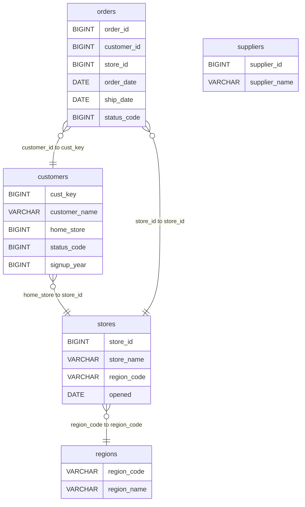
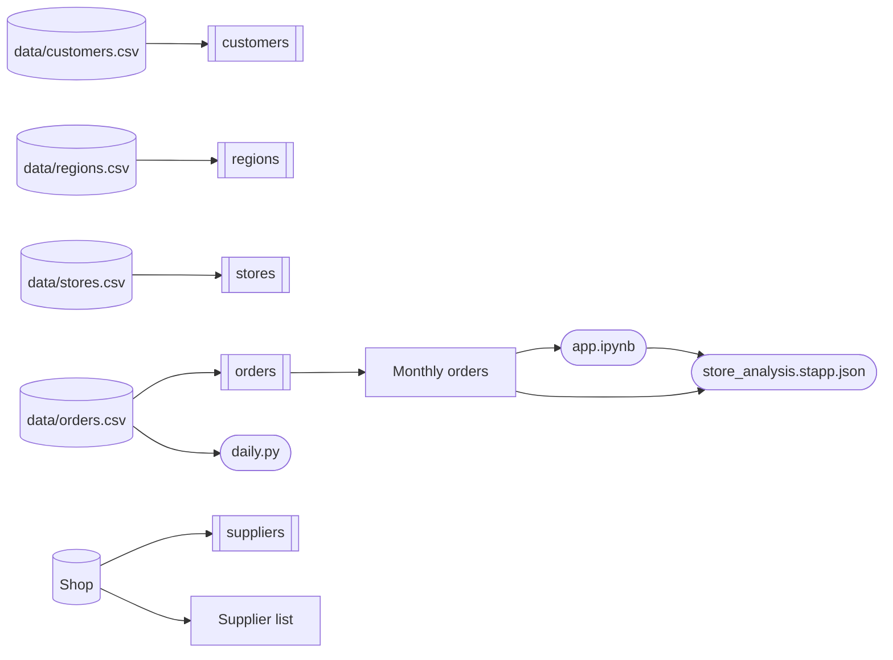

# Store analysis: architecture

> For people joining this project: what it reads, what it makes and how it runs, in eight sections that
> are the same in every Swiss Army Bench project. Written by Export outline from the project as it is; it
> holds names, types and steps only, never a row, a value from the data, a secret or a path outside this
> folder. Every name in `code` came from the project's own data and sources.

## 1. Overview

In short: `Store analysis` is an Analysis project whose deliverable is a notebook, with 4 documents and 5 tables.

- **Name:** `Store analysis`
- **Type:** Analysis (BI): its deliverable is a notebook
- **Purpose:** Which made-up stores sell the most, by region and month, for the planning team.

### Folder layout

```text
Store analysis/
├── app.ipynb                  an app notebook
├── daily.py                   a script
├── data.ipynb                 the data notebook: it makes the tables
├── data.py                    made by the app from another file: never edit it by hand
├── README.md                  what the project is for
├── requirements.txt           what to install
├── store_analysis.stapp.json  an app (its canvas)
```

## 2. Data sources

In short: the project reads from 1 connection. Each is named here; its password or key is found on each computer by its name, never kept in the project.

### Connections

- `Shop`: SQLite
  - Portability: Not checked yet.
  - Needs: `password` (this computer's keyring)
  - Used by: `data.ipynb`, `suppliers`

## 3. Data model

In short: 5 tables and 4 relationships among them. Columns are listed by name and type only.

- `customers`: from file `data/customers.csv`
  - Columns: `cust_key` BIGINT, `customer_name` VARCHAR, `home_store` BIGINT, `status_code` BIGINT, `signup_year` BIGINT
- `orders`: from file `data/orders.csv`
  - Columns: `order_id` BIGINT, `customer_id` BIGINT, `store_id` BIGINT, `order_date` DATE, `ship_date` DATE, `status_code` BIGINT
- `regions`: from file `data/regions.csv`
  - Columns: `region_code` VARCHAR, `region_name` VARCHAR
- `stores`: from file `data/stores.csv`
  - Columns: `store_id` BIGINT, `store_name` VARCHAR, `region_code` VARCHAR, `opened` DATE
- `suppliers`: from connection `Shop`: `suppliers`
  - Columns: `supplier_id` BIGINT, `supplier_name` VARCHAR

### Relationships

- `customers` (`home_store`) to `stores` (`store_id`): many-to-one
- `orders` (`customer_id`) to `customers` (`cust_key`): many-to-one
- `orders` (`store_id`) to `stores` (`store_id`): many-to-one
- `stores` (`region_code`) to `regions` (`region_code`): many-to-one



## 4. Transformations

In short: 1 table is shaped by steps (each as one DuckDB query over the table), and 2 named cells in the data notebook make or read the rest.

### `orders`

1. `Keep rows where status_code does not equal 5`
2. `Sort by order_date descending`

```sql
-- 1. Keep rows where status_code does not equal 5
-- 2. Sort by order_date descending
SELECT *
FROM orders
WHERE "status_code" <> 5
ORDER BY "order_date" DESC NULLS LAST, row_number() OVER ()  -- ties keep their order
```

### Named cells

- `Monthly orders` (`data.ipynb` @cell1): makes `monthly`; reads `orders`
- `Supplier list` (`data.ipynb` @cell2): makes nothing; reads nothing

## 5. Lineage

In short: data flows left to right, from the sources (cylinders) into the tables (double boxes), through the data notebook's named cells (boxes), to what the project delivers (rounded).



## 6. Deliverables

In short: 1 notebook, 1 script, 1 app.

### Notebooks

- `app.ipynb`: reads `monthly`; makes nothing

### Scripts

- `daily.py`: reads nothing; makes `folder`, `orders`

### Apps

- `store_analysis.stapp.json`: reads `monthly`; links `app.ipynb`
  - Page `Overview`: `app.ipynb @cell1 (Orders by month)`

## 7. Running it

In short: what to install, how each script runs, and whether it runs unchanged on an Azure Function App or a hosted Streamlit app.

### Packages

- `duckdb`
- `pandas`
- `streamlit>=1.36`

### Scripts

- `daily.py`: runs as `python daily.py`, given 2 arguments
  - Variables: `REPORT_FOLDER` (this computer's environment)

### Ready for a Function App or a hosted Streamlit app

- [ ] `Shop`: Not checked yet.

## 8. Open issues

None.
